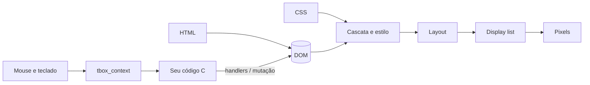

# tbox — Introdução

> - **Escopo:** o que é o tbox, para que serve, vantagens, limites e por onde continuar. Documento principal.
> - **Código relacionado:** `include/tbox/tbox.h`
> - **Veja também:** [Índice](README.md), [Primeiros passos](01-primeiros-passos.md), [Limitações e roadmap](14-limitacoes-e-roadmap.md)

## O que é

O tbox é uma biblioteca em **C** para construir interfaces gráficas
descritas em **HTML e CSS**. A aplicação entrega um documento HTML e uma
folha de estilo; o tbox calcula o layout, desenha em software e mantém a
janela sincronizada com o documento. A lógica — tratar cliques, validar um
formulário, salvar um arquivo — fica em funções C que você registra.

```c
tbox_app *app = tbox_app_create(
    "<body><h1>Contador</h1><p id='n'>0</p><button>+1</button></body>",
    "button { padding: 6px 14px }", 320, 200);
tbox_context_on_click(tbox_app_context(app), "button", 6, on_plus, NULL, NULL);
tbox_app_run(app); /* dorme até algo acontecer; volta quando a janela fecha */
tbox_app_close(app);
```

É um modelo **retained mode**: você não redesenha a tela; você muda o
documento (um atributo, um texto, um nó novo) e o tbox decide o que precisa
ser recalculado e repintado.

## Para que serve

- **Ferramentas e utilitários desktop em C** que precisam de uma interface
  apresentável sem adotar um toolkit grande.
- **Aplicações embarcadas ou de kiosk** em Linux/Wayland, com uma UI
  definida por arquivos HTML/CSS que um designer consegue editar.
- **Renderização headless de HTML/CSS para imagem** — relatórios,
  miniaturas, testes visuais — sem navegador e sem servidor gráfico.
- **Base para um runtime de UI com script**: a API já foi desenhada no
  formato que um futuro motor JavaScript usaria.

## Vantagens

- **HTML e CSS como linguagem de interface.** Conhecidos por quase todo
  mundo, separam aparência de lógica e podem ser trocados sem recompilar
  (`tbox_app_load_from_files`).
- **C puro e pequeno.** Sem runtime, sem coletor de lixo, sem motor de
  navegador. Só o FreeType é obrigatório (baixado pelo build).
- **Sem GPU.** Rasterização em software; roda em qualquer hardware.
- **Testável sem janela.** O pipeline inteiro funciona headless e é
  determinístico com a fonte embutida — dá para testar a UI em CI.
- **Redesenho eficiente.** Só as regiões que mudaram são repintadas
  ([Atualização da tela](05-atualizacao-da-tela.md)).
- **Eventos por seletor CSS.** `on_click(".item button", …)` vale para
  elementos existentes e futuros, como delegação de eventos na web.
- **CSS amplo para o tamanho.** Flexbox, tabelas, posicionamento,
  `z-index`, `calc()`, `var()`, `@media`, `@supports`, `@font-face`,
  `transition` e `animation`/`@keyframes`, gradientes, sombras, bordas
  arredondadas, cores CSS 4/5.
- **Controles de formulário prontos**: campos de texto, data, hora, cor,
  arquivo, range, select, textarea, checkbox, radio, com foco por teclado,
  seleção e clipboard.
- **Arquitetura em camadas** com uma fronteira clara de plataforma: um
  backend novo não toca layout nem renderização.

## Quando não usar (ainda)

O tbox é **experimental**. Hoje ele não serve se você precisa de:

- Windows, macOS ou X11 (só há backend Wayland);
- JavaScript ou páginas web reais;
- acessibilidade (leitores de tela);
- texto bidirecional (árabe e hebraico misturados com latim numa linha) ou
  IME — o shaping dessas escritas existe com HarfBuzz, mas a ordem das
  palavras numa linha mista não;
- `float`, `grid`, animações por `@keyframes`;
- uso a partir de várias threads;
- API estável.

Lista completa e roadmap: [Limitações e roadmap](14-limitacoes-e-roadmap.md).
Comparação com outras abordagens: [Comparação e FAQ](15-comparacao-e-faq.md).

## Como funciona, em uma figura



Detalhes: [Arquitetura](02-arquitetura.md).

## Mapa da documentação

| Capítulo | Para quê |
|---|---|
| [1. Primeiros passos](01-primeiros-passos.md) | Compilar, rodar os exemplos, primeiro programa |
| [2. Arquitetura](02-arquitetura.md) | Módulos, fluxo de dados, posse de memória, diagramas |
| [3. Guia da API](03-guia-da-api.md) | Funções públicas por tarefa |
| [4. Exemplos](04-exemplos.md) | Receitas: cliques, input, formulários, headless… |
| [5. Atualização da tela](05-atualizacao-da-tela.md) | Quando redesenha e como decide o que repintar |
| [6. Eventos e interatividade](06-eventos-e-interatividade.md) | Hit-test, bubbling, foco, teclado, rolagem |
| [7. HTML e CSS](07-html-e-css.md) | Parser, cascata, folha user-agent, seletores, valores |
| [8. Layout e pintura](08-layout-e-pintura.md) | Modelos de layout, simplificações, ordem de pintura |
| [9. Texto e fontes](09-texto-e-fontes.md) | Descoberta, cache, o que funciona em texto |
| [10. Formulários e controles](10-formularios-e-controles.md) | Controles nativos, valores, tema dos popups |
| [11. Plataformas e build](11-plataformas-e-build.md) | Dependências, opções de CMake, integração |
| [12. Ferramentas e testes](12-ferramentas-e-testes.md) | ctest, fixtures, screenshot, `tbox_cmp`, depuração |
| [13. Memória e concorrência](13-memoria-e-concorrencia.md) | Tempo de vida dos objetos, threads |
| [14. Limitações e roadmap](14-limitacoes-e-roadmap.md) | O que falta e o que vem |
| [15. Comparação e FAQ](15-comparacao-e-faq.md) | Alternativas e dúvidas comuns |
| [Referência: CSS](referencia/css-suportado.md) · [HTML](referencia/html-suportado.md) · [Fixtures](referencia/fixtures.md) · [Paridade com o Firefox](referencia/paridade-firefox.md) | Propriedade por propriedade, elemento por elemento, exemplo por recurso, comparação visual com o Firefox |

Para quem vai contribuir com o código: [docs/dev/](dev/README.md).

## Licença

MIT. Ver `LICENSE`.
