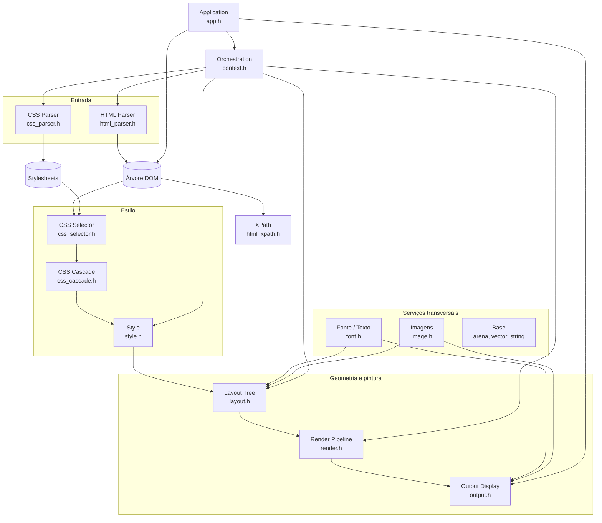
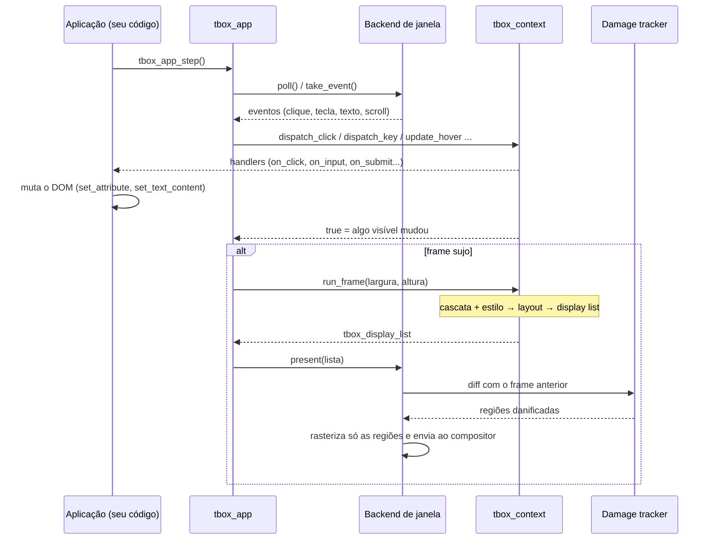
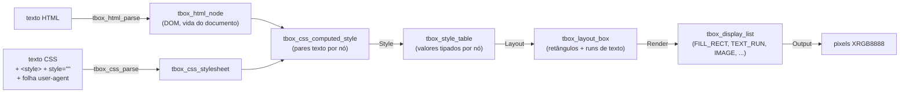
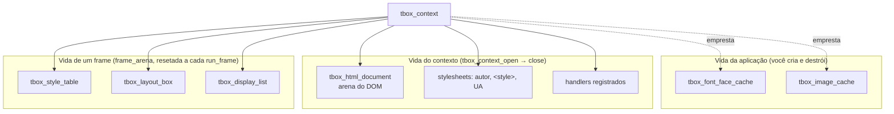
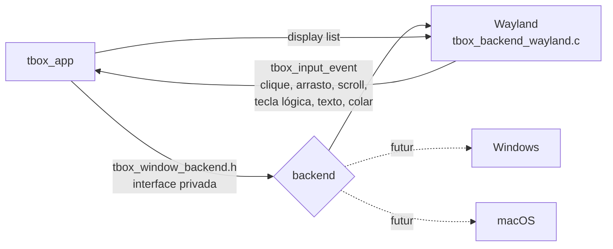

# 2. Arquitetura

> - **Escopo:** como a biblioteca está dividida em módulos, o que cada um faz e como os dados passam de HTML/CSS até pixels.
> - **Código relacionado:** `include/tbox/*.h`, `src/*/`
> - **Veja também:** [Atualização da tela](05-atualizacao-da-tela.md), [Memória e concorrência](13-memoria-e-concorrencia.md), [Organização do código](dev/organizacao-do-codigo.md)

## A ideia em uma frase

O tbox é um pequeno motor de navegador sem rede e sem JavaScript: lê HTML e
CSS, calcula estilo e layout, gera uma lista de comandos de desenho e
rasteriza em software. A aplicação C muda o documento (DOM) e a biblioteca
mantém a tela sincronizada — um modelo **retained mode**.

## Camadas

Cada camada só conhece as que estão abaixo dela. Layout e Render não sabem
que existe uma janela; o Output não sabe de onde veio a display list.

## Módulos

| Módulo | Header | O que faz | Tipo central |
|---|---|---|---|
| Base | (interno) | Arena, vetor, lista, string builder | `tbox_arena` |
| HTML Parser | `html_parser.h` | Tokeniza e constrói uma árvore HTML5 tolerante a erro; API de mutação do DOM | `tbox_html_node`, `tbox_html_document` |
| XPath | `html_xpath.h` | Consultas XPath sobre o DOM | `tbox_xpath_query` |
| CSS Parser | `css_parser.h` | Tokeniza e parseia CSS em regras e declarações (`@media`, `@font-face`) | `tbox_css_stylesheet` |
| CSS Selector | `css_selector.h` | Compila e casa seletores contra o DOM; consultas tipo `querySelectorAll` | `tbox_css_selector_query` |
| CSS Cascade | `css_cascade.h` | Decide, por propriedade, qual declaração vence (origem, `!important`, especificidade, ordem); cores | `tbox_css_computed_style` |
| Style | `style.h` | Converte o resultado textual da cascata em valores tipados: unidades, herança, shorthands, `calc()`, `var()` | `tbox_style`, `tbox_style_table` |
| Fonte / Texto | `font.h` | Descoberta de fontes (Fontconfig ou embutida), métricas, medição, rasterização de glifos, cache de faces | `tbox_font_face_cache` |
| Imagens | `image.h` | Carrega e guarda imagens decodificadas | `tbox_image_cache` |
| Layout Tree | `layout.h` | Constrói a árvore de caixas e resolve a geometria (bloco, inline, posicionamento, tabelas, flexbox) | `tbox_layout_box` |
| Render Pipeline | `render.h` | Percorre as caixas em ordem de pintura e gera comandos de desenho independentes de plataforma | `tbox_display_list` |
| Output Display | `output.h` | Rasterizador em software, escrita de PNG e rastreamento de dano (repintura parcial) | `tbox_raster_*`, `tbox_damage_tracker` |
| Orchestration | `context.h` | Dona do documento e do pipeline de cômputo; hit-test, eventos, foco, formulários, rolagem | `tbox_context` |
| Application | `app.h` | Janela, loop de eventos e apresentação; o ponto de entrada mais simples | `tbox_app` |

Há duas formas de usar a biblioteca:

- **`tbox_app`** — abre uma janela (hoje Linux/Wayland), traduz eventos e
  decide quando redesenhar. É o caminho de quem quer uma aplicação.
- **`tbox_context`** — o mesmo pipeline sem janela. Você fornece o tamanho do
  viewport, recebe uma display list e a rasteriza onde quiser (buffer, PNG,
  outro backend). É o caminho para render headless, testes e integração com
  outro sistema de janelas.

## Um frame, passo a passo

Detalhes de quando um frame é considerado sujo e de como a repintura parcial
funciona estão em [Atualização da tela](05-atualizacao-da-tela.md).

## Como os dados se transformam

Pontos que ajudam a entender o resto da documentação:

- **A cascata trabalha com texto.** Quem transforma `2em` em pixels, herda
  `color` do pai e expande `margin: 1px 2px` é a camada Style.
- **Percentuais ficam para o Layout**, porque dependem do containing block.
- **Texto inline não vira caixa.** Um `<b>` dentro de um `
` contribui
  *runs* de texto (com o próprio estilo) para a caixa do bloco. Conteúdo
  inline solto num container de bloco ganha uma caixa anônima (`node == NULL`).
- **A display list é a fronteira com a plataforma.** O mesmo resultado serve
  à janela Wayland, ao PNG headless e a qualquer backend futuro.

## Quem é dono de quê

- Com `tbox_app`, os caches de fonte e imagem são criados e destruídos por
  ele; você não precisa se preocupar.
- Com `tbox_context` direto, você cria os caches, passa ao contexto
  (emprestados) e os destrói depois de fechar o contexto.
- Nada produzido por um frame sobrevive ao próximo `tbox_context_run_frame`.
  Ponteiros para caixas de layout ou ops da display list não devem ser
  guardados entre frames.

Mais em [Memória e concorrência](13-memoria-e-concorrencia.md).

## Fronteira com a plataforma

O backend abre a janela, entrega eventos já traduzidos para teclas lógicas
(`tbox_key`) e texto UTF-8, cuida do clipboard e do cursor, e apresenta a
display list. Foco, ativação de botões e edição de texto são decididos no
`tbox_context`, não no backend. Um backend novo implementa o mesmo contrato
sem mudar layout, render nem contexto. Ver
[Plataformas e build](11-plataformas-e-build.md).

## Princípios de projeto

- **C puro, sem runtime.** Nenhuma dependência obrigatória além do FreeType
  (baixado pelo CMake). Fontconfig e Wayland são opcionais.
- **Tolerante a entrada ruim.** HTML e CSS malformados nunca fazem o parser
  falhar; o que não é entendido é ignorado.
- **Testável sem janela.** O pipeline inteiro roda headless; nos testes, a
  fonte embutida (Liberation Sans) dá o mesmo resultado em qualquer máquina.
- **API pequena e no formato de um futuro motor de script.** Eventos são
  registrados por seletor CSS; o documento é mutado por funções com
  argumentos simples.
