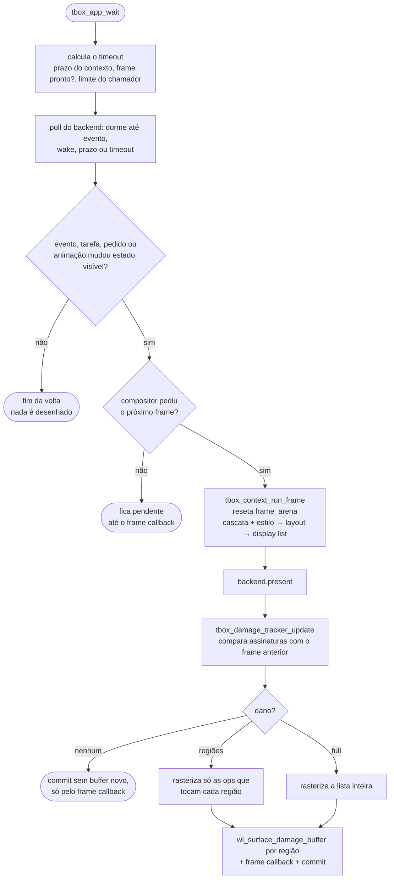

# 5. Atualização da tela

> - **Escopo:** quando o tbox decide redesenhar, o que é recalculado a cada frame e como ele descobre quais pixels precisam ser repintados.
> - **Código relacionado:** `src/app/tbox_app.c` (`tbox_app_wait`, `tbox_app_post`), `src/context/tbox_context.c` (`tbox_context_run_frame`), `src/context/tbox_context_transition.c` (`tbox_context_next_frame_time`), `src/output/tbox_raster_damage.c`, `src/output/tbox_backend_wayland.c`, `src/output/tbox_window_backend.h`, `include/tbox/output.h`
> - **Veja também:** [Arquitetura](02-arquitetura.md), [Eventos e interatividade](06-eventos-e-interatividade.md), [Débito técnico](dev/debito-tecnico.md#pipeline)

## Resumo

1. **Você muda o estado; o tbox decide quando desenhar.** A aplicação altera
   o DOM (atributos, texto, nós). A biblioteca observa eventos, tarefas
   postadas e pedidos de redesenho e marca o frame como *sujo*.
2. **Num frame sujo, estilo, layout e display list são recalculados por
   inteiro.** Não há invalidação por nó (ainda).
3. **Só os pixels que mudaram são repintados.** A display list nova é
   comparada com a anterior; apenas as regiões diferentes são rasterizadas e
   enviadas ao compositor.
4. **Entre um frame e outro, o loop dorme.** `tbox_app_wait` calcula até
   quando nada muda sozinho e bloqueia até lá — ou até um evento, uma tarefa
   postada de outra thread ou o compositor pedir o próximo frame.



## Quando um frame fica sujo

Cada volta de `tbox_app_wait` (e de `tbox_app_step`, que é a mesma volta
sem esperar) processa todos os eventos pendentes e acumula uma decisão
"redesenhar ou não". Fica sujo quando:

| Origem | Condição |
|---|---|
| Mutação do DOM | se `tbox_html_document_revision` mudou desde o último frame (qualquer função de mutação de `html_parser.h` ou `controls.h`, em handler ou não) |
| `tbox_app_request_redraw(app)` | sempre (pedidos antes da próxima volta se juntam em um) |
| `tbox_app_post(app, fn, …)` | sempre que alguma tarefa rodou (uma tarefa costuma mudar o DOM) |
| Clique | sempre — pode mover o cursor de um campo, abrir um popup, mudar foco ou disparar handlers |
| Arrasto | se moveu scrollbar, canal de cor, `range`, barra de hora ou seleção de texto |
| Soltar o botão | se `:active` mudou |
| Rolagem (roda) | se o deslocamento de algum `overflow-y: auto` mudou |
| Tecla | se o handler de `tbox_app_on_key` consumiu, ou se o contexto tratou (foco, edição, ativação, atalhos) |
| Texto digitado / colado | se o campo focado mudou |
| Ponteiro | se o elemento sob o ponteiro mudou (`:hover`) |
| Janela | se o tamanho mudou |
| Animação | quando chega o `tbox_context_next_frame_time`: a cada frame enquanto houver `transition` ou `animation` em curso (inclusive a de entrada, por `@starting-style`) ou rolagem suave (`scroll-behavior: smooth`); uma vez no fim de um `transition-delay`/`animation-delay` e no fim da espera de um scroll snap (0,15 s sem roda). Uma pausada não conta |

O cursor do mouse (`cursor`) é atualizado a cada volta, mas não suja o frame.

**Mutação do DOM fora de um handler** (um timer seu, um arquivo que
terminou de carregar) é detectada pela revisão do documento: cada função
de mutação a avança, e o loop compara com a do último frame (lida logo
depois do `run_frame`, que também normaliza valores no DOM). O loop não
dorme enquanto houver mudança não desenhada. A exceção é escrever direto nos
campos de um `tbox_html_node` (`node->text.text = …`): a revisão não vê, e
é preciso `tbox_app_request_redraw(app)`. **De outra thread**, nunca mude o
DOM diretamente: poste uma tarefa (ver
[Memória e concorrência](13-memoria-e-concorrencia.md#threads)).

## Quando o loop dorme

`tbox_app_run(app)` é `tbox_app_wait(app, -1)` até a janela fechar. Quem tem
loop próprio (um motor de script, um timer seu) chama
`tbox_app_wait(app, max_ms)` com o próprio prazo; `tbox_app_step(app)` é
`tbox_app_wait(app, 0)`, que nunca bloqueia.

O timeout de cada volta é o menor entre:

| Fonte | Quanto espera |
|---|---|
| Limite do chamador (`max_ms`) | `-1` não limita; `0` nunca bloqueia |
| Redesenho pendente, resize ou `:hover` a reconferir após um frame | 0 (se o compositor já liberou o frame) |
| `tbox_context_next_frame_time` | até o prazo: 0 com animação em curso; o fim de um atraso ou do snap; sem limite quando ocioso |
| Frame pendente com o compositor | sem limite: o `wl_surface.frame` (ou o `wl_buffer.release`) é um evento e acorda o poll |
| Backend | o próprio backend reduz o timeout à próxima repetição de tecla (no Wayland a repetição é do cliente) |

E o poll volta antes do timeout com qualquer evento do compositor, um
`tbox_app_post` (o backend Wayland tem um `eventfd` no mesmo `poll`) ou
progresso numa transferência de clipboard (os pipes também entram no
`poll`).

O prazo do contexto vem de `tbox_context_next_frame_time`, calculado em
cada `tbox_context_run_frame` no relógio de `tbox_context_set_animation_time`
(segundos, monotônico): `-INFINITY` = próximo frame, `INFINITY` = ocioso, ou
o instante em que algo volta a mudar. Quem usa `tbox_context` sem
`tbox_app` pode dormir até ele da mesma forma.

Depois de cada frame o loop reconfere o `:hover` uma vez (timeout 0): uma
animação ou um texto digitado pode mover o elemento sob o ponteiro parado.

### Ritmo pelo compositor

Cada commit pede um `wl_surface.frame`. Enquanto ele não chega,
`frame_ready` é falso e um frame sujo fica pendente — o estado (eventos,
handlers, DOM) continua sendo processado, só a pintura espera. Com
animação ativa, isso dá exatamente um frame por atualização do monitor
(medido: ~75 frames/s num monitor de 75 Hz). Uma janela oculta não recebe o
callback e para de animar; como o relógio é real, a animação "pula" para a
posição certa quando a janela volta, como no navegador. Um frame sujo sem
mudança na display list ainda faz um commit sem buffer novo, só para manter
o callback chegando.

Medido em 2026-10-16 (sway, build Debug): `tbox_keyboard_demo` ocioso usou
0,06 s de CPU em 5 s, com 3 commits; antes, o mesmo loop girava a 100% de
um núcleo.

Usando `tbox_context` sem `tbox_app`, a regra é a mesma, só que a decisão é
sua: as funções de evento (`tbox_context_dispatch_click`,
`tbox_context_dispatch_key`, `tbox_context_update_hover`,
`tbox_context_scroll`, …) retornam `true` quando algo visível mudou. O
contexto não guarda flag de "sujo"; o retorno é o sinal.

Os raios explícitos dos gradientes radiais também entram no hash da display
list; mudar apenas um raio já invalida a área pintada pelo gradiente.

### Callbacks de ciclo de vida

Load espera o primeiro frame do documento ser aceito pelo backend; se não
houver buffer livre, continua pendente. Ele não espera confirmação de que o
compositor mostrou os pixels. Alterar o DOM em load solicita outro frame.
Trocar o documento dentro de load agenda o load do novo documento na volta
seguinte. Resize roda antes do recálculo, para que suas alterações entrem no
frame novo. Pagehide/pageshow também marcam o frame sujo quando há callback.
Fechamento interrompe o despacho normal e emite unload uma única vez; não
faz outro frame. Tarefas já postadas ainda podem ser drenadas por step/wait
após fechamento, até a destruição explícita da aplicação.

## O que um frame recalcula

`tbox_context_run_frame(ctx, largura, altura, &lista)`:

1. reseta a `frame_arena` (tudo do frame anterior deixa de existir);
2. aplica o estado de interação atual (`:hover`, `:focus`, `:active`) aos
   seletores;
3. resolve cascata + estilo para todos os nós (`tbox_style_resolve_tree`),
   com `@media` avaliado contra o viewport atual; havendo contêineres de
   consulta (`container-type`), um layout preliminar mede-os e o estilo é
   resolvido de novo para as regras `@container` e as unidades `cq*` (ver
   [HTML e CSS](07-html-e-css.md#regras-e-at-rules));
4. constrói o layout inteiro (`tbox_layout_build`), incluindo rolagem e
   `position: sticky`;
5. gera a display list em ordem de pintura.

Isso é intencionalmente simples: não há caso em que uma parte da árvore
fique desatualizada. O preço é que estilo e layout custam o mesmo para uma
mudança de um pixel e para uma página nova (ver [custo](#custo-medido)).

## Repintura parcial (damage tracking)

A display list é uma sequência de *ops* (`FILL_RECT`, `TEXT_RUN`, `IMAGE`,
`GRADIENT`, …). Para saber o que mudou sem guardar a lista antiga — que
vive na `frame_arena` e some no frame seguinte — o tracker guarda, em
memória própria, uma **assinatura de 40 bytes por op**:

```c
typedef struct tbox_damage_signature {
    uint64_t hash;    /* resume todo o conteúdo visual da op */
    tbox_rect bounds; /* área em pixels que ela pode pintar */
} tbox_damage_signature;
```

### O hash

Um hash é uma impressão digital: a mesma entrada dá sempre o mesmo número
de 64 bits, e uma diferença mínima (`#ff0000` → `#ff0001`) muda o resultado
por completo. O tbox usa **FNV-1a**:

```c
hash = 14695981039346656037ull;
for (cada byte) {
    hash ^= byte;             /* injeta o byte */
    hash *= 1099511628211ull; /* espalha pelos 64 bits */
}
```

Entram no hash: tipo e geometria da op (`rect`, `inner_rect`, raios), cor,
os **bytes** do texto e `letter_spacing`, o `id` e a posição (`x`, `y`) de
cada glifo do `TEXT_RUN` (a mesma frase justificada com outro espaçamento
pinta outra coisa), fonte e imagem (pelo ponteiro),
cada campo do gradiente, as 20 entradas da matriz de filtro, e
`clip`/`rounded_clip`, além de origem, regra e vértices dos recortes
poligonais (pelo conteúdo, não pelo ponteiro da arena). Os bounds de polígonos
são conservadores: preservam a área do conteúdo. Três cuidados:

- **Campo a campo, nunca a struct inteira** — bytes de padding entre campos
  podem conter lixo.
- **Texto pelo conteúdo** — o ponteiro muda a cada frame, o texto não.
- **Fonte e imagem pelo ponteiro** — vêm de caches que vivem a aplicação
  inteira, então o mesmo ponteiro significa o mesmo recurso. `-0.0` é
  normalizado para `0.0`.

Uma colisão (conteúdos diferentes, mesmo hash) faria uma mudança real não
ser repintada. Com 64 bits, comparando sempre a op antiga com a nova
correspondente e exigindo também `bounds` iguais, a chance prática é da
ordem de 1 em 10¹⁹. Resize, invalidação e buffer novo sempre forçam
repintura total.

Caminhos SVG são assinados pelos segmentos (coordenadas, movimentos e
fechamentos), matriz, preenchimento/traço, regra de preenchimento, pontas,
junções e tracejado. Nunca se usa o endereço da geometria na arena do frame.
Os bounds incluem largura do traço, miter, escala e uma margem para
antialiasing; a pintura dentro de camadas desloca também a matriz do caminho.

### Os bounds

`tbox_raster_op_paint_bounds` calcula a área que uma op *pode* pintar, de
forma conservadora: o `rect` limitado por `clip`/`rounded_clip`, arredondado
para fora em pixels inteiros. `TEXT_RUN` ganha uma folga de meia linha para
glifos que passam da caixa; `IMAGE` ganha 1px; linhas onduladas ganham a
amplitude da onda. O cálculo fica no Output, não no Render, porque o bound de
texto depende de métrica de fonte.

### O diff

1. Corta o prefixo e o sufixo de ops iguais entre a lista antiga e a nova.
2. No miolo, toda op presente só de um lado danifica seus bounds (posição
   antiga e nova).
3. O mesmo conjunto de ops em outra ordem (mudança de z-order) danifica o
   miolo inteiro.
4. As regiões viram no máximo `TBOX_DAMAGE_MAX_RECTS` (16) retângulos
   inteiros, sem sobreposição. Acima disso, os mais próximos são fundidos;
   acima de 60% da área, o dano vira `full`.
5. É `full` também no primeiro frame, depois de `tbox_damage_tracker_invalidate`
   e quando o tamanho do buffer muda.

### A repintura

`tbox_raster_display_list_damaged` pinta de branco cada região e rasteriza
as ops que a intersectam, com clip = `clip ∩ região`. Como todo clip do
rasterizador faz `floor` nas bordas, recortar por uma região inteira não
altera nenhum pixel dentro dela: **o resultado é idêntico a uma repintura
completa**. Há um teste de equivalência de pixels em
`tests/output/test_raster.c`.

### Buffer duplo

O backend Wayland alterna entre dois buffers `wl_shm` e só pinta num que o
compositor liberou (`wl_buffer.release`), para nunca escrever no que ele
ainda está lendo. Um buffer livre pode estar um ou mais frames atrás, então
cada buffer guarda o **dano acumulado desde que foi pintado pela última
vez**: o dano de todo frame entra nos dois, e um buffer repinta tudo o que
acumulou quando é usado. Se o compositor já liberou o buffer que está na
tela, ele é reaproveitado (só falta o dano deste frame).

`present` envia ao compositor o dano do buffer escolhido somado ao do que
está na tela, ou seja, tudo o que difere entre os dois. Sem dano, não faz
attach; faz só o commit do frame callback. Se os dois buffers ainda
estiverem com o compositor, `present` recusa o frame (`false`) sem perder o
dano, que já foi somado aos buffers; `frame_ready` também fica falso nesse
caso, e o loop espera o `release`. No resize os dois buffers são recriados
com dano `full`.

## Ver o que está sendo repintado

```c
tbox_app_set_debug_damage(app, true);
```

Cada região repintada ganha um contorno magenta. Nos exemplos do
repositório, `TBOX_DEBUG_DAMAGE=1 build/example/tbox_app_demo` liga isso (a
biblioteca não lê variáveis de ambiente; o exemplo faz o mapeamento).

## Custo medido

Medição de 2026-10-08: `example/tbox_app_demo.html`, janela 1280×800, média de
50 frames, build Debug (em Release os tempos absolutos caem; a proporção é o
que importa).

| Etapa | Tempo |
| --- | --- |
| Estilo + layout + display list | 20,5 ms |
| Hash + diff (291 ops, ~125 KB) | 0,35 ms |
| Repintura completa | 32,5 ms |
| Repintura parcial (uma caixa de 157×140, 2,2% da janela) | 0,87 ms |

- **Mudança pequena** (hover, digitação): ~1,2 ms de pintura
  contra 32,5 ms antes — cerca de 27× mais rápido.
- **Tudo muda** (rolagem da página, resize): o hash é trabalho perdido,
  ~1% a mais.
- **Agora o custo dominante é estilo + layout**, que ainda rodam sobre o
  documento inteiro. É o próximo passo de otimização
  ([Débito técnico](dev/debito-tecnico.md#estilo-e-layout-incrementais)).

O benchmark não está no repositório. Para reproduzir: abra o demo com
`tbox_context_open` e cronometre `tbox_context_run_frame`,
`tbox_damage_tracker_update` e `tbox_raster_display_list_damaged` com dano
`full` e com uma op alterada.

## Usando o damage tracking sem `tbox_app`

Quem desenha num buffer próprio (outro toolkit, um framebuffer, uma textura)
pode usar as mesmas peças:

```c
tbox_damage_tracker *tracker = tbox_damage_tracker_create();
uint32_t *pixels = /* buffer XRGB8888 largura x altura, mantido entre frames */;

for (;;) {
    bool dirty = /* resultado das suas chamadas tbox_context_dispatch_* */;
    if (!dirty) continue;

    tbox_display_list list;
    tbox_context_run_frame(ctx, largura, altura, &list);
    tbox_damage damage = tbox_damage_tracker_update(tracker, &list, largura, altura);
    tbox_raster_display_list_damaged(pixels, largura, altura, &list, &damage);
    /* envie à tela só damage.rects[0..damage.count) — ou tudo, se damage.full */
}

tbox_damage_tracker_destroy(tracker);
```

Se o conteúdo do buffer se perder (realocação, troca de superfície), chame
`tbox_damage_tracker_invalidate(tracker)` antes do próximo frame.

## Limitações atuais

- Estilo e layout não são incrementais: cada frame de animação recalcula o
  documento inteiro (agora no ritmo do monitor, não do loop).
- O screenshot headless sempre repinta tudo.
- Não há integração com loops externos por fd (glib, libuv); quem tem loop
  próprio usa `tbox_app_wait` com o próprio prazo e `tbox_app_post` vindo de
  outras threads.
