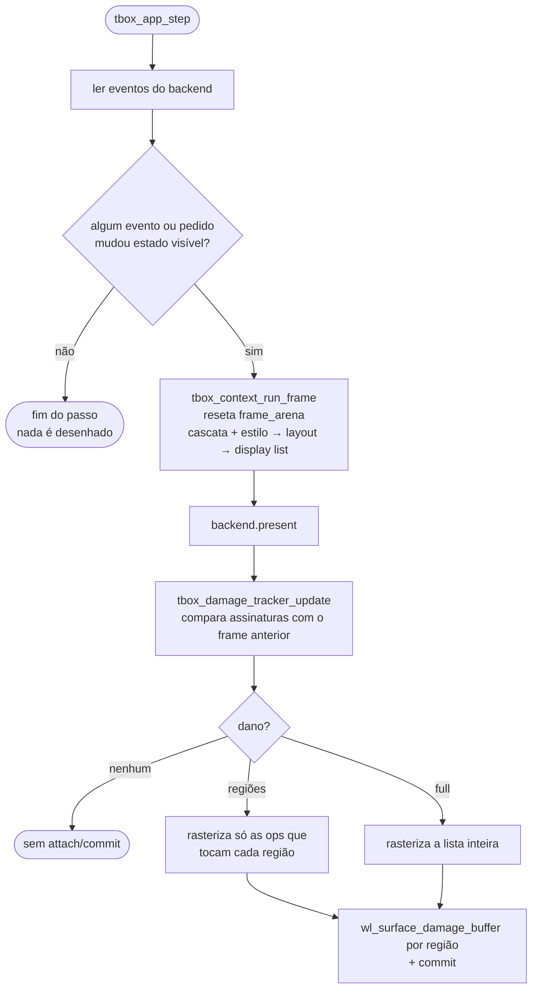

# 5. Atualização da tela

> - **Escopo:** quando o tbox decide redesenhar, o que é recalculado a cada frame e como ele descobre quais pixels precisam ser repintados.
> - **Código relacionado:** `src/app/tbox_app.c` (`tbox_app_step`), `src/context/tbox_context.c` (`tbox_context_run_frame`), `src/output/tbox_raster_damage.c`, `src/output/tbox_backend_wayland.c`, `include/tbox/output.h`
> - **Veja também:** [Arquitetura](02-arquitetura.md), [Eventos e interatividade](06-eventos-e-interatividade.md), [Débito técnico](dev/debito-tecnico.md#pipeline)

## Resumo

1. **Você muda o estado; o tbox decide quando desenhar.** A aplicação altera
   o DOM (atributos, texto, nós). A biblioteca observa eventos e pedidos de
   redesenho e marca o frame como *sujo*.
2. **Num frame sujo, estilo, layout e display list são recalculados por
   inteiro.** Não há invalidação por nó (ainda).
3. **Só os pixels que mudaram são repintados.** A display list nova é
   comparada com a anterior; apenas as regiões diferentes são rasterizadas e
   enviadas ao compositor.



## Quando um frame fica sujo

`tbox_app_step` processa todos os eventos pendentes e acumula uma decisão
"redesenhar ou não". Fica sujo quando:

| Origem | Condição |
|---|---|
| `tbox_app_request_redraw(app)` | sempre (pedidos antes do próximo passo se juntam em um) |
| Clique | sempre — pode mover o cursor de um campo, abrir um popup, mudar foco ou disparar handlers |
| Arrasto | se moveu scrollbar, canal de cor, `range`, barra de hora ou seleção de texto |
| Soltar o botão | se `:active` mudou |
| Rolagem (roda) | se o deslocamento de algum `overflow-y: auto` mudou |
| Tecla | se o handler de `tbox_app_on_key` consumiu, ou se o contexto tratou (foco, edição, ativação, atalhos) |
| Texto digitado / colado | se o campo focado mudou |
| Ponteiro | se o elemento sob o ponteiro mudou (`:hover`) |
| Janela | se o tamanho mudou |
| Animação | enquanto houver `transition` ou `animation` ativa (inclusive a de entrada, por `@starting-style`, e uma `animation` no atraso inicial; uma pausada não conta), rolagem suave (`scroll-behavior: smooth`) em curso ou um scroll snap esperando a roda parar |

O cursor do mouse (`cursor`) é atualizado a cada passo, mas não suja o frame.

**Mutação do DOM fora de um handler** (um timer seu, uma resposta de outra
thread entregue ao loop, um arquivo que terminou de carregar) não é
detectada automaticamente. Depois de mudar o documento, chame
`tbox_app_request_redraw(app)`. Dentro de um handler de clique, tecla ou
input isso não é necessário — o próprio evento já suja o frame.

Usando `tbox_context` sem `tbox_app`, a regra é a mesma, só que a decisão é
sua: as funções de evento (`tbox_context_dispatch_click`,
`tbox_context_dispatch_key`, `tbox_context_update_hover`,
`tbox_context_scroll`, …) retornam `true` quando algo visível mudou. O
contexto não guarda flag de "sujo"; o retorno é o sinal.

## O que um frame recalcula

`tbox_context_run_frame(ctx, largura, altura, &lista)`:

1. reseta a `frame_arena` (tudo do frame anterior deixa de existir);
2. aplica o estado de interação atual (`:hover`, `:focus`, `:active`) aos
   seletores;
3. resolve cascata + estilo para todos os nós (`tbox_style_resolve_tree`),
   com `@media` avaliado contra o viewport atual;
4. constrói o layout inteiro (`tbox_layout_build`), incluindo rolagem e
   `position: sticky`;
5. gera a display list em ordem de pintura.

Isso é intencionalmente simples: não há caso em que uma parte da árvore
fique desatualizada. O preço é que estilo e layout custam o mesmo para uma
mudança de um pixel e para uma página nova (ver [custo](#custo-medido)).

## Repintura parcial (damage tracking)

A display list é uma sequência de *ops* (`FILL_RECT`, `TEXT_RUN`, `IMAGE`,
`GRADIENT`, …). Para saber o que mudou sem guardar a lista antiga — que
vive na `frame_arena` e some no frame seguinte — o tracker guarda, em
memória própria, uma **assinatura de 40 bytes por op**:

```c
typedef struct tbox_damage_signature {
    uint64_t hash;    /* resume todo o conteúdo visual da op */
    tbox_rect bounds; /* área em pixels que ela pode pintar */
} tbox_damage_signature;
```

### O hash

Um hash é uma impressão digital: a mesma entrada dá sempre o mesmo número
de 64 bits, e uma diferença mínima (`#ff0000` → `#ff0001`) muda o resultado
por completo. O tbox usa **FNV-1a**:

```c
hash = 14695981039346656037ull;
for (cada byte) {
    hash ^= byte;             /* injeta o byte */
    hash *= 1099511628211ull; /* espalha pelos 64 bits */
}
```

Entram no hash: tipo e geometria da op (`rect`, `inner_rect`, raios), cor,
os **bytes** do texto e `letter_spacing`, fonte e imagem (pelo ponteiro),
cada campo do gradiente, as 20 entradas da matriz de filtro, e
`clip`/`rounded_clip`. Três cuidados:

- **Campo a campo, nunca a struct inteira** — bytes de padding entre campos
  podem conter lixo.
- **Texto pelo conteúdo** — o ponteiro muda a cada frame, o texto não.
- **Fonte e imagem pelo ponteiro** — vêm de caches que vivem a aplicação
  inteira, então o mesmo ponteiro significa o mesmo recurso. `-0.0` é
  normalizado para `0.0`.

Uma colisão (conteúdos diferentes, mesmo hash) faria uma mudança real não
ser repintada. Com 64 bits, comparando sempre a op antiga com a nova
correspondente e exigindo também `bounds` iguais, a chance prática é da
ordem de 1 em 10¹⁹. Resize, invalidação e buffer novo sempre forçam
repintura total.

### Os bounds

`tbox_raster_op_paint_bounds` calcula a área que uma op *pode* pintar, de
forma conservadora: o `rect` limitado por `clip`/`rounded_clip`, arredondado
para fora em pixels inteiros. `TEXT_RUN` ganha uma folga de meia linha para
glifos que passam da caixa; `IMAGE` ganha 1px; linhas onduladas ganham a
amplitude da onda. O cálculo fica no Output, não no Render, porque o bound de
texto depende de métrica de fonte.

### O diff

1. Corta o prefixo e o sufixo de ops iguais entre a lista antiga e a nova.
2. No miolo, toda op presente só de um lado danifica seus bounds (posição
   antiga e nova).
3. O mesmo conjunto de ops em outra ordem (mudança de z-order) danifica o
   miolo inteiro.
4. As regiões viram no máximo `TBOX_DAMAGE_MAX_RECTS` (16) retângulos
   inteiros, sem sobreposição. Acima disso, os mais próximos são fundidos;
   acima de 60% da área, o dano vira `full`.
5. É `full` também no primeiro frame, depois de `tbox_damage_tracker_invalidate`
   e quando o tamanho do buffer muda.

### A repintura

`tbox_raster_display_list_damaged` pinta de branco cada região e rasteriza
as ops que a intersectam, com clip = `clip ∩ região`. Como todo clip do
rasterizador faz `floor` nas bordas, recortar por uma região inteira não
altera nenhum pixel dentro dela: **o resultado é idêntico a uma repintura
completa**. Há um teste de equivalência de pixels em
`tests/output/test_raster.c`.

No backend Wayland o buffer `wl_shm` persiste entre frames e serve de base.
`present` envia um `wl_surface_damage_buffer` por região; sem dano, não faz
attach nem commit.

## Ver o que está sendo repintado

```c
tbox_app_set_debug_damage(app, true);
```

Cada região repintada ganha um contorno magenta. Nos exemplos do
repositório, `TBOX_DEBUG_DAMAGE=1 build/example/tbox_app_demo` liga isso (a
biblioteca não lê variáveis de ambiente; o exemplo faz o mapeamento).

## Custo medido

Medição de 2026-10-08: `example/tbox_app_demo.html`, janela 1280×800, média de
50 frames, build Debug (em Release os tempos absolutos caem; a proporção é o
que importa).

| Etapa | Tempo |
| --- | --- |
| Estilo + layout + display list | 20,5 ms |
| Hash + diff (291 ops, ~125 KB) | 0,35 ms |
| Repintura completa | 32,5 ms |
| Repintura parcial (uma caixa de 157×140, 2,2% da janela) | 0,87 ms |

- **Mudança pequena** (hover, digitação): ~1,2 ms de pintura
  contra 32,5 ms antes — cerca de 27× mais rápido.
- **Tudo muda** (rolagem da página, resize): o hash é trabalho perdido,
  ~1% a mais.
- **Agora o custo dominante é estilo + layout**, que ainda rodam sobre o
  documento inteiro. É o próximo passo de otimização
  ([Débito técnico](dev/debito-tecnico.md#estilo-e-layout-incrementais)).

O benchmark não está no repositório. Para reproduzir: abra o demo com
`tbox_context_open` e cronometre `tbox_context_run_frame`,
`tbox_damage_tracker_update` e `tbox_raster_display_list_damaged` com dano
`full` e com uma op alterada.

## Usando o damage tracking sem `tbox_app`

Quem desenha num buffer próprio (outro toolkit, um framebuffer, uma textura)
pode usar as mesmas peças:

```c
tbox_damage_tracker *tracker = tbox_damage_tracker_create();
uint32_t *pixels = /* buffer XRGB8888 largura x altura, mantido entre frames */;

for (;;) {
    bool dirty = /* resultado das suas chamadas tbox_context_dispatch_* */;
    if (!dirty) continue;

    tbox_display_list list;
    tbox_context_run_frame(ctx, largura, altura, &list);
    tbox_damage damage = tbox_damage_tracker_update(tracker, &list, largura, altura);
    tbox_raster_display_list_damaged(pixels, largura, altura, &list, &damage);
    /* envie à tela só damage.rects[0..damage.count) — ou tudo, se damage.full */
}

tbox_damage_tracker_destroy(tracker);
```

Se o conteúdo do buffer se perder (realocação, troca de superfície), chame
`tbox_damage_tracker_invalidate(tracker)` antes do próximo frame.

## Limitações atuais

- Estilo e layout não são incrementais.
- O backend Wayland usa um único buffer `wl_shm`; ainda não espera
  `wl_buffer.release` (risco de artefato momentâneo).
- `tbox_app_step` não bloqueia nem sincroniza com o vsync. Um laço
  `while (!tbox_app_should_close(app)) tbox_app_step(app);` gira sem pausa.
  Se o consumo de CPU importar, faça uma pausa curta entre passos (alguns
  milissegundos), ao custo de um pouco de latência.
- O screenshot headless sempre repinta tudo.
