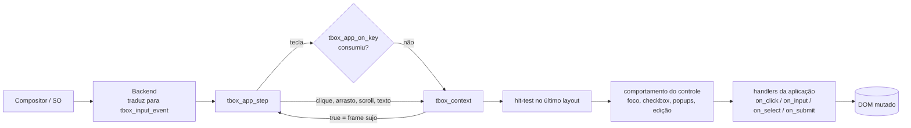
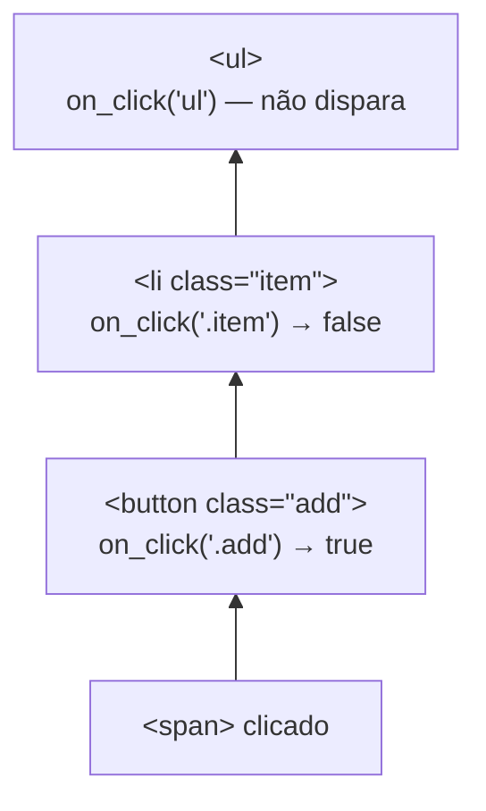

# 6. Eventos e interatividade

> - **Escopo:** como cliques, ponteiro, teclado e texto chegam ao documento; hit-test, delegação por seletor, bubbling, foco, pseudo-classes dinâmicas e rolagem.
> - **Código relacionado:** `include/tbox/context.h`, `include/tbox/input.h`, `src/context/tbox_context_events.c`, `tbox_context_focus.c`, `tbox_context_hit_test.c`, `tbox_context_scroll.c`, `src/app/tbox_app.c`
> - **Veja também:** [Atualização da tela](05-atualizacao-da-tela.md), [Formulários e controles](10-formularios-e-controles.md), [Guia da API](03-guia-da-api.md)

Polígonos de `clip-path` são testados no elemento e em todos os ancestrais,
com a mesma regra `nonzero`/`evenodd` da pintura. Um descendente fora do recorte
não recebe eventos, mesmo se sua border box contiver o ponto. Barras de rolagem
respeitam esses recortes tanto na pintura quanto ao iniciar um arrasto.

## Caminho de um evento



O backend só entrega eventos lógicos: posição de clique/arrasto/scroll,
teclas como `tbox_key` (com `shift`/`control`) e texto UTF-8 já composto.
Foco, ativação de botões e edição de texto são decididos no `tbox_context`,
o que mantém o comportamento igual em qualquer plataforma.

## Hit-test

`tbox_context_hit_test(ctx, x, y)` procura, no layout do último frame, a
caixa mais profunda que contém o ponto. Segue a **ordem de pintura**: entre
caixas sobrepostas (posicionadas, `z-index`, margens negativas) vence a que
está desenhada por cima. Caixas com `visibility: hidden` ou
`pointer-events: none` são ignoradas (descendentes podem voltar com
`pointer-events: auto`), e o recorte de containers roláveis é respeitado.

> **Atenção — elementos inline não são alvo próprio.** Texto inline não
> tem caixa (ver [Arquitetura](02-arquitetura.md)). Um clique ou hover sobre
> um `<a>`, `<span>` ou `<b>` dentro de um parágrafo atinge a caixa do
> **parágrafo**; `on_click("a", …)` não dispara para ele. Para um link ou
> trecho clicável, dê ao elemento `display: inline-block` (ou `block`): aí
> ele ganha caixa própria e vira alvo. Botões e inputs já são
> `inline-block` por padrão.

## Cliques: delegação por seletor

```c
int id = tbox_context_on_click(ctx, ".item button", 12, on_item_click, userdata);
/* ... */
tbox_context_unbind_click(ctx, id);
```

- O handler é associado a um **seletor CSS**, não a um nó. Vale para
  elementos que já existem e para os criados depois. Remover um nó não deixa
  handler pendurado.
- Seletor inválido retorna `-1` e nada é registrado.
- O id retornado é monotônico e nunca reutilizado.

### Bubbling e `stopPropagation`

No clique, o tbox parte do nó atingido e sobe pelos ancestrais (árvore DOM).
Em cada nível, **todos** os registros cujo seletor casa com aquele nó
disparam, na ordem de registro, recebendo o nó do nível (não
necessariamente o atingido). Se algum handler retornar `false`, a subida
para ali.



Não há fase de captura nem `preventDefault` (não existe ação "padrão do
navegador" a prevenir).

### O que acontece antes dos handlers

O próprio contexto trata o clique antes de chamar a aplicação: muda o
foco, alterna `checked` de checkbox/radio, abre popups (cor, data, arquivo,
select), restaura formulários (`reset`), envia (`submit`). Controles
`disabled` não disparam handlers.

## Teclado e foco

O foco pertence ao `tbox_context`.

- **Tab / Shift+Tab** percorrem botões, inputs (inclusive `type=button`,
  checkbox, cor, data, arquivo, imagem), campos de texto e selects visíveis e
  habilitados. O próximo frame rola os ancestrais para mostrar o elemento
  focado.
- **Enter / Espaço** ativam o botão focado pelos mesmos handlers do clique;
  Espaço alterna checkbox; Enter num campo de linha única envia o formulário.
- **`<summary>`** (primeiro filho `<summary>` de `<details>`) recebe foco e
  abre ou fecha o conteúdo com Enter, Espaço ou clique. O estado é o atributo
  `open` no DOM. Sem `open`, só o primeiro `<summary>` ocupa espaço e recebe
  eventos; não há título automático quando ele falta nem agrupamento pelo
  atributo `name`. Veja `tests/assets/108.html`.
- **`<map>`/`<area>`** associam regiões `rect`, `circle`, `poly` ou `default`
  a um ``. O clique usa coordenadas proporcionais ao
  tamanho desenhado e entrega o nó `<area>` aos handlers C; áreas com `href`
  também recebem foco e Enter. A biblioteca não navega automaticamente para
  o `href`. `object-fit` não altera o cálculo das regiões. Veja
  `tests/assets/113.html`.
- **Teclas de edição** agem no campo focado (setas, Home/End, Backspace,
  Delete, Shift para selecionar, Ctrl+A).
- **Ctrl+C / Ctrl+X / Ctrl+V** usam o clipboard do sistema (no `tbox_app`).
  Senhas não são copiadas.
- **Esc** fecha um popup aberto ou limpa um `type=search`; se nenhum
  controle consumir, o `tbox_app` fecha a janela.
- A repetição de tecla segue a configuração do compositor.

Use `tbox_app_on_key` para atalhos da aplicação: ele roda antes do contexto
e pode consumir a tecla.

`tbox_context_focused_node(ctx)` informa o elemento focado.

## Texto

Texto chega separado das teclas, por `tbox_context_dispatch_text`, como
UTF-8 já composto. UTF-8 inválido e caracteres de controle são descartados
(exceto nova linha e tab em `<textarea>`). Sequências XKB Compose
funcionam; composição por IME ainda não (ver
[Débito técnico](dev/debito-tecnico.md#composição-de-texto-ime)).

## Pseudo-classes dinâmicas

| Pseudo-classe | Atualizada por |
|---|---|
| `:hover` | posição do ponteiro a cada `tbox_app_step` (casa o elemento e seus ancestrais) |
| `:active` | botão pressionado até soltar (elemento e ancestrais) |
| `:focus`, `:focus-within` | foco do contexto |
| `:checked`, `:disabled`, `:enabled`, `:required`, `:optional` | atributos do DOM |

Qualquer mudança nelas suja o frame. O estado fica fora do DOM (é do
contexto) e é aplicado aos seletores no início de cada frame.

## Rolagem

Blocos com `overflow-y: auto` (ou `scroll`) rolam com a roda do mouse e
mostram barras de rolagem com polegar arrastável e clique na trilha
(página a página). `scrollbar-width` e `scrollbar-color` estilizam a barra;
`scrollbar-width: none` mantém a rolagem sem desenhar a barra. Rolagem
horizontal de container ainda não existe. `position: sticky` (eixo vertical)
segura a caixa contra a borda do scrollport.

Com `scroll-behavior: smooth` no bloco rolável, as rolagens que a tbox
faz por conta própria — revelar o controle focado e o clique na trilha da
barra (uma página) — são animadas em 0,3 s (ease-in-out), pelo mesmo
relógio das transições. A roda e o arrasto do polegar continuam imediatos
(são manipulação direta) e interrompem uma animação em curso; com
`prefers_reduced_motion` tudo é imediato.

**Scroll snap** (só eixo vertical): num bloco com `scroll-snap-type: y`
(ou `block`/`both`; `mandatory` ou `proximity`, o padrão), os filhos com
`scroll-snap-align: start | center | end` (o primeiro valor, o do eixo de
bloco) são pontos de encaixe, contando `scroll-margin` do filho e
`scroll-padding` do bloco. Quando a roda fica parada por 0,15 s — ou ao
soltar o polegar da barra, ou depois de um clique na trilha — o bloco
desliza (0,3 s, imediato com `prefers_reduced_motion`) até o ponto mais
próximo; com `proximity`, só se ele estiver a até um terço da altura
visível. Um ponto com `scroll-snap-stop: always` entre o início e o fim do
gesto o segura. Revelar o controle focado não encaixa, e um layout que muda
(redimensionar a janela) não reencaixa. As formas `x`/`inline` são aceitas
sem efeito.

Quando uma rolagem pela roda chega ao limite de um bloco, ela passa para o
ancestral rolável; `overscroll-behavior: contain` ou `none` (ou as formas
`-y`/`-block`) interrompe essa passagem. Ao revelar o controle focado, o
`scroll-padding` do bloco rolável encolhe a área visível e o
`scroll-margin` do controle aumenta a caixa a manter visível; as formas
lógicas e os lados de cada uma são aceitos, mas só o eixo vertical tem
efeito. As formas `-x`/`-inline` de `overscroll-behavior` são aceitas sem
efeito.

## Cursor

`tbox_context_cursor_at(ctx, x, y)` devolve o `cursor` CSS do elemento sob o
ponteiro; com `auto`, é texto (I-beam) sobre campos editáveis, mão sobre
`<a href>` e seta no resto — inclusive sobre texto comum, já que a tbox
desenha interfaces de aplicação, não documentos. Para o I-beam sobre um
texto, declare `cursor: text`. O `tbox_app` repassa ao backend (Wayland usa
`wayland-cursor` quando disponível).

## Sem `tbox_app`

Quem integra com outra plataforma chama as mesmas funções do contexto com
seus próprios eventos e usa o retorno `bool` para decidir quando gerar um
frame. A ordem que o `tbox_app` usa, por evento:

- **clique:** `scrollbar_press` → (se não consumido) `set_active_at(true)` →
  `dispatch_click` (duplo clique também envia Ctrl+A ao campo);
- **arrasto:** `scrollbar_drag` → `color_drag` → `range_drag` →
  `datetime_drag` → `drag_select_at` (o primeiro que retornar `true`);
- **soltar:** `scrollbar_release`, `range_release`, `set_active_at(false)`;
- **a cada passo:** `update_hover` com a posição do ponteiro.

Ver `tbox_app_step` em `src/app/tbox_app.c` como referência.
