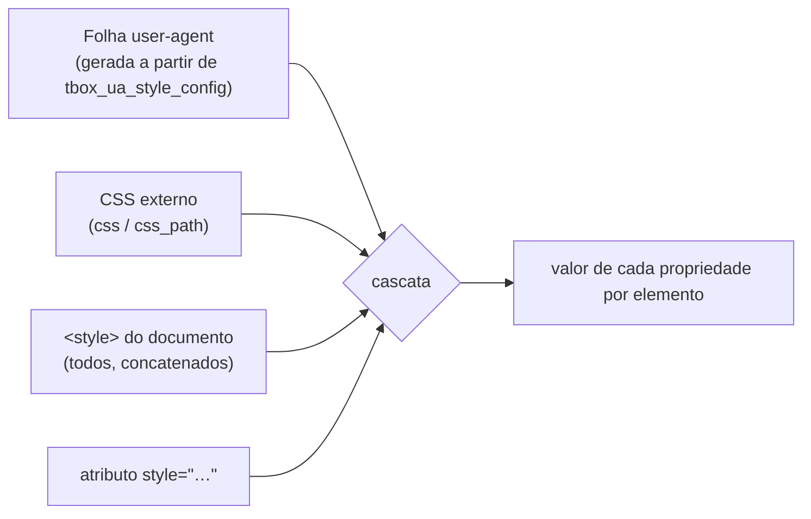

# 7. HTML e CSS

> - **Escopo:** como o tbox lê o documento e as folhas de estilo: regras do parser, origens da cascata, folha user-agent, seletores, unidades e valores. A lista completa do que é suportado está em `referencia/`.
> - **Código relacionado:** `src/html_parser/`, `src/css_parser/`, `src/css_selector/`, `src/css_cascade/`, `src/style/`, `src/context/tbox_ua_style.c`
> - **Veja também:** [CSS suportado](referencia/css-suportado.md), [HTML suportado](referencia/html-suportado.md), [Layout e pintura](08-layout-e-pintura.md)

## O documento HTML

- **Um elemento de topo.** O parser não cria `<html>`/`<body>` implícitos, e
  só o **primeiro** elemento do nível raiz é desenhado. Envolva tudo num
  único `<html>`, `<body>` ou `<div>`. (Um `<head>` irmão do `<body>`
  continua valendo para `<style>`, veja abaixo.)
- **Tolerante.** Markup quebrado nunca faz o parse falhar. Tags
  desconhecidas viram elementos genéricos; comentários e DOCTYPE são aceitos;
  aninhamento muito profundo não estoura a pilha (a construção é iterativa).
- **Fechamento implícito** só para `<p>` (fechado por um novo bloco como
  `<div>`, `<ul>`, `<h1>`, outro `<p>`…) e `<li>` (fechado por outro `<li>`
  da mesma lista: a busca para em `<ul>`/`<ol>`/`<menu>` e em fronteiras
  como `<table>`/`<td>`/`<button>`, então o primeiro `<li>` de uma lista
  aninhada não fecha o item de fora).
  Feche explicitamente `<tr>`, `<td>`, `<th>` e `<option>`; o parser também
  não insere `<tbody>`.
- **Entidades**: numéricas (`&#233;`, `&#xE9;`) e todas as nomeadas do HTML5
  de um codepoint (`&amp;`, `&nbsp;`, `&frac12;`…), sempre com `;` final.
  Não são decodificadas dentro de `<script>`/`<style>`.
- **`<script>` não é executado.** O conteúdo é guardado como texto, mas não
  há motor de JavaScript.

## De onde vem o CSS



Prioridade, da menor para a maior:

```
user-agent < user < autor < autor-inline
  < autor !important < autor-inline !important
    < user !important < user-agent !important
```

- A origem *user* existe na cascata (`TBOX_CSS_ORIGIN_USER`), mas o
  `tbox_context` não carrega nenhuma folha dessa origem.
- CSS externo e `<style>` interno são a mesma origem (autor). Com mesma
  especificidade, o `<style>` interno vence o externo.
- `style=""` vence qualquer seletor de autor, e `!important` dentro dele
  vence qualquer `!important` de seletor.
- **Camadas (`@layer`)**: dentro de uma origem e importância, antes da
  especificidade. Nas declarações normais, uma regra fora de camada vence
  todas as camadas, e uma camada posterior vence uma anterior; nas
  `!important` a ordem se inverte (camada anterior vence, e qualquer camada
  vence a regra fora de camada). A ordem é a da primeira menção; as
  subcamadas de `a` vêm antes das regras diretas de `a`. Cada folha tem a
  própria ordem: o CSS da aplicação e o CSS do documento não compartilham
  nomes de camada. `tbox_css_ruleset.layer` guarda a posição (0 = fora de
  camada).
- `<style>` é procurado no documento inteiro, inclusive num `<head>`.
- `<link rel="stylesheet" href="...">` lê CSS de arquivo local na abertura do
  contexto. `<link>` e `<style>` obedecem à ordem do documento; a folha CSS
  passada pela aplicação vem antes de ambas. Caminhos relativos de `<link>`
  usam `asset_base_dir` e o primeiro `<base href>` do documento, se houver.
  `<base href>` deve apontar para um diretório e terminar com `/`; também
  afeta `src` de `` e `<source>` em `<picture>`. Não há URLs de rede,
  `target`, atualização dinâmica de `<link>` ou `@import`. URLs de fontes em
  folhas vinculadas ainda usam `asset_base_dir`, sem resolução relativa ao
  arquivo CSS. Exemplos: `tests/assets/110.html` e `112.html`.

### A folha user-agent

É o "estilo padrão do navegador": `display` de cada elemento, tamanhos e
negrito de `<h1>`–`<h6>`, margens de `<p>`, recuo de listas, `<pre>`
monoespaçado, `<mark>` amarelo, controles de formulário como `inline-block`
etc. É gerada pela biblioteca (não há arquivo externo) e os valores
numéricos vêm de `tbox_ua_style_config`:

```c
tbox_ua_style_config ua = tbox_ua_style_config_default();
ua.font.base_px = 18.0;           /* tamanho base do body */
ua.margin.paragraph_px = 10.0;    /* margem vertical de <p> */
tbox_app *app = tbox_app_create_with_config(html, css, 800, 600, ua);
```

Campos: `font.base_px`, `font.heading_em[6]` (escala de `h1`…`h6`),
`margin.heading_px[6]`, `margin.paragraph_px`, `margin.body_px`,
`margin.list_px`, `margin.hr_px`, `list_padding_left_px`, `hr_height_px`.
Qualquer regra da UA pode ser sobrescrita pelo CSS de autor normalmente.

## Regras e at-rules

- **`@media`**: `screen`/`all`, listas com vírgula, `and`/`not`,
  `min-`/`max-width`, `min-`/`max-height`, `orientation`
  (`px`, `em`, `rem`), `aspect-ratio` (com `min-`/`max-`) e
  `prefers-reduced-motion` (definido por
  `tbox_context_options.prefers_reduced_motion`). As demais features têm
  valores fixos de um app desktop: `prefers-color-scheme: light`,
  `prefers-contrast: no-preference`, `forced-colors: none`,
  `inverted-colors: none`, `hover`/`any-hover: hover`,
  `pointer`/`any-pointer: fine`, `resolution` 1dppx (`dppx`, `x`, `dpi`,
  `dpcm`), `color` 8, `monochrome` 0, `scripting: none`, `update: fast`.
  A forma booleana (`(hover)`) também vale. Reavaliado a cada frame,
  inclusive no resize. Sem `print`, sem sintaxe de intervalo.
- **`@import`**: só no início da folha (depois de um `@charset` opcional),
  com `url()` ou string e uma lista de media opcional (vira `@media`).
  Arquivos locais, relativos à folha que importa (ou ao documento, numa
  `<style>`), aninhados até 8 níveis; o texto importado entra antes das
  regras da folha. `supports()` no `@import` é avaliado como `@supports`
  (falso descarta a importação); `layer()` é aceito (ver `@layer`). Vale em `<style>`,
  `<link>` e no CSS passado pela aplicação.
- **`@charset`**: aceito e ignorado; todo CSS é lido como UTF-8.
- **`@namespace`**: aceito e ignorado. Para HTML isso equivale ao
  comportamento correto: o namespace padrão não muda nada, e uma regra com
  seletor prefixado (`svg|circle`) é descartada — não casaria com nada, já
  que não há SVG.
- **`@starting-style { regras }`**: as regras ficam marcadas
  (`tbox_css_ruleset.starting_style`) e não entram na cascata normal. Quando
  um elemento aparece (primeiro frame ou saída de `display: none`) e tem
  `transition`, o estilo resolvido com essas regras
  (`tbox_css_cascade_resolve_starting_style_in_viewport`) é o ponto de
  partida da transição. Vale em todas as propriedades que transicionam
  (ver [Transições e animações](#transições-e-animações)); a forma aninhada
  dentro de uma regra (CSS nesting) não é suportada.
- **`@layer`**: `@layer a, b;`, `@layer a { … }`, nomes com ponto
  (`a.b`), camadas anônimas (`@layer { … }`), aninhamento com `@media` nos
  dois sentidos e `@import … layer(nome)`/`layer`. Um prelúdio inválido
  descarta a regra inteira.
- **`@font-face`**: arquivos locais via `url()` relativos ao documento (ou ao
  diretório do CSS externo), com `font-family`, um `font-weight` e
  `font-style`. Sem URLs remotas nem faixas de peso.
- **`@supports`**: `not`/`and`/`or` (misturar `and` e `or` sem parênteses
  invalida a regra), `(propriedade: valor)` e `selector()`. É decidido uma
  vez, no parse (`tbox_css_supports`): o que a tbox suporta não muda. Uma
  declaração é verdadeira quando a tbox resolve a **propriedade** (tabela
  em `tbox_css_supports.c`, igual à [referência](referencia/css-suportado.md))
  e custom properties sempre; o valor não é validado, exceto os que
  enganariam a detecção: `display` fora dos valores suportados (`grid`…),
  `transform` com rotação/escala/matriz, `filter`/`backdrop-filter` com
  `url()` e `backdrop-filter` com `drop-shadow()`. `selector()` exige que o seletor compile e só use
  pseudo-classes e pseudo-elementos que o matcher conhece. Outras funções
  (`font-tech()`, `font-format()`) são falsas. Aninha com `@media` e
  `@layer` nos dois sentidos.
- **`@keyframes nome { … }`** (e `@-webkit-keyframes`): `from`, `to` e
  porcentagens, listas (`0%, 50% { … }`) e o nome entre aspas. Um keyframe
  com seletor inválido é descartado sozinho; os nomes `none`/`initial`/
  `inherit`/`unset` descartam a regra. Dentro de `@media`, só vale enquanto
  a condição vale; com dois de mesmo nome, vence o último. Ver
  [Transições e animações](#transições-e-animações).
- **Ignorados sem quebrar o resto**: um `@import` fora do início da folha e
  qualquer at-rule desconhecida; propriedades e valores desconhecidos.

## Seletores

- Tipo, universal, `#id`, `.classe`, atributo (`[a]`, `[a=v]`, `^=`, `$=`,
  `*=`, com modificadores `i`/`s`).
- Combinadores: descendente, `>`, `+`, `~`.
- Estruturais: `:root`, `:first-child`, `:last-child`, `:only-child`,
  `:empty`, `:first-of-type`, `:last-of-type`, `:only-of-type`,
  `:nth-child()`, `:nth-of-type()`, `:nth-last-child()`,
  `:nth-last-of-type()` (com `an+b`, `odd`, `even`).
- Estado: `:hover`, `:active`, `:focus`, `:focus-within`, `:checked`,
  `:disabled`, `:enabled`, `:required`, `:optional`, `:link`/`:any-link`
  (todo link é não visitado), `:lang()`.
- `:not()` com um seletor simples.
- Pseudo-elementos: `::marker`, `::before` e `::after` (também na forma
  CSS2 `:before`/`:after`); pesam como seletor de tipo na especificidade.

### Conteúdo gerado (`::before`/`::after`)

- **`content`**: strings (com escapes CSS, `"\201C"`), `attr(nome)` (com
  fallback em string), `counter(nome[, estilo])`,
  `counters(nome, "sep"[, estilo])`, `open-quote`/`close-quote`/
  `no-open-quote`/`no-close-quote`; `none`/`normal` não geram caixa;
  `url()` é ignorado (sem imagem gerada); o texto alternativo depois de `/`
  é ignorado. `content: ""` gera uma caixa vazia (barras decorativas).
- **`display`** padrão do pseudo é `inline`; `block`, `inline-block` etc.
  funcionam como num elemento real.
- **Contadores**: `counter-reset`, `counter-increment`, `counter-set` em
  elementos e nos próprios pseudos, com escopos aninhados (o padrão
  `ol { counter-reset } li { counter-increment }` com `counters()`
  funciona); elementos em `display: none` não contam. Estilos de contador:
  os de `list-style-type` (decimal, decimal-leading-zero, romanos, letras,
  grego, disc/circle/square, none). O contador implícito `list-item`
  não está ligado à numeração das listas.
- **`quotes`** (herdado): `auto` (aspas curvas “ ” ‘ ’), `none` ou pares de
  strings; a profundidade de aninhamento corre pelo documento.
- **Onde não há pseudo**: elementos substituídos e vazios (`img`, `input`,
  `select`, `textarea`, `br`, `hr`, `progress`, `meter`…).
- **Interação**: um clique ou hover sobre o conteúdo gerado conta como sobre
  o elemento (`tbox_context_hit_test` devolve a caixa do elemento).
- **Limitações**: pseudos não têm `transition`, `animation` nem `@starting-style`; um
  pseudo `position: absolute` dentro de `<p>`/`<li>`/`<button>` (contexto
  inline) não aparece, como qualquer filho absoluto nesses elementos;
  `::first-line`/`::first-letter` são reconhecidos mas não estilizam nada.
- Um seletor não suportado invalida só a própria regra, como no CSS.

## Valores

A resolução das propriedades fica em `src/style/tbox_style.c`. Os parsers de
funções de cálculo, gradientes, filtros, formas, transformações e tempo ficam
em `tbox_style_functions.c`, apoiados pelos utilitários de valores em
`tbox_style_values.c`. Cores, substituições e conteúdo gerado mantêm seus
arquivos especializados; veja [Organização do código](dev/organizacao-do-codigo.md).

- **Unidades**: `px`, `em`, `rem`, `ex`/`ch` (aproximados como 0,5em), `pt`,
  `pc`, `in`, `cm`, `mm`, `Q`, `%`, `vw`/`vh`/`vmin`/`vmax` (e as variantes
  `sv*`/`lv*`/`dv*`, iguais ao tamanho da janela).
- **Funções**: `calc()` (`+ - * /`, parênteses, aninhado), `min()`, `max()`,
  `clamp()`, `var()` com fallback (custom properties `--nome`, herdadas).
  Comparações aceitam percentuais puros (`min(20%, 50%)`) e expressões com
  o mesmo termo em pixels ou percentual; uma chamada de `min()`/`max()`
  com argumento único preserva seu valor. Misturas gerais continuam
  limitadas aos casos descritos na referência. `pow()`, `sqrt()`, `exp()` e
  `log()` avaliam números sem unidade dentro de cálculos de comprimento,
  como `calc(pow(2, 3) * 10px)`; domínios inválidos e valores não finitos
  são rejeitados. `hypot()` aceita até oito números ou comprimentos com
  unidades compatíveis. `abs()` preserva o tipo do número/comprimento e
  `sign()` retorna -1, zero ou 1. As constantes `pi`/`e` podem ser usadas
  dentro de cálculos, como `calc(pi * 10px)`. `round()`, `mod()` e
  `rem()` aceitam números ou comprimentos resolvidos em pixels. `round()`
  oferece `nearest` (padrão, empate para cima), `up`, `down` e `to-zero`.
  `mod()` segue o sinal do divisor e `rem()` o do dividendo; percentuais e
  limites pendentes nessas operações ficam de fora. `sin()`/`cos()`/`tan()`
  recebem expressão numérica em radianos, como `sin(pi / 2)`, ou um ângulo
  em `deg`/`rad`/`grad`/`turn`, como `cos(60deg)`, inclusive expressões
  angulares como `sin(45deg + 45deg)`. `asin()`/`acos()`/`atan()` retornam
  ângulos; `atan2(y, x)` aceita dois números, comprimentos resolvidos ou
  ângulos de tipos iguais. Os resultados podem alimentar trigonometria,
  gradientes lineares e `hue-rotate()`. Valores não finitos, domínios
  inválidos e percentuais de comprimento pendentes são rejeitados.
  Veja o [catálogo por custo](referencia/funcoes-css-pendentes.md).
- **Gradientes radiais**: aceitam raio explícito de círculo (`circle 40px`)
  ou dois raios de elipse (`ellipse 80px 40px`), inclusive percentuais por
  eixo na elipse. Isso também vale para `repeating-radial-gradient()`;
  a forma omitida é inferida pelo número de raios.
- **Gradientes cônicos**: `conic-gradient()` e `repeating-conic-gradient()`
  aceitam `from <angle>`, `at <position>` e stops angulares/percentuais,
  inclusive duas posições por cor. Reutilizam fundos em camadas, máscaras e
  dimensionamento/repetição de imagem; interpolação em sRGB premultiplicado,
  até oito stops, sem hints ou seleção de espaço de cor.
- **Polígonos**: `clip-path: polygon(...)` aceita três a 32 vértices em
  comprimentos/percentuais e regra `nonzero` (padrão) ou `evenodd`. Recorta
  descendentes e barras de rolagem, com o mesmo interior no hit-test.
  Sem `round`, caixa de referência explícita ou antialiasing nas arestas.
- **Opacidade calculada**: `opacity` usa o mesmo avaliador e aceita funções
  numéricas diretamente, como `sqrt(.25)`, ou dentro de `calc()`. Percentuais
  viram números antes da aritmética (100% = 1): `calc(50% + .25)` resulta em
  0,75. O valor final é limitado a 0–1; resultados em unidades de comprimento
  e valores não finitos são rejeitados. Outras propriedades numéricas ainda
  não passam por esse avaliador.
- **Palavras-chave globais**: `inherit`, `initial`, `unset` (`revert` age
  como `unset`), também via `all`, que as aplica a toda propriedade que a
  tbox resolve (custom properties ficam de fora); uma declaração de
  prioridade maior de uma propriedade específica ainda vence. O `display`
  inicial é `inline`, como no CSS.
- **Cores**: nomes CSS, hexadecimal (`#rgb`, `#rrggbb`), `rgb()`/`hsl()` nas duas
  sintaxes, `hwb()`, `lab()`, `lch()`, `oklab()`, `oklch()`,
  `color(srgb ...)`/`color(srgb-linear ...)`, `color-mix()`
  (em OKLCH: `shorter hue`, `longer hue`, `increasing hue`, `decreasing hue`;
  nomes de espaços desconhecidos e pesos fora de 0%–100% são rejeitados),
  `transparent`, `currentColor`, `light-dark()` (escolhe pelo
  `color-scheme` herdado: escuro só com `dark` sem `light`, já que o
  ambiente prefere claro; vale em qualquer propriedade, inclusive vindo de
  `var()`). `color-scheme` não muda as cores da UA (controles, barras).
- **Herança e valores iniciais** seguem o CSS: `color`, fonte, `text-align`
  etc. herdam; `background`, `border`, `margin` não.

## Transições e animações

As duas rodam na orquestração (`tbox_context_transition.c`,
`tbox_context_animation.c`) sobre os estilos já resolvidos do frame e antes
do layout, então propriedades de layout (`width`, `padding`…) animam
refazendo o layout a cada frame. O relógio é
`tbox_context_set_animation_time`; enquanto alguma estiver ativa,
`tbox_context_animations_active` é verdadeiro, e
`tbox_context_next_frame_time` diz quando o próximo frame muda algo (no
atraso inicial de uma `transition-delay`/`animation-delay`, o fim do atraso).

- **Propriedades que interpolam** (`tbox_style_animatable`): `color`,
  `background-color`, `opacity`, `border-*-color`, `border-*-width`,
  `border-*-radius`, `outline-color`/`-width`/`-offset`,
  `text-decoration-color`, `accent-color`, `caret-color`, `translate` e
  `transform` (só translação), `width`/`height` (e `inline-size`/
  `block-size`), `padding-*`, `margin-*`, `top`/`right`/`bottom`/`left`
  (`inset`), `letter-spacing`, `word-spacing`; os shorthands (`border`,
  `border-color`, `padding`, `outline`…) valem pelos longhands. Cores
  interpolam em sRGB pré-multiplicado. Um comprimento que troca de tipo
  (px ↔ % ↔ `auto`) ou um `accent-color`/`caret-color` `auto` muda de uma
  vez.
- **Funções de tempo**: `ease`, `linear`, `ease-in`, `ease-out`,
  `ease-in-out`, `cubic-bezier()`, `steps(n[, jump-start | jump-end |
  jump-none | jump-both | start | end])`, `step-start`, `step-end`. A forma
  `linear()` com paradas não é suportada.
- **`transition`**: o shorthand com várias entradas e os longhands
  (`-property`, `-duration`, `-delay`, `-timing-function`), cada um uma
  lista pareada pelo índice com `transition-property` e repetida quando é
  mais curta. Com duas entradas para a mesma propriedade, vale a última. Uma
  mudança no meio de uma transição recomeça do valor atual.
- **`animation`**: shorthand (palavras-chave em qualquer ordem, o nome por
  último) e os longhands `animation-name`, `-duration`, `-delay`,
  `-timing-function`, `-iteration-count` (inclusive `infinite` e
  fracionário), `-direction`, `-fill-mode`, `-play-state`, pareados com
  `animation-name`. `animation-timing-function` dentro de um keyframe vale
  para o trecho que começa nele; `!important` dentro de keyframes é
  ignorado. Keyframes de 0%/100% ausentes usam o valor atual do elemento.
  Uma animação recomeça quando o nome sai e volta para a lista do elemento
  (ou o elemento sai de `display: none`). Com várias animações na mesma
  propriedade, vence a última da lista.
- **Limitações**: os valores de cada keyframe são resolvidos quando a
  animação começa (`em`, `%` e `currentColor` ficam fixos dali em diante);
  não há `animation-composition`, `animation-timeline` nem eventos
  (`animationend`); pseudo-elementos não animam. Com
  `prefers_reduced_motion` as animações continuam: use
  `@media (prefers-reduced-motion: reduce)` como na web.

## Propriedades aceitas sem efeito

Não fazem nada numa tela sem paginação, sem 3D e sem `float`, e isso é o
resultado correto para o que a tbox desenha: `break-before`/`-after`/
`-inside`, `page-break-*`, `orphans`, `widows` (impressão), `clear` (nada
flutua), `overflow-anchor` (não há ancoragem de rolagem, o mesmo que
`none`), `perspective`, `perspective-origin`, `transform-style` e
`backface-visibility` (sem transformações 3D, a face de trás nunca
aparece). As de impressão contam como suportadas em `@supports`; as de 3D
não, para não levar uma página ao seu caminho 3D.

## O que fica de fora

Os grandes ausentes, para decidir rápido: `float`, `grid`, `transform`
além de translação, `writing-mode` vertical e texto bidirecional. A lista completa
por propriedade e função (incluindo limitações e referências ao código) está em [CSS suportado](referencia/css-suportado.md)
e [HTML suportado](referencia/html-suportado.md); o que existe de
layout está em [Layout e pintura](08-layout-e-pintura.md).
