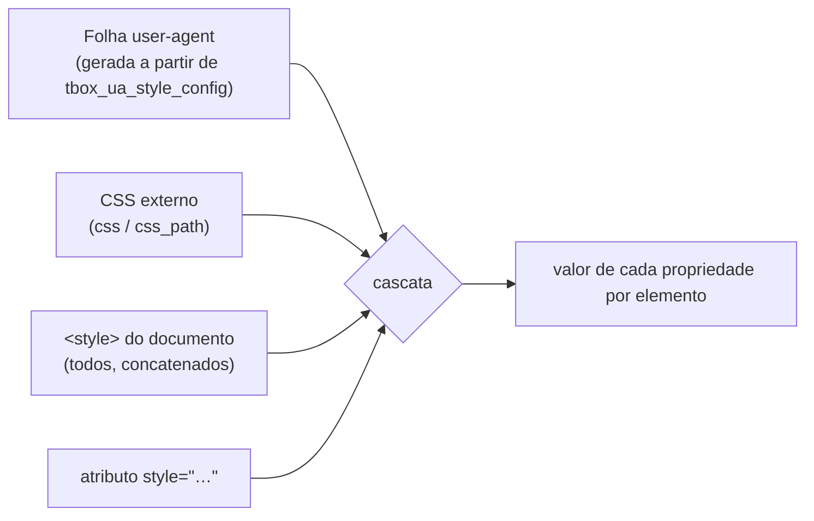

# 7. HTML e CSS

> - **Escopo:** como o tbox lê o documento e as folhas de estilo: regras do parser, origens da cascata, folha user-agent, seletores, unidades e valores. A lista completa do que é suportado está em `referencia/`.
> - **Código relacionado:** `src/html_parser/`, `src/css_parser/`, `src/css_selector/`, `src/css_cascade/`, `src/style/`, `src/context/tbox_ua_style.c`
> - **Veja também:** [CSS suportado](referencia/css-suportado.md), [HTML suportado](referencia/html-suportado.md), [Layout e pintura](08-layout-e-pintura.md)

## O documento HTML

- **Um elemento de topo.** O parser não cria `<html>`/`<body>` implícitos, e
  só o **primeiro** elemento do nível raiz é desenhado. Envolva tudo num
  único `<html>`, `<body>` ou `<div>`. (Um `<head>` irmão do `<body>`
  continua valendo para `<style>`, veja abaixo.)
- **Tolerante.** Markup quebrado nunca faz o parse falhar. Tags
  desconhecidas viram elementos genéricos; comentários e DOCTYPE são aceitos;
  aninhamento muito profundo não estoura a pilha (a construção é iterativa).
- **Fechamento implícito** só para `<p>` (fechado por um novo bloco como
  `<div>`, `<ul>`, `<h1>`, outro `<p>`…) e `<li>` (fechado por outro `<li>`
  da mesma lista: a busca para em `<ul>`/`<ol>`/`<menu>` e em fronteiras
  como `<table>`/`<td>`/`<button>`, então o primeiro `<li>` de uma lista
  aninhada não fecha o item de fora).
  Feche explicitamente `<tr>`, `<td>`, `<th>` e `<option>`; o parser também
  não insere `<tbody>`.
- **Entidades**: numéricas (`&#233;`, `&#xE9;`) e todas as nomeadas do HTML5
  de um codepoint (`&amp;`, `&nbsp;`, `&frac12;`…), sempre com `;` final.
  Não são decodificadas dentro de `<script>`/`<style>`.
- **`<script>` não é executado.** O conteúdo é guardado como texto, mas não
  há motor de JavaScript.

## De onde vem o CSS



Prioridade, da menor para a maior:

```
user-agent < user < autor < autor-inline
  < autor !important < autor-inline !important
    < user !important < user-agent !important
```

- A origem *user* existe na cascata (`TBOX_CSS_ORIGIN_USER`), mas o
  `tbox_context` não carrega nenhuma folha dessa origem.
- CSS externo e `<style>` interno são a mesma origem (autor). Com mesma
  especificidade, o `<style>` interno vence o externo.
- `style=""` vence qualquer seletor de autor, e `!important` dentro dele
  vence qualquer `!important` de seletor.
- **Camadas (`@layer`)**: dentro de uma origem e importância, antes da
  especificidade. Nas declarações normais, uma regra fora de camada vence
  todas as camadas, e uma camada posterior vence uma anterior; nas
  `!important` a ordem se inverte (camada anterior vence, e qualquer camada
  vence a regra fora de camada). A ordem é a da primeira menção; as
  subcamadas de `a` vêm antes das regras diretas de `a`. Cada folha tem a
  própria ordem: o CSS da aplicação e o CSS do documento não compartilham
  nomes de camada. `tbox_css_ruleset.layer` guarda a posição (0 = fora de
  camada).
- `<style>` é procurado no documento inteiro, inclusive num `<head>`.
- `<link rel="stylesheet" href="...">` lê CSS de arquivo local na abertura do
  contexto. `<link>` e `<style>` obedecem à ordem do documento; a folha CSS
  passada pela aplicação vem antes de ambas. Caminhos relativos de `<link>`
  usam `asset_base_dir` e o primeiro `<base href>` do documento, se houver.
  `<base href>` deve apontar para um diretório e terminar com `/`; também
  afeta `src` de `` e `<source>` em `<picture>`. Não há URLs de rede,
  `target`, atualização dinâmica de `<link>` ou `@import`. URLs de fontes em
  folhas vinculadas ainda usam `asset_base_dir`, sem resolução relativa ao
  arquivo CSS. Exemplos: `tests/assets/110.html` e `112.html`.

### A folha user-agent

É o "estilo padrão do navegador": `display` de cada elemento, tamanhos e
negrito de `<h1>`–`<h6>`, margens de `<p>`, recuo de listas, `<pre>`
monoespaçado, `<mark>` amarelo, controles de formulário como `inline-block`
etc. É gerada pela biblioteca (não há arquivo externo) e os valores
numéricos vêm de `tbox_ua_style_config`:

```c
tbox_ua_style_config ua = tbox_ua_style_config_default();
ua.font.base_px = 18.0;           /* tamanho base do body */
ua.margin.paragraph_px = 10.0;    /* margem vertical de <p> */
tbox_app *app = tbox_app_create_with_config(html, css, 800, 600, ua);
```

Campos: `font.base_px`, `font.heading_em[6]` (escala de `h1`…`h6`),
`margin.heading_px[6]`, `margin.paragraph_px`, `margin.body_px`,
`margin.list_px`, `margin.hr_px`, `list_padding_left_px`, `hr_height_px`.
Qualquer regra da UA pode ser sobrescrita pelo CSS de autor normalmente.

## Regras e at-rules

- **`@media`**: `screen`/`all`, listas com vírgula, `and`/`not`,
  `min-`/`max-width`, `min-`/`max-height`, `orientation`
  (`px`, `em`, `rem`), `aspect-ratio` (com `min-`/`max-`) e
  `prefers-reduced-motion` (definido por
  `tbox_context_options.prefers_reduced_motion`). As demais features têm
  valores fixos de um app desktop: `prefers-color-scheme: light`,
  `prefers-contrast: no-preference`, `forced-colors: none`,
  `inverted-colors: none`, `hover`/`any-hover: hover`,
  `pointer`/`any-pointer: fine`, `resolution` 1dppx (`dppx`, `x`, `dpi`,
  `dpcm`), `color` 8, `monochrome` 0, `scripting: none`, `update: fast`.
  A forma booleana (`(hover)`) também vale. Reavaliado a cada frame,
  inclusive no resize. Sem `print`, sem sintaxe de intervalo.
- **`@import`**: só no início da folha (depois de um `@charset` opcional),
  com `url()` ou string e uma lista de media opcional (vira `@media`).
  Arquivos locais, relativos à folha que importa (ou ao documento, numa
  `<style>`), aninhados até 8 níveis; o texto importado entra antes das
  regras da folha. `supports()` no `@import` descarta a
  importação; `layer()` é aceito (ver `@layer`). Vale em `<style>`,
  `<link>` e no CSS passado pela aplicação.
- **`@charset`**: aceito e ignorado; todo CSS é lido como UTF-8.
- **`@namespace`**: aceito e ignorado. Para HTML isso equivale ao
  comportamento correto: o namespace padrão não muda nada, e uma regra com
  seletor prefixado (`svg|circle`) é descartada — não casaria com nada, já
  que não há SVG.
- **`@starting-style { regras }`**: as regras ficam marcadas
  (`tbox_css_ruleset.starting_style`) e não entram na cascata normal. Quando
  um elemento aparece (primeiro frame ou saída de `display: none`) e tem
  `transition`, o estilo resolvido com essas regras
  (`tbox_css_cascade_resolve_starting_style_in_viewport`) é o ponto de
  partida da transição. Só vale nas propriedades que já transicionam
  (`color`, `background-color`, `opacity`); a forma aninhada dentro de uma
  regra (CSS nesting) não é suportada.
- **`@layer`**: `@layer a, b;`, `@layer a { … }`, nomes com ponto
  (`a.b`), camadas anônimas (`@layer { … }`), aninhamento com `@media` nos
  dois sentidos e `@import … layer(nome)`/`layer`. Um prelúdio inválido
  descarta a regra inteira.
- **`@font-face`**: arquivos locais via `url()` relativos ao documento (ou ao
  diretório do CSS externo), com `font-family`, um `font-weight` e
  `font-style`. Sem URLs remotas nem faixas de peso.
- **Ignorados sem quebrar o resto**: `@keyframes`, `@supports`, um
  `@import` fora do início da folha e qualquer at-rule desconhecida; propriedades e valores desconhecidos.

## Seletores

- Tipo, universal, `#id`, `.classe`, atributo (`[a]`, `[a=v]`, `^=`, `$=`,
  `*=`, com modificadores `i`/`s`).
- Combinadores: descendente, `>`, `+`, `~`.
- Estruturais: `:root`, `:first-child`, `:last-child`, `:only-child`,
  `:empty`, `:first-of-type`, `:last-of-type`, `:only-of-type`,
  `:nth-child()`, `:nth-of-type()`, `:nth-last-child()`,
  `:nth-last-of-type()` (com `an+b`, `odd`, `even`).
- Estado: `:hover`, `:active`, `:focus`, `:focus-within`, `:checked`,
  `:disabled`, `:enabled`, `:required`, `:optional`, `:link`/`:any-link`
  (todo link é não visitado), `:lang()`.
- `:not()` com um seletor simples.
- Pseudo-elementos: `::marker`, `::before` e `::after` (também na forma
  CSS2 `:before`/`:after`); pesam como seletor de tipo na especificidade.

### Conteúdo gerado (`::before`/`::after`)

- **`content`**: strings (com escapes CSS, `"\201C"`), `attr(nome)` (com
  fallback em string), `counter(nome[, estilo])`,
  `counters(nome, "sep"[, estilo])`, `open-quote`/`close-quote`/
  `no-open-quote`/`no-close-quote`; `none`/`normal` não geram caixa;
  `url()` é ignorado (sem imagem gerada); o texto alternativo depois de `/`
  é ignorado. `content: ""` gera uma caixa vazia (barras decorativas).
- **`display`** padrão do pseudo é `inline`; `block`, `inline-block` etc.
  funcionam como num elemento real.
- **Contadores**: `counter-reset`, `counter-increment`, `counter-set` em
  elementos e nos próprios pseudos, com escopos aninhados (o padrão
  `ol { counter-reset } li { counter-increment }` com `counters()`
  funciona); elementos em `display: none` não contam. Estilos de contador:
  os de `list-style-type` (decimal, decimal-leading-zero, romanos, letras,
  grego, disc/circle/square, none). O contador implícito `list-item`
  não está ligado à numeração das listas.
- **`quotes`** (herdado): `auto` (aspas curvas “ ” ‘ ’), `none` ou pares de
  strings; a profundidade de aninhamento corre pelo documento.
- **Onde não há pseudo**: elementos substituídos e vazios (`img`, `input`,
  `select`, `textarea`, `br`, `hr`, `progress`, `meter`…).
- **Interação**: um clique ou hover sobre o conteúdo gerado conta como sobre
  o elemento (`tbox_context_hit_test` devolve a caixa do elemento).
- **Limitações**: pseudos não têm `transition` nem `@starting-style`; um
  pseudo `position: absolute` dentro de `<p>`/`<li>`/`<button>` (contexto
  inline) não aparece, como qualquer filho absoluto nesses elementos;
  `::first-line`/`::first-letter` são reconhecidos mas não estilizam nada.
- Um seletor não suportado invalida só a própria regra, como no CSS.

## Valores

- **Unidades**: `px`, `em`, `rem`, `ex`/`ch` (aproximados como 0,5em), `pt`,
  `pc`, `in`, `cm`, `mm`, `Q`, `%`, `vw`/`vh`/`vmin`/`vmax` (e as variantes
  `sv*`/`lv*`/`dv*`, iguais ao tamanho da janela).
- **Funções**: `calc()` (`+ - * /`, parênteses, aninhado), `min()`, `max()`,
  `clamp()`, `var()` com fallback (custom properties `--nome`, herdadas).
- **Palavras-chave globais**: `inherit`, `initial`, `unset` (`revert` age
  como `unset`), também via `all`, que as aplica a toda propriedade que a
  tbox resolve (custom properties ficam de fora); uma declaração de
  prioridade maior de uma propriedade específica ainda vence. O `display`
  inicial é `inline`, como no CSS.
- **Cores**: nomes CSS, hexadecimal (`#rgb`, `#rrggbb`), `rgb()`/`hsl()` nas duas
  sintaxes, `hwb()`, `lab()`, `lch()`, `oklab()`, `oklch()`, `color-mix()`,
  `transparent`, `currentColor`, `light-dark()` (escolhe pelo
  `color-scheme` herdado: escuro só com `dark` sem `light`, já que o
  ambiente prefere claro; vale em qualquer propriedade, inclusive vindo de
  `var()`). `color-scheme` não muda as cores da UA (controles, barras).
- **Herança e valores iniciais** seguem o CSS: `color`, fonte, `text-align`
  etc. herdam; `background`, `border`, `margin` não.

## O que fica de fora

Os grandes ausentes, para decidir rápido: `float`, `grid`, `::before`/
`::after`, `transform` além de translação, `animation`/`@keyframes`,
`writing-mode` vertical e texto bidirecional, `@import`. A lista completa
por propriedade e por elemento está em [CSS suportado](referencia/css-suportado.md)
e [HTML suportado](referencia/html-suportado.md); o que existe de
layout está em [Layout e pintura](08-layout-e-pintura.md).
