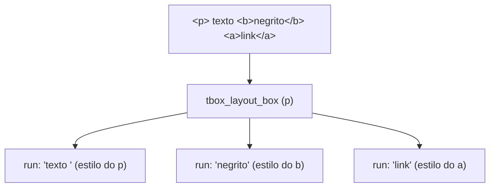
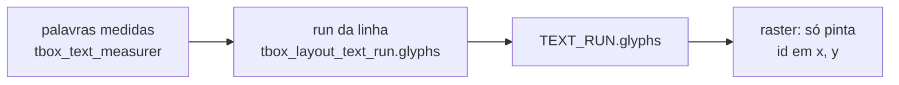
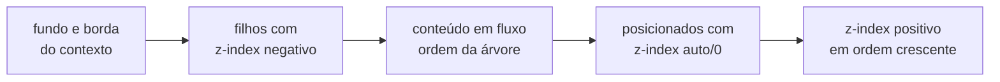

# 8. Layout e pintura

> - **Escopo:** quais modelos de layout CSS o tbox implementa, onde ele simplifica, e como a árvore de caixas vira comandos de desenho.
> - **Código relacionado:** `include/tbox/layout.h`, `src/layout/`, `include/tbox/render.h`, `src/render/tbox_render.c`, `src/output/tbox_raster.c`
> - **Veja também:** [HTML e CSS](07-html-e-css.md), [Texto e fontes](09-texto-e-fontes.md), [CSS suportado](referencia/css-suportado.md), [Débito técnico](dev/debito-tecnico.md#layout)

## A árvore de caixas

`tbox_layout_build` transforma DOM + estilos em uma árvore de
`tbox_layout_box`. Cada caixa tem os quatro retângulos do modelo de caixa
CSS (`margin_box`, `border_box`, `padding_box`, `content_box`), em pixels,
relativos à janela. Caixas de texto carregam também `text_runs`: trechos de
uma linha com a mesma fonte e o mesmo estilo.



Regras que explicam a maior parte do comportamento:

- **Elementos inline não ganham caixa**; contribuem runs para o bloco que os
  contém, cada um com o próprio estilo (cor, fonte, fundo, decoração,
  `vertical-align`), em qualquer profundidade de aninhamento.
- **Conteúdo inline solto** num container de bloco (texto direto em
  `<body>`, um `<span>` entre dois `<div>`) ganha uma **caixa anônima**
  (`node == NULL`) com só as propriedades herdáveis do pai.
- **`<p>`, `<h1>`–`<h6>`, `<li>`, `<td>`/`<th>`, `<caption>` e `<summary>`**
  são um único contexto inline, a menos que tenham um filho direto de bloco
  em fluxo (`display: block`/`flex`, não `absolute`/`fixed`): aí viram
  container de bloco, com o texto antes e depois do bloco em caixas
  anônimas (`tbox_layout_is_inline_box`). Num `<li>` assim, o marcador vai
  para a primeira caixa anônima; se o item começa com um bloco, o marcador
  fica ao lado do topo desse bloco. Um bloco dentro de um elemento
  **inline** (`<span><div>…</div></span>`) ainda é achatado em linha, e
  `<button>`/`<pre>` ignoram filhos de bloco.
- **`::before`/`::after`** são nós sintéticos (tag `::before`/`::after`,
  um filho de texto) que a Style cria; `tbox_layout_build` os encaixa como
  primeiro/último filho do elemento enquanto monta a árvore e os retira no
  fim — o documento do chamador não muda. A partir daí seguem as mesmas
  regras de qualquer filho (inline, bloco, inline-block…).
- **`inline-block`/`inline-flex`** viram uma "palavra atômica" na linha:
  a caixa é medida (largura declarada ou shrink-to-fit), entra na quebra de
  linha e se alinha pela baseline da sua última linha.
- `display: none` não gera caixa; `visibility: hidden` gera caixa e não
  pinta.
- Em `<details>` fechado, somente o primeiro `<summary>` gera caixa. Em
  `<fieldset>`, o primeiro `<legend>` cruza a borda superior, que é dividida
  em torno da legenda.
- Em `<picture>`, o primeiro `<source>` anterior ao `` com `srcset` e
  tipo de imagem aceito fornece o arquivo desenhado. Usa a primeira URL do
  `srcset`; fontes com `media` são ignoradas e o `` serve de fallback.
  Veja `tests/assets/111.html`.
- `<ruby>` participa da linha como uma unidade indivisível. Cada `<rt>` fica
  acima e centralizado no texto-base correspondente; sua altura aumenta a
  linha ao redor. Os caracteres de `<rp>` não são desenhados.

## O que está implementado

| Área | Situação |
|---|---|
| **Fluxo de bloco** | Largura do pai, `width`/`height`, min/max, `box-sizing`, `aspect-ratio`, `min-content`/`max-content`/`fit-content`. |
| **Margens** | Collapsing entre irmãos adjacentes (`max` das duas). Com margem negativa, o par soma. Sem collapsing pai/filho. |
| **Texto em linha** | Quebra por palavra, `white-space` (normal, nowrap, pre, pre-wrap, pre-line, break-spaces), `overflow-wrap`, `word-break`, hifenização por soft hyphen (o traço mostrado vem de `hyphenate-character`), `line-break: anywhere`, `text-align` (incl. justify, desligável com `text-justify: none`), `text-align-last`, `text-indent` (hanging, each-line), `text-wrap: balance`, `line-height`, `letter-`/`word-spacing`, `text-overflow`, `line-clamp`, `tab-size`. |
| **Posicionamento** | `relative`, `absolute` (contra o ancestral posicionado mais próximo), `fixed` (contra a janela), `sticky` (só eixo vertical), `z-index`, `inset`. |
| **Listas** | Marcadores `outside`/`inside`, `list-style-type` (disc, circle, square, decimal, letras, romanos, grego, disclosure…), `list-style-image`, `::marker` (cor, fonte, `content`). |
| **Tabelas** | `caption`, `colgroup`/`col`, `thead`/`tbody`/`tfoot`, `colspan`/`rowspan`, `border-collapse`, `border-spacing`, `table-layout: fixed`, `empty-cells`, `vertical-align` em células, blocos dentro de células. |
| **Flexbox** | CSS Flexbox Level 1 §9: direção (incl. reversa), wrap, `justify-content`, `align-*`, `place-*`, `gap`, `flex-grow/shrink/basis`, `order`, margens auto, mínimo automático, min/max. |
| **`direction`** | `ltr`/`rtl` (CSS ou atributo HTML `dir`, que perde para qualquer CSS), herdado: troca o lado de `*-inline-start`/`-end` (margens, paddings, `inset`, bordas e cantos lógicos), resolve `text-align: start`/`end` (e o `start` inicial) e faz uma linha flex (`row`) começar na direita. |
| **Imagens** | `` inline ou como caixa (block/flex item), proporção preservada, `object-fit`, `object-position`, `image-rendering`. PNG/JPEG etc. via `stb_image`. |
| **Overflow** | `overflow-y: auto/scroll/hidden/clip`, `overflow-x` com recorte; rolagem vertical com barras. |
| **Unidades de viewport e `@media`** | Resolvidas contra o tamanho atual da janela. |

## Gradientes cônicos e polígonos

Gradientes cônicos reutilizam stops e cores dos demais gradientes, amostrando
o ângulo horário em torno do centro. Stops angulares são percentuais de uma
volta no estilo, sem depender do tamanho da imagem. Polígonos de `clip-path`
formam uma camada composta: Render resolve seus vértices na arena do frame e
Output testa a regra `nonzero` ou `evenodd` ao compor. Os pontos ficam locais
à border box, com origem separada para buffers temporários. Recortes de
ancestrais são preservados por camadas aninhadas; damage conserva os bounds
do conteúdo e compara toda a geometria do polígono.

## Raios de gradientes radiais

O estilo preserva raios explícitos em `tbox_style_gradient.radius`. Com
`AUTO`, o raster usa a extensão automática (`closest-*`/`farthest-*`); com
comprimentos/percentuais, resolve o raio horizontal pela largura e o vertical
pela altura da imagem do gradiente. Círculos usam um comprimento nos dois
eixos. As mesmas regras atendem fundos, máscaras e gradientes repetidos.
Raios zero usam a aproximação por epsilon já existente; elipses degeneradas
e a média dos repetidos ainda não seguem todas as regras CSS.

## Simplificações que você pode notar

- **`text-justify`** só distribui espaço entre palavras: `inter-character`
  age como `auto`. **`line-break`** só tem efeito com `anywhere` (quebra como
  `word-break: break-all` e reduz o min-content a um caractere); `loose`,
  `normal` e `strict` só diferem em pontuação CJK.
- **`hyphenate-character: ""`** equivale a `auto` (mostra `-`), e a largura
  do caractere não entra na decisão de quebra de linha (o mesmo vale para o
  `-` padrão).
- **`clip-path`** aceita `circle()`, `ellipse()`, `inset()`, `xywh()` e
  `rect()`, referidos à border box. `rect()` recebe top/right/bottom/left
  e um `round` opcional. `xywh()`/`rect()`
  são convertidos para o mesmo recorte de `inset()`. `rect()` usa espaços,
  aceita `auto` e produz dimensão zero se as arestas se cruzarem.
  Raios de `round` preservam pixels e percentuais (incluindo eixos distintos com `/`); percentuais
  usam largura/altura da border box e os raios compartilham uma escala de
  redução para caber no retângulo. `polygon()` aceita três a 32 vértices,
  com `nonzero`/`evenodd`; sem cantos arredondados ou caixa explícita.
- **`clip`** só aceita `rect()` (com vírgulas ou espaços, lados `auto`) em
  caixas `absolute`/`fixed`; perde para `clip-path` quando os dois existem e
  não aceita `inherit`/`initial`/`unset`.
- **`absolute`/`fixed` sem `left`/`right` (ou sem `top`/`bottom`)** vão para
  o canto do containing block, não para a posição estática "natural".
- **Ancestral posicionado com `height: auto`**: descendentes `absolute`
  ancorados por `bottom` veem um containing block mais baixo que o real.
- **Margens negativas** entre irmãos somam em vez de colapsar pelo algoritmo
  completo.
- **`box-shadow` e `text-shadow` com blur** continuam aproximados em
  degraus; o blur de `filter`, `drop-shadow()` e `backdrop-filter` é
  gaussiano (três box blurs), numa [camada](#camadas-de-composição).
- **`filter`**: `url()` é ignorado. Em `backdrop-filter`, `drop-shadow()`
  também.
- **`mask`** tem uma camada só (a primeira da lista), com `mask-origin` e
  `mask-clip` sempre `border-box` e sem `mask-composite`; `mask-mode`
  `match-source` é alfa (não há SVG `<mask>`).
- **Blur tem custo proporcional à área**: refeito a cada frame em que a
  região dele suja (uma animação dentro dele, por exemplo). Em tela cheia,
  ~0,1 s por blur num build Release.
- **`direction: rtl`** não reordena texto (não há bidi) nem move o
  marcador de lista, a barra de rolagem ou o eixo cruzado de um flex em
  coluna; `text-align-last: start`/`end` continuam físicos.
- **`transform`** só translação (`translate()`, `translateX/Y`, `translate`).

Detalhes e o motivo de cada um: [Débito técnico](dev/debito-tecnico.md#layout).

## Não implementado

`float`, `grid`, rolagem horizontal de containers, `writing-mode` vertical,
texto bidirecional, `columns`, transformações de rotação/escala.

## Da caixa ao desenho

`tbox_render_build_display_list` percorre as caixas na **ordem de pintura**
do CSS e emite comandos (`tbox_paint_op`):

| Op | Uso |
|---|---|
| `FILL_RECT` | Fundos, bordas, decorações de texto, destaque de `<mark>` (com raio, para cantos arredondados) |
| `TEXT_RUN` | Um trecho de texto com uma face, uma cor e seus [glifos posicionados](#texto-como-glifos-posicionados) |
| `IMAGE` | Imagens e `background-image` |
| `GRADIENT` | Gradientes lineares/radiais/cônicos (e `repeating-`) |
| `FILL_RING` | Retângulo arredondado menos outro (bordas e contornos arredondados, sombras `inset`). Um `outline` sólido numa caixa com `border-radius` circular vira um anel que acompanha os cantos (raio da borda + `outline-offset`, mais a largura por fora); com cantos elípticos ou outros estilos, segue reto |
| `WAVY_LINE` | `text-decoration-style: wavy` |
| `BACKDROP_FILTER` | `backdrop-filter`: aplica a lista de `filters` aos pixels já pintados na forma |
| `LAYER_BEGIN` / `LAYER_MASK` / `LAYER_END` | [camada de composição](#camadas-de-composição) |

Cada op carrega retângulo, cor, `clip` (recorte de overflow) e, se preciso,
`rounded_clip` (cantos arredondados, `clip-path`; o `clip: rect()` legado
de caixas `absolute`/`fixed` vira um `clip-path: inset()` equivalente na
Style) e matriz de cor (`filter` só de cor); `IMAGE`/`GRADIENT` levam
também o `background-blend-mode` da camada. `opacity` e os filtros que
espalham vão no `LAYER_BEGIN` da [camada](#camadas-de-composição).

### Texto como glifos posicionados

Um `TEXT_RUN` carrega, além de `text`/`face`/`letter_spacing`, o vetor
`glyphs`/`glyph_count` (`tbox_glyph`, em `<tbox/font.h>`): para cada glifo,
o índice na fonte (`id`), a posição `x`/`y` relativa a `rect.x` e à linha
de base, o `advance` (avanço + `letter-spacing`) e o `cluster` — offset em
bytes, em `text`, do caractere que o originou. Os glifos vivem na arena do
frame, como o resto da display list.



- **Quem posiciona é o layout.** `tbox_layout_build_line_runs` gera os
  glifos de cada palavra na posição em que a própria linha a colocou, com o
  mesmo shaper que mediu a palavra (`tbox_font_shape`, sobre
  `tbox_text_measurer`). Por isso o desenho coincide com o que o layout
  mediu, inclusive nos espaços.
- **O raster não decodifica UTF-8 nem calcula kerning.** Para cada glifo,
  rasteriza o `id` (`tbox_font_rasterize_glyph_id`) em
  `rect.x + x`, `linha de base + y`. Um `TEXT_RUN` sem glifos (montado à
  mão por uma aplicação ou por um teste) é moldado na hora pelo mesmo
  shaper — mesma regra, só fora da arena.
- **`word-spacing` e `text-align: justify`** viram deslocamento dos glifos;
  uma linha não é mais partida em um `TEXT_RUN` por palavra.
- **Reticências** cortam o vetor de glifos (e `text`, pelo `cluster`);
  marcas de `text-emphasis` ficam centradas em cada glifo.
- **Damage tracking:** o hash do op inclui `id` e `x` de cada glifo, então
  mudar só o espaçamento de uma linha justificada repinta a linha.

Edição de texto (cursor, seleção, clique em `<input>`/`<textarea>`)
continua no `tbox_text_measurer` sobre o valor do campo, que não é o texto
pintado (máscara de senha, linhas do textarea); como medidor e shaper são o
mesmo código, os dois não divergem. O shaping (HarfBuzz, quando presente)
mora só no shaper; fallback de fonte e bidi entrariam no mesmo lugar — ver
[Texto e fontes](09-texto-e-fontes.md#shaping-do-texto-aos-glifos).

### Ordem de pintura



Criam contexto de empilhamento: a raiz, caixas posicionadas com `z-index`
e caixas com camada de composição (`opacity` < 1, `filter`,
`mix-blend-mode`, `mask`, `isolation: isolate`, `clip-path: polygon(...)`) ou com `backdrop-filter`. Dentro de um contexto, empate é resolvido pela
ordem da árvore. O hit-test usa a mesma ordem
([Eventos](06-eventos-e-interatividade.md#hit-test)).

Num fundo, a ordem é: `backdrop-filter` → cor → camadas de
imagem/gradiente (da última para a primeira, posicionadas na área de
`background-origin`, recortadas por `background-clip`, misturadas pelo
`background-blend-mode`) → sombras `inset` → borda.

### Rasterização

O Output rasteriza a display list em software num buffer XRGB8888
(`uint32_t` por pixel, sempre opaco), com antialiasing de glifos e cantos.
Não há GPU. A repintura de um frame pode ser parcial; ver
[Atualização da tela](05-atualizacao-da-tela.md).

### Camadas de composição

A `opacity` usada aqui já foi calculada em Style, inclusive para expressões
como `calc(pow(.5, 2))`; o resultado é limitado a 0–1 antes de gerar a camada.

Alguns efeitos só existem sobre o elemento **inteiro**, já pintado: o blur
espalha pixels vizinhos, a sombra de `drop-shadow()` segue a forma alfa do
conteúdo, `opacity` funde o grupo antes de deixá-lo transparente,
`mix-blend-mode` e `mask-image` combinam o grupo com o fundo.
`clip-path: polygon(...)` também usa uma camada para recortar o conjunto,
com interseção correta de polígonos aninhados. Para eles o
Render embrulha os ops do elemento (sombras, fundo, borda, texto, filhos e
os posicionados do seu contexto) entre dois marcadores:

```
LAYER_BEGIN (efeitos, recorte de composição)
  ...ops do elemento e da subárvore...
  [LAYER_MASK  ...ops que pintam a máscara...]
LAYER_END
```

No `LAYER_BEGIN`, o Output aloca um buffer transparente (RGBA
pré-multiplicado, o mesmo `uint32_t`, com o alfa no byte de cima) do
tamanho dos ops contidos mais o alcance dos efeitos, e desenha neles com
um deslocamento inteiro, então cada op sai igual ao que sairia na tela. No
`LAYER_MASK`, os ops seguintes vão para um segundo buffer, a máscara. No
`LAYER_END`, aplica na ordem do CSS: filtros (`filter`, na ordem das
funções: matriz de cor, `blur()`, `drop-shadow()`), máscara, `opacity` e,
na composição com o buffer de baixo, o `mix-blend-mode` e o recorte
(`clip-path` e o overflow dos ancestrais). Camadas aninham; a tela é a
camada de baixo de todas, sempre opaca.

Quem ganha camada (`tbox_style_needs_layer`): `opacity` < 1, `filter` com
`blur()` ou `drop-shadow()`, `mix-blend-mode` diferente de `normal`,
`mask-image` e `isolation: isolate`. Um `filter` só de funções de cor
continua aplicado op a op, sem buffer. Todo elemento com camada é um
contexto de empilhamento, para que a subárvore inteira caia entre os
marcadores. O fundo de um elemento com `background-blend-mode` também vai
para uma camada própria, só dele (o grupo isolado do CSS).

`backdrop-filter` não precisa de camada: o op `BACKDROP_FILTER` aplica a
mesma lista de filtros aos pixels já pintados do buffer atual — a tela ou
a camada do ancestral mais próximo, que é a raiz de backdrop do CSS.

**Repintura parcial.** O damage tracker dá ao `LAYER_BEGIN` o retângulo de
tudo o que a camada pode tocar, e infla os ops de dentro pelo alcance dos
efeitos que espalham (blur, sombra): mudar um op dentro de um blur suja
também a vizinhança. Ao repintar uma região, a camada é refeita sobre a
região inflada pelo alcance e composta só dentro da região. Um
`backdrop-filter` com blur lê pixels fora do próprio retângulo: se a região
suja o toca, ela cresce até cobrir tudo o que ele lê.
