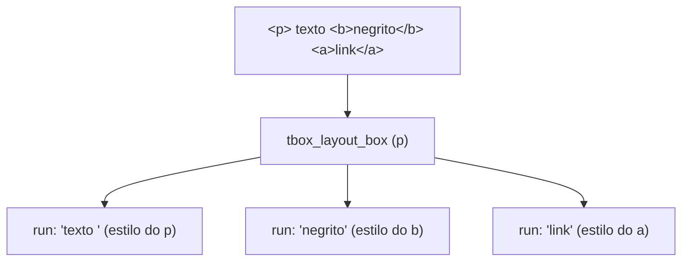
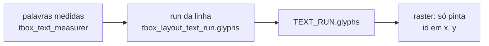
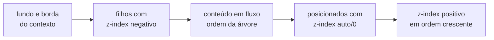

# 8. Layout e pintura

> - **Escopo:** quais modelos de layout CSS o tbox implementa, onde ele simplifica, e como a árvore de caixas vira comandos de desenho.
> - **Código relacionado:** `include/tbox/layout.h`, `src/layout/` (escrita vertical: `tbox_layout_writing.c`), `include/tbox/render.h`, `src/render/tbox_render.c`, `src/output/tbox_raster.c`
> - **Veja também:** [HTML e CSS](07-html-e-css.md), [Texto e fontes](09-texto-e-fontes.md), [CSS suportado](referencia/css-suportado.md), [Débito técnico](dev/debito-tecnico.md#layout)

## A árvore de caixas

`tbox_layout_build` transforma DOM + estilos em uma árvore de
`tbox_layout_box`. Cada caixa tem os quatro retângulos do modelo de caixa
CSS (`margin_box`, `border_box`, `padding_box`, `content_box`), em pixels,
relativos à janela. Caixas de texto carregam também `text_runs`: trechos de
uma linha com a mesma fonte e o mesmo estilo.



Regras que explicam a maior parte do comportamento:

- **Elementos inline não ganham caixa**; contribuem runs para o bloco que os
  contém, cada um com o próprio estilo (cor, fonte, fundo, decoração,
  `vertical-align`), em qualquer profundidade de aninhamento.
- **Conteúdo inline solto** num container de bloco (texto direto em
  `<body>`, um `<span>` entre dois `<div>`) ganha uma **caixa anônima**
  (`node == NULL`) com só as propriedades herdáveis do pai.
- **`text-decoration` se propaga** para o texto dos descendentes e para
  o texto anônimo do bloco, menos para inline atômico (`inline-block`,
  `inline-flex`, `inline-grid`), float ou caixa fora do fluxo
  (`tbox_style.decoration_propagated`). O run desenha as próprias linhas e
  as herdadas, estas com estilo, cor e espessura do ancestral decorado mais
  próximo.
- **`<p>`, `<h1>`–`<h6>`, `<li>`, `<td>`/`<th>`, `<caption>` e `<summary>`**
  são um único contexto inline, a menos que tenham um filho direto de bloco
  em fluxo (`display: block`/`flex`/`grid`, não `absolute`/`fixed`): aí viram
  container de bloco, com o texto antes e depois do bloco em caixas
  anônimas (`tbox_layout_is_inline_box`). Num `<li>` assim, o marcador vai
  para a primeira caixa anônima; se o item começa com um bloco, o marcador
  fica ao lado do topo desse bloco. Um bloco dentro de um elemento
  **inline** (`<span><div>…</div></span>`) ainda é achatado em linha, e
  `<button>`/`<pre>` ignoram filhos de bloco.
- **`::before`/`::after`** são nós sintéticos (tag `::before`/`::after`,
  um filho de texto) que a Style cria; `tbox_layout_build` os encaixa como
  primeiro/último filho do elemento enquanto monta a árvore e os retira no
  fim — o documento do chamador não muda. A partir daí seguem as mesmas
  regras de qualquer filho (inline, bloco, inline-block…).
- **`inline-block`/`inline-flex`/`inline-grid`** viram uma "palavra atômica" na linha:
  a caixa é medida (largura declarada ou shrink-to-fit), entra na quebra de
  linha e se alinha pela baseline da sua última linha.
- `display: none` não gera caixa; `visibility: hidden` gera caixa e não
  pinta.
- Em `<details>` fechado, somente o primeiro `<summary>` gera caixa. Em
  `<fieldset>`, o primeiro `<legend>` começa no topo da caixa. A borda
  superior passa pelo meio dela, e o conteúdo vem depois da legenda.
- Em `<picture>`, o primeiro `<source>` anterior ao `` com `srcset` e
  tipo de imagem aceito fornece o arquivo desenhado. Usa a primeira URL do
  `srcset`; fontes com `media` são ignoradas e o `` serve de fallback.
  Veja `tests/assets/html-picture-and-map.html`.
- `<ruby>` participa da linha como uma unidade indivisível. Cada `<rt>` fica
  acima e centralizado no texto-base correspondente; sua altura aumenta a
  linha ao redor. Os caracteres de `<rp>` não são desenhados.

**Inline fora do fluxo:** `absolute`/`fixed` dentro de um contexto de
texto ganham caixas próprias e não contribuem palavras, largura ou altura
à linha. A caixa usa o contexto posicionado do bloco e os mesmos recortes
dos demais elementos. Isso inclui spans aninhados e texto auxiliar
`.visually-hidden` em células, sem exigir `display: block` no autor.

## O que está implementado

| Área | Situação |
|---|---|
| **Fluxo de bloco** | Largura do pai, `width`/`height`, min/max, `box-sizing`, `aspect-ratio`, `min-content`/`max-content`/`fit-content`. |
| **Margens** | Collapsing entre irmãos adjacentes (`max` das duas). Com margem negativa, o par soma. Sem collapsing pai/filho. |
| **Texto em linha** | Quebra por palavra, `white-space` (normal, nowrap, pre, pre-wrap, pre-line, break-spaces), `overflow-wrap`, `word-break`, hifenização por soft hyphen (o traço mostrado vem de `hyphenate-character`), `line-break: anywhere`, `text-align` (incl. justify, desligável com `text-justify: none`), `text-align-last`, `text-indent` (hanging, each-line), `text-wrap: balance`, `line-height`, `letter-`/`word-spacing`, `text-overflow`, `line-clamp`, `tab-size`. |
| **Posicionamento** | `relative`, `absolute` (contra o ancestral posicionado mais próximo), `fixed` (contra a janela), `sticky` (só eixo vertical), `z-index`, `inset`. Com `width: auto`, `absolute`/`fixed` com `left` e `right` estica entre eles. Com um só, é shrink-to-fit: max-content, limitado ao que sobra ao lado do deslocamento, e no mínimo min-content. |
| **Listas** | Marcadores `outside`/`inside`, `list-style-type` (disc, circle, square, decimal, letras, romanos, grego, disclosure…), `list-style-image`, `::marker` (cor, fonte, `content`). |
| **Tabelas** | `caption`, `colgroup`/`col`, `thead`/`tbody`/`tfoot`, `colspan`/`rowspan`, `border-collapse`, `border-spacing`, `table-layout: fixed`, `empty-cells`, `vertical-align` em células, blocos dentro de células. Layout automático como nos navegadores: cada coluna tem min/max-content e talvez largura em `px` ou `%`. Tabela com `width: auto` encolhe até o conteúdo. A sobra vai primeiro às colunas `%`, depois às fixas, depois às automáticas até o max-content, e o resto na proporção dele. Linhas com `visibility: collapse` dimensionam as colunas. A folha UA dá `border-spacing: 2px` e `padding: 1px` às células. |
| **Multicolunas** | `column-count`, `column-width`, `columns`, `column-gap`, `column-fill`, `column-rule` e longhands, `column-span: all`; fragmentação de blocos e linhas. |
| **Flexbox** | CSS Flexbox Level 1 §9: direção (incl. reversa), wrap, `justify-content`, `align-*`, `place-*`, `gap`, `flex-grow/shrink/basis`, `order`, margens auto, mínimo automático, min/max. |
| **Grid** | `grid`/`inline-grid`, trilhas explícitas e implícitas, áreas e linhas nomeadas, spans, auto-placement por linha/coluna com `dense`, alinhamento e `order`; ver [CSS Grid](#css-grid-nível-1). |
| **Escrita vertical** | `writing-mode` (`vertical-rl`/`-lr`, `sideways-rl`/`-lr`), `text-orientation`, `text-combine-upright: all`, propriedades lógicas no modo, fluxos ortogonais (ver [Escrita vertical](#escrita-vertical)). |
| **`direction`** | `ltr`/`rtl` (CSS ou atributo HTML `dir`, que perde para qualquer CSS), herdado: troca o lado de `*-inline-start`/`-end` (margens, paddings, `inset`, bordas e cantos lógicos), resolve `text-align: start`/`end` (e o `start` inicial), faz uma linha flex (`row`) começar na direita e é a direção base do texto [bidirecional](09-texto-e-fontes.md#texto-bidirecional). |
| **`unicode-bidi`** | `normal`, `embed`, `isolate`, `bidi-override`, `isolate-override`, `plaintext` (não herdado; `<bdo>`, `<bdi>` e `dir` dão o valor padrão): ver [Texto bidirecional](09-texto-e-fontes.md#texto-bidirecional). |
| **Imagens** | `` inline ou como caixa (block/flex item), proporção preservada, `object-fit`, `object-position`, `image-rendering`. PNG/JPEG etc. via `stb_image`. `` inline ocupa na linha a caixa de margem inteira, com padding, borda e margem, e pinta fundo e borda como uma caixa. A imagem preenche o content box. Escala em luz linear: filtro triangular (bilinear) ao ampliar, como nos navegadores, e Mitchell ao reduzir. `pixelated`/`crisp-edges` usam o pixel mais próximo. |
| **Overflow** | `overflow-y: auto/scroll/hidden/clip`, `overflow-x` com recorte; rolagem vertical com barras. |
| **Unidades de viewport e `@media`** | Resolvidas contra o tamanho atual da janela. |
| **`zoom`** | `normal`, `<number>`, `<percentage>` (ver [abaixo](#zoom)). Afeta o layout, não é transformação. |
| **`resize`** | Alça no canto da caixa que muda `width`/`height` arrastando (ver [Redimensionar](06-eventos-e-interatividade.md#redimensionar-resize)). |

## zoom

`zoom` segue o comportamento padronizado (CSS Viewport; Firefox 126+ e
Chrome): o fator efetivo de um elemento é o produto do seu `zoom` pelo dos
ancestrais (`tbox_style.zoom`, lido por `tbox_style_zoom()`, que trata o 0
de um estilo montado à mão como 1). O Style aplica o fator onde resolve os
comprimentos — `tbox_style_units.zoom` multiplica as unidades absolutas
(`px`, `pt`, `cm`, `in`…), os tamanhos de fonte nomeados (`medium`…) e
`thin`/`medium`/`thick` de borda — e os atributos `width`/`height` de
``. `em` segue o `font-size` já ampliado e `rem` usa o tamanho da raiz
sem zoom vezes o fator do elemento, então nada é aplicado duas vezes;
percentuais e unidades de viewport não mudam. Valores herdados em px
(`font-size`, `line-height`, `letter-`/`word-spacing`, `text-indent`)
são multiplicados só pelo fator próprio do filho, para que pai `zoom: 2` e
filho `zoom: .5` deem o tamanho normal. O Layout multiplica o tamanho
natural das imagens (``, `input type=image`, `object-fit: none`/
`scale-down` e `background-image` em `auto`).

Limitações: `reset` não existe; `zoom: inherit` vale 1; não anima; tamanhos
embutidos dos controles (caixa do checkbox, setas, barras de rolagem, a
alça de `resize`) não ampliam; propriedades registradas por `@property`
são substituídas sem zoom e ampliadas pela propriedade que as usa. Veja
`tests/assets/interaction-zoom-and-resize.html`.

## Escrita vertical

`writing-mode` (herdado; `horizontal-tb`, `vertical-rl`, `vertical-lr`,
`sideways-rl`, `sideways-lr`, e os legados `tb`/`tb-rl` como
`vertical-rl`, `lr`/`lr-tb`/`rl`/`rl-tb` como `horizontal-tb`) não é
um segundo algoritmo de layout: uma subárvore vertical é **diagramada como
se fosse horizontal, num referencial próprio**, e uma transformação a leva
para a tela (`src/layout/tbox_layout_writing.c`).

- **Referenciais** (`tbox_style_frame`): `vertical-rl` e `sideways-rl`
  giram 90° no sentido horário (o topo do referencial é a direita da
  tela: blocos fluem da direita para a esquerda, a linha de cima para
  baixo); `vertical-lr` transpõe x e y (o topo é a esquerda); `sideways-lr`
  gira no sentido anti-horário (o topo é a esquerda, a linha corre de baixo
  para cima). Em todos, a borda de cima do referencial é *block-start* e a
  da esquerda é *inline-start* (com `direction: rtl`, a da direita).
- **Estilo**: as propriedades lógicas já saem do Style nos lados físicos
  certos (`tbox_style_logical_side`: `margin-block-start` é a margem
  direita em `vertical-rl`; `inline-size` é a altura; cantos
  `border-start-end-radius` etc.). `tbox_style_frame_side` dá o lado
  físico de cada lado do referencial.
- **Mudança de referencial**: `tbox_layout_build_element_sized` compara o
  referencial do `writing-mode` do elemento com `tbox_style.layout_frame`
  (o referencial em que o estilo está escrito, `NONE` para tudo o que vem
  do Style). Se diferem, `tbox_layout_build_orthogonal` cria uma
  `tbox_style_table` com os estilos da subárvore convertidos para o novo
  referencial (lados e tamanhos permutados, `layout_frame` marcado),
  apoiada na tabela original por `tbox_style_table.fallback`, e diagrama o
  elemento nela, na origem. Documentos sem escrita vertical só pagam uma
  comparação por caixa.
- **Tamanho** (CSS Writing Modes 3 §7.3): o tamanho inline de uma caixa
  ortogonal é *fit-content* dentro da altura do bloco de contenção, se
  definida, ou da janela; o tamanho de bloco vem do conteúdo (as colunas).
  A raiz (`<html>`) vertical ocupa a janela inteira. Na medição intrínseca
  (`tbox_layout_intrinsic_outer`), a caixa é diagramada para medir.
- **Resultado**: a caixa do elemento fica nas coordenadas do pai (com o
  estilo do pai, que pinta fundo e borda na tela) e tem um único filho
  anônimo (`style == NULL`, mesmo `node`) com `has_transform` e a matriz
  do referencial: dentro dele ficam os filhos e as linhas, no referencial.
  Pintura, repintura parcial, hit testing e `tbox_layout_translate` usam o
  caminho das [Transformações](#transformações) sem nada novo. Um
  `transform` CSS dentro do referencial é conjugado para continuar físico
  (`tbox_layout_frame_transform`); `offset-path` é amostrado com a caixa
  e a referência na orientação da tela (`tbox_layout_frame_upright`), e o
  bloco de contenção de um movimento logo abaixo da caixa que inicia o
  modo é ela mesma, no referencial. `::first-letter` é convertido para o
  referencial do bloco. A folha UA usa `margin-block`/
  `padding-inline-start` em parágrafos, títulos e listas, então eles
  também seguem o modo.
- **Texto**: as linhas são moldadas por uma variante vertical da face;
  glifos em pé, `text-orientation` e `text-combine-upright` estão em
  [Texto e fontes](09-texto-e-fontes.md#escrita-vertical).
- Floats, flex, grid, multicolunas, `text-align` e alinhamentos funcionam
  no referencial, então seguem os eixos lógicos: `float: left` é o lado
  *line-left* (o topo), uma linha flex (`row`) corre na direção inline.
  Uma subárvore horizontal dentro de uma vertical (ou `vertical-lr` dentro
  de `vertical-rl`) é outra mudança de referencial.

Limitações (status X*): imagens (``, `background-image`, gradientes,
`border-image`, sombras) de caixas *dentro* do referencial giram junto com
ele (a caixa que inicia o modo vertical pinta as suas na tela); caixas
`absolute`/`fixed` dentro de uma subárvore vertical usam a caixa que a
inicia como bloco de contenção, e as ancoradas pelo lado que vira o fim do
bloco (`left` em `vertical-rl`) caem na simplificação de altura `auto`
acima; `overflow` não troca de eixo e não há rolagem horizontal;
tabelas e controles de formulário verticais não são suportados (giram como
qualquer conteúdo); percentuais de margem/padding resolvem contra a
largura do referencial. Veja `tests/assets/text-vertical-writing.html`.

## Floats

`float` (`left`, `right`, `inline-start`/`inline-end` pela `direction` do
bloco que contém), `clear` e `shape-outside` seguem CSS 2.1 §9.5 e CSS
Shapes 1 (`src/layout/tbox_layout_float.c`). O estilo bloqueifica o
`display` de um float e zera `float` em caixas `absolute`/`fixed` e em
itens flex (`tbox_style_finish_float`).

Cada contexto de formatação de bloco (BFC) tem um `tbox_layout_floats`,
criado pela caixa que o estabelece (raiz, float, `absolute`/`fixed`,
`inline-block`, flex e itens flex, `display: flow-root`, `overflow` ≠
`visible`, tabelas e células, imagens e controles) e passado aos
descendentes em `tbox_layout_positioned_context.floats` — nada global. Ele
guarda os floats já postos, em coordenadas absolutas, e responde quanto
espaço horizontal sobra numa faixa de y:

- **Float entre blocos** (`tbox_layout_build_children`): construído com
  largura shrink-to-fit e posto a partir de onde o próximo bloco em fluxo
  começaria (regras 1–9: nunca acima de um float anterior, lado a lado,
  descendo até caber). Não move o cursor do fluxo e suas margens não
  colapsam.
- **Float no meio do texto**: vira uma "palavra" de largura zero que leva a
  caixa já construída; `tbox_layout_break_lines` a posiciona no topo da
  linha em que aparece (ou da seguinte, se não couber ao lado das palavras
  já na linha). A caixa vira filha da caixa de texto.
- **Linhas** (`tbox_layout_line_space`): cada linha pergunta a faixa
  `[topo, topo + line-height do bloco)` e ganha `left`/`width`/`y_offset`;
  se a primeira palavra não cabe ao lado dos floats a linha desce até a
  borda inferior deles. Blocos comuns passam por baixo do float (o fundo
  fica sob ele); só as linhas desviam.
- **Blocos que estabelecem BFC** não sobrepõem a margin box dos floats:
  são construídos no espaço que sobra (largura `auto` encolhe) e descem
  quando não cabem (`tbox_layout_build_beside_floats`). Com altura `auto`,
  contêm os próprios floats.
- **`clear`** põe a borda superior do bloco (ou o topo do float) abaixo
  dos floats dos lados pedidos; a margem superior não colapsa através da
  clearance.
- **`shape-outside`**: `circle()`, `ellipse()`, `inset()` (com `round`),
  `polygon()` — o mesmo parser e a mesma geometria do `clip-path` —,
  `margin-box`/`border-box`/`padding-box`/`content-box` (sozinhas, com os
  cantos de `border-radius`) como caixa de referência, `shape-margin` e
  `url()` de imagem com `shape-image-threshold` (o alfa da imagem esticada
  sobre a content box). A linha desvia pela extensão horizontal da forma na
  sua faixa, recortada pela margin box; a posição dos floats continua pela
  margin box.

Render pinta os floats não posicionados depois do conteúdo em fluxo do
seu contexto de empilhamento e antes das caixas posicionadas
(`tbox_render_is_float`); o hit testing segue a mesma ordem.

## Multicolunas

O layout multicoluna mede o fluxo na largura de uma coluna e o fragmenta
entre blocos e caixas de linha. Cada fragmento é uma `tbox_layout_box` na
arena do frame, com o mesmo nó DOM e estilo de origem: pintura e hit testing
usam diretamente sua geometria. A decoração é fatiada nas quebras (sem
repetir as bordas superior/inferior). Os conjuntos separados por
`column-span: all` têm balanceamento próprio; as linhas de `column-rule`
ficam na caixa do contêiner e reutilizam a pintura de bordas.

- `column-count: auto | <inteiro positivo>` e
  `column-width: auto | <comprimento positivo>` seguem o
  [pseudo-algoritmo de CSS Multi-column 1 §3.4](https://www.w3.org/TR/css-multicol-1/#pseudo-algorithm):
  quando ambos são definidos, o count limita a quantidade que cabe pela
  largura preferida. A largura usada distribui o espaço restante igualmente.
  `columns` aceita as duas componentes em qualquer ordem e reinicia as omitidas.
- `column-gap: normal` é `1em` aqui (continua zero em flex); comprimentos e
  percentuais usam a largura do contêiner. A ordem das colunas segue `direction`.
- `column-fill: balance | auto | balance-all`: altura auto sempre equilibra;
  com altura definida, `auto` enche sequencialmente e cria colunas adicionais
  para o lado. `balance`/`balance-all` têm o mesmo efeito nesta tela sem
  paginação. Conjuntos anteriores a um span sempre equilibram.
- `column-rule` aceita largura, estilo de borda e cor, incluindo `currentColor`;
  longhands seguem a prioridade da cascata. A regra fica no centro do gap,
  somente entre colunas ocupadas; não consome espaço nem recebe cliques.
  Inclui estilos sólidos, tracejados, pontilhados, duplos e 3D.
- `column-span: all` em um **filho direto de bloco** atravessa a largura útil,
  encerrando o conjunto anterior e iniciando outro depois. `none` é o padrão.
- Blocos comuns e texto fragmentam entre caixas de linha, inclusive com
  fontes diferentes e `vertical-align`; nenhum glifo determina sozinho a
  quebra. Fundos sólidos e bordas laterais continuam nas duas partes.
  `break-inside: avoid | avoid-column` mantém inteiro um bloco que cabe numa
  coluna; se for maior, a restrição relaxa. `break-before/after: column`
  força a próxima coluna, inclusive dentro de blocos aninhados.
  Marcadores `outside` acompanham a primeira caixa de linha do item, mesmo
  quando a fonte ou o leading deslocam o glifo. Nas quebras automáticas
  entre blocos, as margens adjacentes são truncadas: o fragmento anterior
  termina antes da margem e o seguinte começa depois dela, sem deslocar o
  topo da coluna. O espaço de bordas e padding continua preservado.
- O contêiner estabelece um contexto de formatação independente (sem
  collapsing entre a margem do contêiner e a dos filhos, como no fluxo de
  bloco atual). Os fragmentos compartilham nó DOM, mas têm retângulos e runs
  próprios; hit testing funciona também nas colunas que transbordam.
- Transições/animações interpolam count (inteiro), width, gap, largura e cor
  da regra; trocas com `auto`/`normal` são discretas.

Limitações: spans em descendentes indiretos ainda não saem do fluxo da
coluna. Flex, tabelas, imagens substituídas e multicolunas aninhadas são
atômicos na fragmentação externa. `orphans`/`widows`, `break-before/after:
avoid` e paginação não são aplicados. Fundos com imagens,
gradientes, raios e `border-image` são resolvidos por fragmento; não há
continuidade de imagem nem tratamento completo de cantos na emenda.
O balanceamento usa a altura definida; `max-height` de um contêiner com
altura auto ainda só limita sua caixa depois de fragmentar. Há um limite
operacional de 4096 colunas por conjunto; além dele o conteúdo restante
transborda verticalmente na última coluna, preservando o texto.

Fixture: `tests/assets/layout-multicol.html` (seis variantes em três fileiras; body com
margens ocupa 760×526px, com folga na janela 800×600).

## Gradientes cônicos e polígonos

Gradientes cônicos reutilizam stops e cores dos demais gradientes, amostrando
o ângulo horário em torno do centro. Stops angulares são percentuais de uma
volta no estilo, sem depender do tamanho da imagem. Polígonos de `clip-path`
formam uma camada composta: Render resolve seus vértices na arena do frame e
Output testa a regra `nonzero` ou `evenodd` ao compor. Os pontos ficam locais
à border box, com origem separada para buffers temporários. Recortes de
ancestrais são preservados por camadas aninhadas; damage conserva os bounds
do conteúdo e compara toda a geometria do polígono.

## Raios de gradientes radiais

O estilo preserva raios explícitos em `tbox_style_gradient.radius`. Com
`AUTO`, o raster usa a extensão automática (`closest-*`/`farthest-*`); com
comprimentos/percentuais, resolve o raio horizontal pela largura e o vertical
pela altura da imagem do gradiente. Círculos usam um comprimento nos dois
eixos. As mesmas regras atendem fundos, máscaras e gradientes repetidos.
Raios zero usam a aproximação por epsilon já existente; elipses degeneradas
e a média dos repetidos ainda não seguem todas as regras CSS.

## Estilos de borda

Os estilos seguem o desenho do Firefox:
- **`dashed` com bordas nos dois vizinhos:** cada canto é um quadrado que continua em meio traço. O trecho entre os cantos é dividido num número par de segmentos iguais, o par mais próximo de (trecho + largura) / (3 × largura).
- **`dashed` sem vizinhos:** o lado é dividido num número ímpar de segmentos de até 3× a largura, com traço nas duas pontas.
- **`dotted`:** pontos redondos com espaçamento de 1× a largura.
- **Caixa arredondada:** o traço percorre a linha central com traço e intervalo de 3×. Os traços são carimbados com quadrados e os pontos com círculos.
- **Bordas 3D:** `groove`, `ridge`, `inset` e `outset` usam a própria cor e a cor × 2/3. Os lados são trapézios com emenda diagonal nos cantos, pintados em faixas de 1px.

## border-image

`border-image` e seus longhands (`-source`, `-slice`, `-width`, `-outset`,
`-repeat`) seguem CSS Backgrounds 3 §6. O estilo guarda tudo em
`tbox_style.border_image` (resolvido em `src/style/tbox_style_border_image.c`,
com `border` zerando o `border-image` como pede a spec); o Layout decodifica
o `url()` pelo cache de imagens em `tbox_layout_box.border_image`.

Render (`tbox_render_push_border_image`) corta a fonte em nove fatias pelo
`slice` (números são pixels da imagem; percentuais, do tamanho dela) e as
desenha na *border image area* — a border box crescida por `outset`
(comprimento ou múltiplo de `border-width`). `border-image-width` aceita
comprimento, percentual da área, número (múltiplo de `border-width`) ou
`auto` (o tamanho da fatia); larguras opostas que não cabem encolhem
juntas. Cantos são esticados; as bordas são escaladas para a largura e
repetidas com `stretch`/`repeat` (centrado)/`round`/`space`; o meio só com
`fill`, escalado pelos fatores das bordas de cima e da esquerda. A imagem
substitui só o desenho do `border-style` — a largura continua vindo de
`border-width`/`border-style` — e ignora `border-radius`. Se o `url()` não
carrega, a borda comum é desenhada.

Cada pedaço vira um op por ladrilho, recortado (`clip`) ao seu pedaço.
Imagens usam `source_rect` no op `IMAGE` (só aquela parte da imagem é
escalada, sem vazar pixels vizinhos) e ladrilhos alinhados a pixels
inteiros, para não deixar frestas. Gradientes não têm tamanho intrínseco:
são dispostos no tamanho da área e o op `GRADIENT` com `source_rect` leva
essa caixa (escalada de forma não uniforme) até o ladrilho, de modo que um
`radial-gradient(circle …)` continua contínuo entre as fatias. Como o
damage tracking usa os limites de cada op, o `outset` já entra na região
repintada.

## Simplificações que você pode notar

- **Oportunidades de quebra** dentro de uma palavra seguem um subconjunto
  do UAX #14, o que os navegadores usam em texto latino. A quebra pode
  acontecer depois de um hífen entre letras (`ease-|out`), depois de uma
  barra (`exemplo.com/|caminho`) e no hífen suave. Não quebra antes de
  dígito (`-5`, `1/2`) nem entre barras seguidas (`http://`). Valem também
  para o `min-content`. Não há o algoritmo completo: CJK, pontuação e
  aspas usam só espaços.
- **`text-justify`** só distribui espaço entre palavras: `inter-character`
  age como `auto`. **`line-break`** só tem efeito com `anywhere` (quebra como
  `word-break: break-all` e reduz o min-content a um caractere); `loose`,
  `normal` e `strict` só diferem em pontuação CJK.
- **`hyphenate-character: ""`** equivale a `auto` (mostra `-`), e a largura
  do caractere não entra na decisão de quebra de linha (o mesmo vale para o
  `-` padrão).
- **`clip-path`** aceita `circle()`, `ellipse()`, `inset()`, `xywh()` e
  `rect()`, referidos à border box. `rect()` recebe top/right/bottom/left
  e um `round` opcional. `xywh()`/`rect()`
  são convertidos para o mesmo recorte de `inset()`. `rect()` usa espaços,
  aceita `auto` e produz dimensão zero se as arestas se cruzarem.
  Raios de `round` preservam pixels e percentuais (incluindo eixos distintos com `/`); percentuais
  usam largura/altura da border box e os raios compartilham uma escala de
  redução para caber no retângulo. `polygon()` aceita três a 32 vértices,
  com `nonzero`/`evenodd`; sem cantos arredondados ou caixa explícita.
- **`clip`** só aceita `rect()` (com vírgulas ou espaços, lados `auto`) em
  caixas `absolute`/`fixed`; perde para `clip-path` quando os dois existem e
  não aceita `inherit`/`initial`/`unset`.
- **`absolute`/`fixed` sem `left`/`right` (ou sem `top`/`bottom`)** vão para
  o canto do containing block, não para a posição estática "natural".
- **Ancestral posicionado com `height: auto`**: descendentes `absolute`
  ancorados por `bottom` veem um containing block mais baixo que o real.
- **Margens negativas** entre irmãos somam em vez de colapsar pelo algoritmo
  completo.
- **`box-shadow` e `text-shadow` com blur** continuam aproximados em
  degraus; o blur de `filter`, `drop-shadow()` e `backdrop-filter` é
  gaussiano (três box blurs), numa [camada](#camadas-de-composição).
- **`filter`**: `url()` é ignorado. Em `backdrop-filter`, `drop-shadow()`
  também.
- **`mask`** compõe até quatro camadas, como os fundos. `mask-mode`
  `match-source` é alfa (não há SVG `<mask>`).
- **Blur tem custo proporcional à área**: refeito a cada frame em que a
  região dele suja (uma animação dentro dele, por exemplo). Em tela cheia,
  ~0,1 s por blur num build Release.
- **`direction: rtl`** reordena o texto ([bidi](09-texto-e-fontes.md#texto-bidirecional)),
  mas não move o marcador de lista, a barra de rolagem ou o eixo cruzado de um flex em
  coluna; `text-align-last: start`/`end` continuam físicos.
- **`transform`** é 2D: as funções 3D são achatadas por projeção
  ortográfica, sem `perspective`; ver [Transformações](#transformações).
- **`border-image`** não tem prefixo `-webkit-`, não anima e com `repeat`
  /`space` os ladrilhos de imagem são alinhados a pixels inteiros (podem
  diferir 1px do navegador). Um pedaço que daria mais de 4096 ladrilhos
  não é desenhado.

- **Floats** são pintados depois também do *texto* dos blocos em fluxo
  (CSS os pinta antes): só se nota quando um texto cruza a área pintada
  do float, fora da sua `shape-outside`. Um float no meio do texto com
  descendentes `absolute` que escapam dele resolve-os contra a origem
  provisória (como `inline-block`). A faixa de uma linha usa a
  `line-height` do bloco, não a altura final da linha. `shape-margin` em
  `polygon()`/imagem cresce a faixa e a extensão, não a forma exata.
  `shape-outside` com gradiente é ignorado e nada disso anima.

Detalhes e o motivo de cada um: [Débito técnico](dev/debito-tecnico.md#layout).

## Não implementado

rolagem horizontal de containers, transformações 3D (perspectiva,
`preserve-3d`).

## Da caixa ao desenho

`tbox_render_build_display_list` percorre as caixas na **ordem de pintura**
do CSS e emite comandos (`tbox_paint_op`):

| Op | Uso |
|---|---|
| `FILL_RECT` | Fundos, bordas, decorações de texto, destaque de `<mark>` (com raio, para cantos arredondados) |
| `TEXT_RUN` | Um trecho de texto com uma face, uma cor e seus [glifos posicionados](#texto-como-glifos-posicionados) |
| `IMAGE` | Imagens e `background-image` |
| `GRADIENT` | Gradientes lineares/radiais/cônicos (e `repeating-`) |
| `FILL_RING` | Retângulo arredondado menos outro (bordas e contornos arredondados, sombras `inset`). Um `outline` sólido numa caixa com `border-radius` circular vira um anel que acompanha os cantos (raio da borda + `outline-offset`, mais a largura por fora); com cantos elípticos ou outros estilos, segue reto |
| `WAVY_LINE` | `text-decoration-style: wavy` |
| `BACKDROP_FILTER` | `backdrop-filter`: aplica a lista de `filters` aos pixels já pintados na forma |
| `LAYER_BEGIN` / `LAYER_MASK` / `LAYER_END` | [camada de composição](#camadas-de-composição) |

Cada op carrega retângulo, cor, `clip` (recorte de overflow) e, se preciso,
`rounded_clip` (cantos arredondados, `clip-path`; o `clip: rect()` legado
de caixas `absolute`/`fixed` vira um `clip-path: inset()` equivalente na
Style) e matriz de cor (`filter` só de cor); `IMAGE`/`GRADIENT` levam
também o `background-blend-mode` da camada. `opacity` e os filtros que
espalham vão no `LAYER_BEGIN` da [camada](#camadas-de-composição).

### Texto como glifos posicionados

Um `TEXT_RUN` carrega, além de `text`/`face`/`letter_spacing`, o vetor
`glyphs`/`glyph_count` (`tbox_glyph`, em `<tbox/font.h>`): para cada glifo,
o índice na fonte (`id`), a posição `x`/`y` relativa a `rect.x` e à linha
de base, o `advance` (avanço + `letter-spacing`) e o `cluster` — offset em
bytes, em `text`, do caractere que o originou. Os glifos vivem na arena do
frame, como o resto da display list.



- **Quem posiciona é o layout.** `tbox_layout_build_line_runs` gera os
  glifos de cada palavra na posição em que a própria linha a colocou, com o
  mesmo shaper que mediu a palavra (`tbox_font_shape`, sobre
  `tbox_text_measurer`). Por isso o desenho coincide com o que o layout
  mediu, inclusive nos espaços.
- **O raster não decodifica UTF-8 nem calcula kerning.** Para cada glifo,
  rasteriza o `id` (`tbox_font_rasterize_glyph_id`) em
  `rect.x + x`, `linha de base + y`. Um `TEXT_RUN` sem glifos (montado à
  mão por uma aplicação ou por um teste) é moldado na hora pelo mesmo
  shaper — mesma regra, só fora da arena.
- **`word-spacing` e `text-align: justify`** viram deslocamento dos glifos;
  uma linha não é mais partida em um `TEXT_RUN` por palavra.
- **Reticências** cortam o vetor de glifos (e `text`, pelo `cluster`), e a
  marca (`…` ou a string de `text-overflow`) vem logo depois do último glifo
  mantido, sem vão até a borda; marcas de `text-emphasis` ficam centradas em cada glifo.
- **Damage tracking:** o hash do op inclui `id` e `x` de cada glifo, então
  mudar só o espaçamento de uma linha justificada repinta a linha.

Edição de texto (cursor, seleção, clique em `<input>`/`<textarea>`)
continua no `tbox_text_measurer` sobre o valor do campo, que não é o texto
pintado (máscara de senha, linhas do textarea); como medidor e shaper são o
mesmo código, os dois não divergem. O shaping (HarfBuzz, quando presente)
mora só no shaper; fallback de fonte entraria no mesmo lugar. Linhas com
texto bidirecional são reordenadas antes, no layout
(`src/layout/tbox_layout_bidi.c`): cada trecho de mesmo nível é moldado
com a direção do nível, e um run junta trechos vizinhos na tela, com os
glifos na ordem visual e `text` na lógica — ver
[Texto e fontes](09-texto-e-fontes.md#shaping-do-texto-aos-glifos).

### Ordem de pintura



Criam contexto de empilhamento: a raiz, caixas posicionadas com `z-index`
e caixas com camada de composição (`opacity` < 1, `filter`,
`mix-blend-mode`, `mask`, `box-reflect`, `isolation: isolate`, `clip-path: polygon(...)`), com `backdrop-filter`
ou com uma transformação (inclusive só translação). Dentro de um contexto, empate é resolvido pela
ordem da árvore. O hit-test usa a mesma ordem
([Eventos](06-eventos-e-interatividade.md#hit-test)).

Num fundo, a ordem é: `backdrop-filter` → cor → camadas de
imagem/gradiente (da última para a primeira, posicionadas na área de
`background-origin`, recortadas por `background-clip`, misturadas pelo
`background-blend-mode`) → sombras `inset` → borda.

### Rasterização

O Output rasteriza a display list em software num buffer XRGB8888
(`uint32_t` por pixel, sempre opaco), com antialiasing de glifos e cantos.
Não há GPU. A repintura de um frame pode ser parcial; ver
[Atualização da tela](05-atualizacao-da-tela.md).

### Camadas de composição

A `opacity` usada aqui já foi calculada em Style, inclusive para expressões
como `calc(pow(.5, 2))`; o resultado é limitado a 0–1 antes de gerar a camada.

Alguns efeitos só existem sobre o elemento **inteiro**, já pintado: o blur
espalha pixels vizinhos, a sombra de `drop-shadow()` segue a forma alfa do
conteúdo, `opacity` funde o grupo antes de deixá-lo transparente,
`mix-blend-mode` e `mask-image` combinam o grupo com o fundo.
`clip-path: polygon(...)` também usa uma camada para recortar o conjunto,
com interseção correta de polígonos aninhados. Para eles o
Render embrulha os ops do elemento (sombras, fundo, borda, texto, filhos e
os posicionados do seu contexto) entre dois marcadores:

```
LAYER_BEGIN (efeitos, recorte de composição)
  ...ops do elemento e da subárvore...
  [LAYER_MASK  ...ops da camada inferior da máscara...
   LAYER_MASK  ...ops da próxima camada...]
LAYER_END
```

No `LAYER_BEGIN`, o Output aloca um buffer transparente (RGBA
pré-multiplicado, o mesmo `uint32_t`, com o alfa no byte de cima) do
tamanho dos ops contidos mais o alcance dos efeitos, e desenha neles com
um deslocamento inteiro, então cada op sai igual ao que sairia na tela. Em cada
`LAYER_MASK`, os ops seguintes vão para um segundo buffer; as coberturas são
combinadas conforme `mask-composite`. No
`LAYER_END`, aplica na ordem do CSS: filtros (`filter`, na ordem das
funções: matriz de cor, `blur()`, `drop-shadow()`), máscara, `opacity` e,
na composição com o buffer de baixo, o `mix-blend-mode` e o recorte
(`clip-path` e o overflow dos ancestrais). Camadas aninham; a tela é a
camada de baixo de todas, sempre opaca.

Quem ganha camada (`tbox_style_needs_layer`): `opacity` < 1, `filter` com
`blur()` ou `drop-shadow()`, `mix-blend-mode` diferente de `normal`,
`mask-image`, `box-reflect` e `isolation: isolate`. Um `filter` só de funções de cor
continua aplicado op a op, sem buffer. Todo elemento com camada é um
contexto de empilhamento, para que a subárvore inteira caia entre os
marcadores. O fundo de um elemento com `background-blend-mode` também vai
para uma camada própria, só dele (o grupo isolado do CSS).

`backdrop-filter` não precisa de camada: o op `BACKDROP_FILTER` aplica a
mesma lista de filtros aos pixels já pintados do buffer atual — a tela ou
a camada do ancestral mais próximo, que é a raiz de backdrop do CSS.

**Repintura parcial.** O damage tracker dá ao `LAYER_BEGIN` o retângulo de
tudo o que a camada pode tocar, e infla os ops de dentro pelo alcance dos
efeitos que espalham (blur, sombra): mudar um op dentro de um blur suja
também a vizinhança. Ao repintar uma região, a camada é refeita sobre a
região inflada pelo alcance e composta só dentro da região. Um
`backdrop-filter` com blur lê pixels fora do próprio retângulo: se a região
suja o toca, ela cresce até cobrir tudo o que ele lê.

### Máscaras em várias camadas

`mask` e `mask-image` aceitam até quatro imagens/gradientes, em ordem da
frente para trás. As listas `mask-size`, `mask-position`, `mask-repeat`,
`mask-mode`, `mask-origin`, `mask-clip` e `mask-composite` repetem seus valores
para cobrir a lista de imagens. Cada camada tem origem e recorte próprios:
`border-box` (inicial), `padding-box` ou `content-box`; `mask-clip: no-clip`
usa a área de pintura do viewport. Os aliases `-webkit-mask-*` participam
da mesma precedência da cascata.

O Render emite um `LAYER_MASK` por camada, da última para a primeira.
O Output pinta cada fonte num buffer transparente, converte alfa ou luminância
em cobertura e combina com o resultado das camadas abaixo. Para cobertura
fonte S e destino D, `add` usa S + D(1−S), `subtract` usa S(1−D),
`intersect` usa SD e `exclude` usa S(1−D) + D(1−S). A última camada
não tem destino: seu operador é ignorado. Os operadores legados
`-webkit-mask-composite: source-over | source-out | source-in | xor`
correspondem, nessa ordem, aos quatro operadores. Uma imagem ausente/falha
é transparente; ela mantém sua posição na lista. Só após compor as máscaras
o Output multiplica os pixels do elemento pela cobertura final.

### Reflexos e decoração de fragmentos inline

`box-reflect` e `-webkit-box-reflect` aceitam `none` ou uma direção
`above | below | left | right`, deslocamento opcional (inclusive negativo
ou percentual do eixo refletido) e uma imagem/gradiente opcional. O Render duplica
os ops já pintados do elemento e de seus filhos dentro de um grupo
espelhado, com máscara independente para o gradiente. O reflexo participa
dos recortes dos ancestrais e da transformação do elemento. Não altera
as medidas, a área rolável ou o hit-test. Os bounds transformados do grupo
ampliam o damage, inclusive quando só muda o conteúdo refletido.
A máscara opcional do reflexo aceita imagens locais e gradientes; a sintaxe
de máscara com recortes de border-image nesse argumento não é implementada.

`box-decoration-break: slice | clone` (também com `-webkit-`) é discreto e
não herdável. No contexto inline, padding e bordas horizontais entram na
medição da linha. Com `clone`, cada fragmento recebe os dois extremos,
raios, fundo e sombras próprios; com `slice`, apenas o primeiro/último
fragmento recebe a borda e o padding do respectivo extremo. Padding vertical
não aumenta a altura da linha. A pintura reutiliza caixas de decoração
sem texto, mantendo as mesmas rotinas de fundo, borda e sombra dos blocos.
A fragmentação aqui é por estilo de run; decorações de ancestrais inline
atravessando descendentes com outro estilo ainda não formam um único
fragmento. O fundo de `slice` reinicia em cada fragmento. Multicolunas e
fragmentação de página não participam deste caminho.

A reserva horizontal dos fragmentos é compartilhada pela quebra de linha,
pela justificação e pelos caminhos de pintura LTR/bidi. Com floats, o teste
de encaixe usa `left`/`width` da faixa disponível, incluindo padding e borda:
a primeira palavra decorada desce quando não cabe ao lado do float. Palavras
que representam floats não abrem nem fecham a decoração do texto. Padding
percentual continua relativo à largura do bloco, não à faixa estreitada.
Nas linhas bidi, os trechos são reordenados antes de reservar os extremos de
cada fragmento visual; o shaping e os clusters lógicos permanecem os mesmos.
Em `slice`, a direção RTL troca o extremo físico inicial/final da decoração.


O fixture `effects-masks-and-reflection.html` mostra os quatro operadores, `slice`/`clone` e um
reflexo com gradiente. `@supports` reconhece as propriedades e os aliases,
validando os valores novos de composição. Declarações inválidas são descartadas
antes da cascata, preservando uma declaração válida anterior da mesma
propriedade. As estruturas públicas `tbox_style`, `tbox_layout_box`,
`tbox_layout_text_run` e `tbox_paint_op` ganharam campos; consumidores
binários devem ser recompilados. Não há nova dependência nem estado global.

### Transformações

`transform`, `translate`, `rotate`, `scale`, as propriedades `offset-*`
e `transform-origin` viram uma matriz afim 2D por elemento
(`tbox_style_transform_matrix`), composta na ordem do CSS Transforms 2:
origem, `translate`, `rotate`, `scale`, **offset**, as funções de `transform`
na ordem escrita, menos a origem. Percentuais de translação e da origem
são da border box. A função recebe o termo `offset` já resolvido pelo layout
relativo a `transform-origin`; `NULL` usa identidade.

**Motion Path 1** ([especificação](https://www.w3.org/TR/motion-1/)):

- `offset-path`: `none`, `path("...")`, `ray()`, `circle()`, `ellipse()`,
  `inset()`, `polygon()`, `rect()` e `xywh()`. As formas usam o mesmo
  parser de `clip-path`. `path()` aceita `M/L/H/V/C/S/Q/T/A/Z`, absolutos
  e relativos, argumentos repetidos, subcaminhos e fill-rule opcional;
  arcos SVG são convertidos em curvas cúbicas.
- `ray(<angle> [closest-side|closest-corner|farthest-side|farthest-corner|sides]
  [contain] [at <position>])`: ângulo de rumo (0deg para cima, positivo
  horário), tamanho padrão `closest-side`. `contain` reduz o comprimento
  pela metade da maior dimensão da border box e limita a distância ao
  segmento; sem ele, a distância pode ultrapassar os extremos do raio.
- `<coord-box>` opcional antes/depois da função: `border-box` (padrão),
  `padding-box`, `content-box`, `margin-box`; `fill-box` equivale a
  `content-box`, `stroke-box`/`view-box` a `border-box` em caixas CSS.
  A referência é a caixa do bloco de contenção, incluindo o ancestral
  posicionado dos `absolute` e o viewport ou ancestral transformado dos
  `fixed`. Uma caixa sem função segue seu contorno arredondado.
- `offset-distance`: comprimento ou percentual do comprimento do caminho,
  inclusive `calc()`. Caminhos abertos limitam aos extremos; fechados
  aplicam módulo não negativo. Movimentos entre subcaminhos SVG não
  acrescentam comprimento. `offset-position: normal` usa o centro padrão
  das formas e raios; `auto` fornece o topo esquerdo do próprio elemento;
  `<position>` fornece um ponto do bloco de contenção. Uma posição explícita
  na forma/raio prevalece. `path()` já define suas coordenadas.
- `offset-anchor: auto` usa `transform-origin`; `<position>` resolve sobre
  a border box do elemento. `offset-rotate` aceita `auto`, `reverse`,
  ângulo e combinações: `auto` segue a tangente, `reverse` soma 180deg.
  O shorthand `offset` recebe posição, caminho, distância/rotação e
  `/ anchor`; reinicia as longhands omitidas e respeita a cascata.
- O layout constrói uma tabela de segmentos e comprimentos acumulados
  por elemento na arena do frame, com subdivisão de curvas a tolerância
  fixa de 0,125px. Derivadas nas pontas preservam a tangente das curvas.
  A mesma tabela determina ponto e direção. A matriz resultante usa a
  composição, o damage tracking e o hit test das outras transformações;
  o caminho não altera o fluxo normal.
- `offset-distance` anima/interpola px + percentual, inclusive entre
  unidades diferentes; `offset-rotate` interpola ângulos quando ambas as
  pontas têm o mesmo modo auto/fixo (`reverse` é auto + 180deg).
  Posições explícitas de `offset-anchor`/`offset-position` também interpolam;
  trocas entre posições e palavras-chave são discretas.

Limites do Motion Path: sem `url()`/referências SVG; `@supports` rejeita
esses valores e os inválidos, e reconhece `ray()`. Dados SVG copiados no
estilo têm até 4095 bytes após escapes CSS; polígonos têm até 32 vértices,
como em `clip-path`. A tabela tem até 16384 segmentos e a subdivisão até
16 níveis; esgotar esses limites descarta o termo offset daquele frame.
Não há interpolação de `offset-path`; distâncias e posições com limites percentuais
não resolvidos (`min()`/`max()`/`clamp()`) permanecem discretas. Fixture:
`tests/assets/effects-motion-path.html` (curva em 0/50/100%, círculo, raio e âncoras).

- **Funções 2D**: `translate`/`translateX`/`translateY`, `rotate`/`rotateZ`,
  `scale`/`scaleX`/`scaleY` (números ou percentuais), `skew`/`skewX`/
  `skewY` e `matrix()`. Cada uma ocupa uma posição da lista (até oito; mais
  que isso invalida o valor), guardada como a primitiva do CSS
  (`translateX` é um `translate`), o que permite interpolar função a
  função ([HTML e CSS](07-html-e-css.md#transições-e-animações)).
- **Funções 3D** (`rotateX/Y`, `rotate3d`, `matrix3d`, `translateZ`,
  `translate3d`, `scaleZ`, `scale3d`, `perspective`): uma sequência delas é
  multiplicada como matrizes 4x4 e guardada como uma `matrix()` com a parte
  2D afim do produto — a projeção ortográfica do 3D. `rotateX(60deg)` só
  achata a altura pela metade, como num navegador sem `perspective`;
  `perspective()` não tem efeito (mexe só no `w`, que a projeção
  descarta). A propriedade `rotate` com eixo (`x 45deg`, `1 1 0 30deg`) é
  achatada do mesmo jeito.
- **Layout não vê a transformação**: a caixa ocupa o lugar de antes. Uma
  translação pura (o caso comum) só desloca a caixa e a subárvore depois do
  layout, sem camada. Qualquer outra matriz fica na caixa
  (`tbox_layout_box.has_transform`/`transform`), relativa às coordenadas
  não transformadas dela; rolagem e `sticky` que movem a caixa depois
  corrigem a matriz junto.
- **Pintura**: a caixa transformada embrulha seus ops num `LAYER_BEGIN`
  com `has_transform`, fora da camada de efeitos (se houver): a subárvore é
  rasterizada sem transformação num buffer do tamanho do que a região
  pedida precisa dela, e a composição percorre os pixels de destino pela
  inversa da matriz, com amostragem bilinear (bordas suavizadas contra o
  transparente). O recorte dos ancestrais fica no `LAYER_BEGIN`, nas
  coordenadas de fora; os ops de dentro não o carregam. O
  `mix-blend-mode` da caixa passa para a camada da transformação, que é a
  que compõe com o fundo.
- **Repintura parcial**: dentro de uma camada transformada os ops são
  medidos sem os limites da tela e o retângulo sujo é o bounding box deles
  mapeado por todas as transformações acima; mudar a matriz repinta o
  conteúdo velho e o novo.
- **Hit test**: o ponteiro é levado às coordenadas não transformadas de
  cada caixa pela inversa das matrizes da raiz até ela
  (`tbox_context_box_point`), para a border box, o recorte de overflow e
  `clip-path: polygon()`. Uma matriz singular (`scale(0)`) não é atingida.
- **Contexto e bloco de contenção**: qualquer transformação cria contexto
  de empilhamento e é o bloco de contenção dos descendentes `absolute` e
  `fixed`, como no CSS.

Limitações: os controles que leem a posição do ponteiro dentro da caixa
(cursor de texto, slider, barra de rolagem, popups de `<select>`) ainda
usam coordenadas de tela, então ficam desalinhados num controle rodado ou
escalado; um `backdrop-filter` dentro de uma caixa transformada lê só a
própria camada (transparente), não o fundo da página.

## CSS Grid (nível 1)

O contexto de Grid fica em `src/layout/tbox_layout_grid.c`, separado de flex.
Usa medição intrínseca e construção de caixas com dimensões forçadas, sem
estado global. O estilo guarda listas de trilhas e áreas validadas em buffers
próprios: não depende da vida das declarações da cascata nem exige destrutor
na API de resolução avulsa. O layout expande as repetições contra o tamanho
disponível, posiciona os itens e dimensiona colunas antes de medir as linhas.
As limitações e os limites de trabalho estão descritos abaixo junto do
comportamento implementado.

### Trilhas e posicionamento

- `display: grid` cria um bloco; `inline-grid` participa como caixa atômica,
  com largura intrínseca. Filhos de elemento viram itens; sequências de texto
  não vazio viram itens anônimos. Espaço em branco, `display: none` e filhos
  absolutos/fixos não ocupam células. `order` altera posicionamento e pintura.
- `grid-template-columns`/`grid-template-rows`: comprimentos nas unidades já
  aceitas, percentuais, `fr`, `auto`, `min-content`, `max-content`, `minmax()`,
  `fit-content()`, `repeat(n, …)`, `repeat(auto-fill, …)` e
  `repeat(auto-fit, …)`. A repetição automática exige trilhas com tamanho
  fixo mínimo ou máximo; `auto-fit` colapsa trilhas vazias e seus gutters.
  Nomes de linha entre colchetes admitem múltiplos nomes e ocorrências.
- `grid-template-areas` exige linhas com igual número de células e áreas
  retangulares; `.` representa células vazias. Áreas geram os nomes de linha
  `nome-start`/`nome-end`; pares desses nomes também permitem posicionar pela
  área implícita. Os nomes distinguem maiúsculas de minúsculas.
- `grid-template` aceita `rows / columns` e linhas de áreas entre aspas, com
  tamanho opcional e nomes de linha. `grid` aceita essas formas e
  `auto-flow [dense] [sizes] / columns` ou `rows / auto-flow [dense] [sizes]`;
  redefine também as propriedades implícitas. A prioridade contra longhands
  respeita a cascata, inclusive `!important` e palavras-chave globais.
- `grid-area`, `grid-row`, `grid-column` e seus `-start`/`-end` aceitam
  inteiros positivos/negativos, nomes, ocorrências nomeadas e `span` numérico
  ou nomeado. Índices negativos contam a partir do fim da grade explícita;
  trilhas implícitas podem surgir antes dela.
- `grid-auto-rows`/`grid-auto-columns` aceitam padrões de tamanhos.
  `grid-auto-flow: row|column` percorre linhas ou colunas; `dense` volta ao
  início para preencher lacunas. Itens totalmente posicionados podem se
  sobrepor. `gap`, `row-gap` e `column-gap` usam os mesmos campos de flex,
  mas percentuais referem-se ao eixo correspondente; gaps cíclicos não
  aumentam a dimensão intrínseca, podendo produzir overflow após resolvidos.

### Dimensionamento, alinhamento e pintura

O dimensionamento segue as etapas do [CSS Grid 1 §11](https://www.w3.org/TR/css-grid-1/#algo-track-sizing):
inicialização de mínimos/limites, contribuições intrínsecas em ordem de span,
maximização, cálculo da unidade `fr` com congelamento de mínimos maiores e
stretch de trilhas `auto`. Colunas são resolvidas antes da medição das alturas;
linhas percentuais são resolvidas após obter a altura intrínseca quando ela
não era definida. `min-height`/`max-height` limitam a caixa do container;
conteúdo excedente permanece contabilizado no overflow.

`justify-items`/`justify-self` controlam o eixo horizontal e
`align-items`/`align-self` o vertical, com `normal`, `auto` (self), `start`,
`end`, `center`, `stretch` e sinônimos `flex-*`/`self-*`. `normal` faz stretch,
exceto em itens substituídos ou com proporção. Margens automáticas absorvem
espaço antes do alinhamento. A primeira baseline é compartilhada entre itens
na mesma linha. `justify-content`/`align-content` distribuem as trilhas com
`start`, `end`, `center`, `space-between`, `space-around`, `space-evenly` e
stretch de trilhas `auto`; `place-content`, `place-items` e `place-self`
resolvem os dois eixos. `direction: rtl` espelha colunas e alinhamento lógico.

Itens com `z-index` explícito criam contextos de empilhamento mesmo com
`position: static`. Filhos absolutos de um grid posicionado podem usar sua
área como containing block, sem alterar a ocupação nem os tamanhos das
trilhas. Um filho fixo continua relativo à janela. `@supports` reconhece
as propriedades novas e os valores `display: grid`/`inline-grid`.

### Limitações (status X*)

- Distribuir contribuições de itens com span, sobretudo sobre trilhas
  flexíveis, usa uma aproximação de partes iguais; não implementa todas as
  redistribuições e iterações de dependências cruzadas do §11. Itens com
  proporção e tamanhos intrínsecos complexos podem diferir de um navegador.
- A grade de trabalho tem até 128 trilhas por eixo, 256 entradas de nomes
  de linha e 64 áreas. Posições implícitas extremas são limitadas à grade;
  declarações que excedem os limites de parsing são ignoradas. Listas
  explícitas/áreas têm até 1023 bytes; padrões implícitos, 255; nomes, 63.
  Nomes com escapes CSS não são aceitos.
- `auto-fill`/`auto-fit` sem tamanho disponível definido usam uma repetição;
  não procuram uma contagem derivada somente de `min-height`/`max-height`.
- `last baseline` usa a primeira baseline; baseline no eixo horizontal age
  como start. Não há `legacy`, `left`/`right` em `justify-items`/`justify-self`,
  modificadores `safe`/`unsafe`, fragmentação nem subgrid.
- Absolutos usam a área quando ela cabe nas trilhas existentes e o grid é
  seu containing block posicionado. Uma única linha definida seleciona uma
  trilha; não há resolução completa das bordas `auto` da área absoluta.
- Listas de trilhas não interpolam em transições/animações; mudam
  discretamente, como outras propriedades sem interpolador registrado.

Testes de comportamento: `tests/style/test_grid_style.c` e
`tests/layout/test_grid.c`, executados nos grupos `style` e `layout`.
`layout-grid-tracks.html` e `layout-grid-areas-and-alignment.html` mostram trilhas, repetições, spans, áreas, fluxo e
alinhamento em 800×600.

## Capitulares e pontuação pendurada

O estilo de `::first-letter` vive na arena da tabela de estilos; o DOM não
é modificado. O layout separa a primeira unidade tipográfica, incluindo
pontuação precedente e marcas combinantes, antes de quebrar as linhas.
Capitulares `initial-letter` usam cap-height da fonte e o gerenciador de
floats do BFC para reservar a faixa de linhas afundadas, sem aumentar a
altura das linhas do texto. O valor no bloco seleciona sua primeira letra;
num inline inicial pode selecionar um trecho explícito.

Sem `initial-letter`, o `::first-letter` flutuante mantém a caixa de
`line-height` declarada para posicionamento, fundo e margens, no topo da
primeira linha. A tinta dos glifos, incluindo pontuação e marcas moldadas,
é alinhada a esse topo e determina a faixa de exclusão do texto: um A de
48px pode fazer duas linhas de 20px desviarem, sem reservar uma terceira
linha vazia. Floats comuns continuam usando sua margin box. Sem `float`,
a caixa da primeira letra participa da baseline e da altura da linha,
com `line-height` próprio e altura mínima de um em; a altura herdada do
parágrafo não reduz essa caixa abaixo do tamanho da fonte.

`hanging-punctuation` desconta os avanços pendurados ao decidir quebras e
justificação; os glifos continuam desenhados fora da largura de conteúdo.
`allow-end` só desconta ponto/vírgula quando necessário para caber, enquanto
`force-end` desconta também quando caberia sem pendurar.

No fixture `text-initial-letter.html`, o bloco (d) reserva padding à esquerda para a aspa ficar
inteira entre a borda e o início da linha; o bloco (e) tem uma borda de
referência à direita e três linhas terminadas em ponto/vírgula pendurados.
