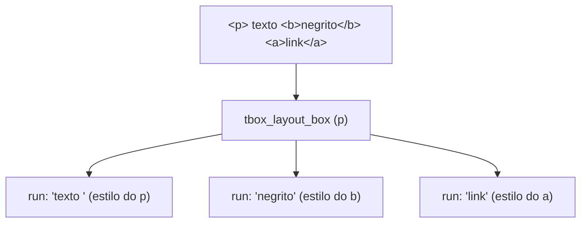
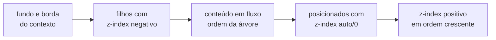

# 8. Layout e pintura

> - **Escopo:** quais modelos de layout CSS o tbox implementa, onde ele simplifica, e como a árvore de caixas vira comandos de desenho.
> - **Código relacionado:** `include/tbox/layout.h`, `src/layout/`, `include/tbox/render.h`, `src/render/tbox_render.c`, `src/output/tbox_raster.c`
> - **Veja também:** [HTML e CSS](07-html-e-css.md), [Texto e fontes](09-texto-e-fontes.md), [CSS suportado](referencia/css-suportado.md), [Débito técnico](dev/debito-tecnico.md#layout)

## A árvore de caixas

`tbox_layout_build` transforma DOM + estilos em uma árvore de
`tbox_layout_box`. Cada caixa tem os quatro retângulos do modelo de caixa
CSS (`margin_box`, `border_box`, `padding_box`, `content_box`), em pixels,
relativos à janela. Caixas de texto carregam também `text_runs`: trechos de
uma linha com a mesma fonte e o mesmo estilo.

Regras que explicam a maior parte do comportamento:

- **Elementos inline não ganham caixa**; contribuem runs para o bloco que os
  contém, cada um com o próprio estilo (cor, fonte, fundo, decoração,
  `vertical-align`), em qualquer profundidade de aninhamento.
- **Conteúdo inline solto** num container de bloco (texto direto em
  `<body>`, um `` entre dois `
`) ganha uma **caixa anônima**
  (`node == NULL`) com só as propriedades herdáveis do pai.
- **`
`, `<h1>`–`<h6>`, `<li>`, `<td>`/`<th>`, `<caption>` e `
`**
  são um único contexto inline, a menos que tenham um filho direto de bloco
  em fluxo (`display: block`/`flex`, não `absolute`/`fixed`): aí viram
  container de bloco, com o texto antes e depois do bloco em caixas
  anônimas (`tbox_layout_is_inline_box`). Num `<li>` assim, o marcador vai
  para a primeira caixa anônima; se o item começa com um bloco, o marcador
  fica ao lado do topo desse bloco. Um bloco dentro de um elemento
  **inline** (`
…
`) ainda é achatado em linha, e
  `<button>`/`<pre>` ignoram filhos de bloco.
- **`::before`/`::after`** são nós sintéticos (tag `::before`/`::after`,
  um filho de texto) que a Style cria; `tbox_layout_build` os encaixa como
  primeiro/último filho do elemento enquanto monta a árvore e os retira no
  fim — o documento do chamador não muda. A partir daí seguem as mesmas
  regras de qualquer filho (inline, bloco, inline-block…).
- **`inline-block`/`inline-flex`** viram uma "palavra atômica" na linha:
  a caixa é medida (largura declarada ou shrink-to-fit), entra na quebra de
  linha e se alinha pela baseline da sua última linha.
- `display: none` não gera caixa; `visibility: hidden` gera caixa e não
  pinta.
- Em `
` fechado, somente o primeiro `
` gera caixa. Em
  `<fieldset>`, o primeiro `<legend>` cruza a borda superior, que é dividida
  em torno da legenda.
- Em `<picture>`, o primeiro `<source>` anterior ao `` com `srcset` e
  tipo de imagem aceito fornece o arquivo desenhado. Usa a primeira URL do
  `srcset`; fontes com `media` são ignoradas e o `` serve de fallback.
  Veja `tests/assets/111.html`.
- `<ruby>` participa da linha como uma unidade indivisível. Cada `<rt>` fica
  acima e centralizado no texto-base correspondente; sua altura aumenta a
  linha ao redor. Os caracteres de `<rp>` não são desenhados.

## O que está implementado

| Área | Situação |
|---|---|
| **Fluxo de bloco** | Largura do pai, `width`/`height`, min/max, `box-sizing`, `aspect-ratio`, `min-content`/`max-content`/`fit-content`. |
| **Margens** | Collapsing entre irmãos adjacentes (`max` das duas). Com margem negativa, o par soma. Sem collapsing pai/filho. |
| **Texto em linha** | Quebra por palavra, `white-space` (normal, nowrap, pre, pre-wrap, pre-line, break-spaces), `overflow-wrap`, `word-break`, hifenização por soft hyphen (o traço mostrado vem de `hyphenate-character`), `line-break: anywhere`, `text-align` (incl. justify, desligável com `text-justify: none`), `text-align-last`, `text-indent` (hanging, each-line), `text-wrap: balance`, `line-height`, `letter-`/`word-spacing`, `text-overflow`, `line-clamp`, `tab-size`. |
| **Posicionamento** | `relative`, `absolute` (contra o ancestral posicionado mais próximo), `fixed` (contra a janela), `sticky` (só eixo vertical), `z-index`, `inset`. |
| **Listas** | Marcadores `outside`/`inside`, `list-style-type` (disc, circle, square, decimal, letras, romanos, grego, disclosure…), `list-style-image`, `::marker` (cor, fonte, `content`). |
| **Tabelas** | `caption`, `colgroup`/`col`, `thead`/`tbody`/`tfoot`, `colspan`/`rowspan`, `border-collapse`, `border-spacing`, `table-layout: fixed`, `empty-cells`, `vertical-align` em células, blocos dentro de células. |
| **Flexbox** | CSS Flexbox Level 1 §9: direção (incl. reversa), wrap, `justify-content`, `align-*`, `place-*`, `gap`, `flex-grow/shrink/basis`, `order`, margens auto, mínimo automático, min/max. |
| **`direction`** | `ltr`/`rtl` (CSS ou atributo HTML `dir`, que perde para qualquer CSS), herdado: troca o lado de `*-inline-start`/`-end` (margens, paddings, `inset`, bordas e cantos lógicos), resolve `text-align: start`/`end` (e o `start` inicial) e faz uma linha flex (`row`) começar na direita. |
| **Imagens** | `` inline ou como caixa (block/flex item), proporção preservada, `object-fit`, `object-position`, `image-rendering`. PNG/JPEG etc. via `stb_image`. |
| **Overflow** | `overflow-y: auto/scroll/hidden/clip`, `overflow-x` com recorte; rolagem vertical com barras. |
| **Unidades de viewport e `@media`** | Resolvidas contra o tamanho atual da janela. |

## Simplificações que você pode notar

- **`text-justify`** só distribui espaço entre palavras: `inter-character`
  age como `auto`. **`line-break`** só tem efeito com `anywhere` (quebra como
  `word-break: break-all` e reduz o min-content a um caractere); `loose`,
  `normal` e `strict` só diferem em pontuação CJK.
- **`hyphenate-character: ""`** equivale a `auto` (mostra `-`), e a largura
  do caractere não entra na decisão de quebra de linha (o mesmo vale para o
  `-` padrão).
- **`clip`** só aceita `rect()` (com vírgulas ou espaços, lados `auto`) em
  caixas `absolute`/`fixed`; perde para `clip-path` quando os dois existem e
  não aceita `inherit`/`initial`/`unset`.
- **`absolute`/`fixed` sem `left`/`right` (ou sem `top`/`bottom`)** vão para
  o canto do containing block, não para a posição estática "natural".
- **Ancestral posicionado com `height: auto`**: descendentes `absolute`
  ancorados por `bottom` veem um containing block mais baixo que o real.
- **Margens negativas** entre irmãos somam em vez de colapsar pelo algoritmo
  completo.
- **Sombras e `blur`** são aproximados em degraus; `filter: blur()` é
  ignorado.
- **`filter: drop-shadow()`** não segue a forma alfa do conteúdo: num
  elemento que pinta fundo ou borda, vira uma sombra de caixa (que segue o
  `border-radius`) abaixo das próprias; senão, vira sombra do texto, que os
  descendentes herdam como `text-shadow` (e que um `text-shadow` próprio
  substitui).
- **`backdrop-filter`** aplica só as funções de cor (`grayscale`, `sepia`,
  `invert`, `brightness`…) ao que já está pintado atrás da border box (com
  os cantos arredondados); `blur()`, `drop-shadow()` e `url()` são
  ignorados.
- **`background-blend-mode`** mistura cada camada de imagem/gradiente com
  o que já está pintado sob ela — a cor de fundo e as camadas de baixo, mas
  também o que está atrás do elemento quando o fundo é transparente (não há
  grupo isolado). Os 16 modos de Compositing and Blending 1.
- **`direction: rtl`** não reordena texto (não há bidi) nem move o
  marcador de lista, a barra de rolagem ou o eixo cruzado de um flex em
  coluna; `text-align-last: start`/`end` continuam físicos.
- **`transform`** só translação (`translate()`, `translateX/Y`, `translate`).

Detalhes e o motivo de cada um: [Débito técnico](dev/debito-tecnico.md#layout).

## Não implementado

`float`, `grid`, rolagem horizontal de containers, `writing-mode` vertical,
texto bidirecional, `columns`, `::before`/`::after`, transformações de
rotação/escala.

## Da caixa ao desenho

`tbox_render_build_display_list` percorre as caixas na **ordem de pintura**
do CSS e emite comandos (`tbox_paint_op`):

| Op | Uso |
|---|---|
| `FILL_RECT` | Fundos, bordas, decorações de texto, destaque de `<mark>` (com raio, para cantos arredondados) |
| `TEXT_RUN` | Um trecho de texto com uma face e uma cor |
| `IMAGE` | Imagens e `background-image` |
| `GRADIENT` | Gradientes lineares/radiais (e `repeating-`) |
| `FILL_RING` | Retângulo arredondado menos outro (bordas e contornos arredondados, sombras `inset`) |
| `WAVY_LINE` | `text-decoration-style: wavy` |
| `BACKDROP_FILTER` | `backdrop-filter`: aplica `color_filter` aos pixels já pintados na forma |

Cada op carrega retângulo, cor, `clip` (recorte de overflow) e, se preciso,
`rounded_clip` (cantos arredondados, `clip-path`; o `clip: rect()` legado
de caixas `absolute`/`fixed` vira um `clip-path: inset()` equivalente na
Style) e matriz de cor
(`filter`, `opacity`); `IMAGE`/`GRADIENT` levam também o
`background-blend-mode` da camada.

### Ordem de pintura

Criam contexto de empilhamento: a raiz, caixas posicionadas com `z-index`,
caixas com `opacity` < 1 e caixas com `isolation: isolate`. Dentro de um contexto, empate é resolvido pela
ordem da árvore. O hit-test usa a mesma ordem
([Eventos](06-eventos-e-interatividade.md#hit-test)).

Num fundo, a ordem é: `backdrop-filter` → cor → camadas de
imagem/gradiente (da última para a primeira, posicionadas na área de
`background-origin`, recortadas por `background-clip`, misturadas pelo
`background-blend-mode`) → sombras `inset` → borda.

### Rasterização

O Output rasteriza a display list em software num buffer XRGB8888
(`uint32_t` por pixel, sempre opaco), com antialiasing de glifos e cantos.
Não há GPU. A repintura de um frame pode ser parcial; ver
[Atualização da tela](05-atualizacao-da-tela.md).
