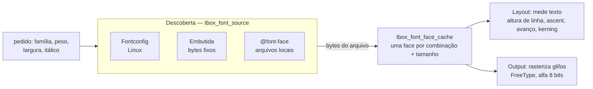
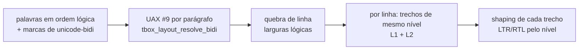

# 9. Texto e fontes

> - **Escopo:** como o tbox encontra, carrega, mede e desenha fontes; o que funciona em texto e o que não funciona.
> - **Código relacionado:** `include/tbox/font.h`, `src/font/`, `src/base/tbox_bidi*.c`, `src/layout/tbox_layout_bidi.c`, `src/layout/tbox_layout_writing.c`, `src/context/tbox_context_font.c`, `src/app/tbox_app.c` (resolver de fontes), `external/liberation-sans/`
> - **Veja também:** [Layout e pintura](08-layout-e-pintura.md), [Plataformas e build](11-plataformas-e-build.md)

## Três responsabilidades separadas



1. **Descoberta** — de onde vêm os bytes da fonte. No Linux, o Fontconfig
   transforma `"sans-serif", negrito` num arquivo `.ttf` real. Um nome só
   conta se o Fontconfig achar a própria família ou um alias forte da
   configuração (Arial → Liberation Sans). O substituto fraco de um nome
   desconhecido (Verdana → DejaVu Sans) é recusado, como no Firefox, e a
   lista segue para o próximo nome. A fonte embutida
   (`tbox_font_source_embedded_create`) sempre devolve os mesmos bytes; é o
   que os testes usam para ter resultados iguais em qualquer máquina.
   `@font-face` registra arquivos locais no cache.
2. **Faces e métricas** — `tbox_font_face` é um `FT_Face` do FreeType num
   tamanho em pixels. O cache carrega sob demanda uma face por combinação de
   família, peso, largura (`font-stretch`), itálico, kerning e tamanho, e a
   mantém pela vida do cache (não é refeita a cada frame).
3. **Rasterização** — o Output pede o bitmap de cobertura de cada glifo que
   o layout já posicionou (ver [Shaping](#shaping-do-texto-aos-glifos)) e
   o compõe no buffer com a cor do texto.

Com `tbox_app` você não precisa fazer nada: ele resolve serif regular e
negrito (a família padrão, como nos navegadores) pelo Fontconfig na criação e as outras famílias sob demanda. Com
`tbox_context` direto, você cria o `tbox_font_face_cache` (ver
[exemplo 9](04-exemplos.md#9-pipeline-sem-tbox_app)).

## Shaping: do texto aos glifos

Todo texto passa por um **shaper** antes de ser medido ou desenhado. Ele
recebe o trecho, a face e o `letter-spacing` e devolve glifos posicionados:

```c
typedef struct tbox_glyph {
    uint32_t id;       /* índice do glifo na face */
    uint32_t cluster;  /* offset em bytes do caractere de origem no texto */
    double x, y;       /* posição relativa à origem do run e à linha de base */
    double advance;    /* avanço + letter-spacing */
} tbox_glyph;
```

Há duas implementações, escolhidas no configure — uma ou outra é compilada,
nunca as duas (ver [Plataformas e build](11-plataformas-e-build.md#dependências)):

| Arquivo | Quando | O que faz |
|---|---|---|
| `src/font/tbox_font_shaper_harfbuzz.c` | HarfBuzz encontrado (`TBOX_ENABLE_HARFBUZZ=ON`, padrão) | GSUB/GPOS do HarfBuzz: ligaduras, formas contextuais (árabe, devanágari…), marcas combinantes posicionadas (`y`), kerning OpenType |
| `src/font/tbox_font_shaper_simple.c` | sem HarfBuzz | um glifo por codepoint, kerning da tabela `kern` pelo FreeType |

No HarfBuzz:

- **A fonte é lida dos bytes que a face já guarda** (`hb_face` sobre o
  mesmo buffer do `FT_Face`), sem `hb-ft`. Essa integração é preservada com
  o FreeType do sistema: as funções OpenType do HarfBuzz são combinadas com
  o callback de avanços com hinting do FreeType.
- **Avanços vêm do FreeType** (`FT_Load_Glyph`, com hinting) — os mesmos
  que o raster usa para os bitmaps; o HarfBuzz decide quais glifos e os
  deslocamentos (kerning, marcas). Cada face guarda o avanço de cada glifo
  já carregado (`tbox_font_face_glyph_advance`, em páginas de 256 glifos
  alocadas sob demanda), já que tamanho e flags de carga são fixos nela; o
  shaper simples usa o mesmo cache.
- **`font-kerning: none`** desliga a feature `kern`; **`letter-spacing`
  diferente de zero** desliga as ligaduras opcionais (`liga`, `clig`,
  `dlig`), como o CSS recomenda. O `letter-spacing` entra uma vez por
  cluster, depois do último glifo dele.
- O objeto `hb_font` e o buffer de shaping vivem **na face** (nada global);
  são criados no `tbox_font_face_load` e destruídos com ela.
- Script, direção e idioma são adivinhados por trecho
  (`hb_buffer_guess_segment_properties`), salvo o idioma explicitado por
  `font-language-override`. A **direção** vem do layout quando a linha
  passou pelo [bidi](#texto-bidirecional): `tbox_font_shape` recebe
  `TBOX_FONT_DIRECTION_LTR`/`RTL` pelo nível de cada trecho (AUTO para
  quem só mede). Em RTL o HarfBuzz devolve os glifos na ordem visual
  (clusters decrescentes) e espelha parênteses e afins (L4); o shaper
  simples faz o mesmo percorrendo os codepoints de trás para a frente com
  `tbox_bidi_mirror`.

Veja `tests/assets/text-shaping-latin.html` e `text-shaping-scripts.html`
(compare com um build
`-DTBOX_ENABLE_HARFBUZZ=OFF`).

`tbox_font_shape` (`src/font/tbox_font_measure.h`) grava os glifos numa
arena; `tbox_font_measure_text_spaced` é a largura do mesmo shaping. O
layout molda cada palavra na posição em que a linha a coloca e guarda os
glifos em `tbox_layout_text_run.glyphs`; o render os copia para o
`TEXT_RUN` e o raster os pinta por índice (`tbox_font_rasterize_glyph_id`)
— ver [Layout e pintura](08-layout-e-pintura.md#texto-como-glifos-posicionados).

### Cache de runs

Como o layout é refeito a cada frame, as mesmas palavras seriam moldadas de
novo em todo frame, e o shaping do HarfBuzz (com o hinting do FreeType nos
avanços) era a maior parte do custo do layout. Cada face guarda então os
runs já moldados (`tbox_font_face.runs`, em `src/font/tbox_font_face.c`):

- **Chave:** os bytes do texto, o `letter-spacing` e a direção. O resto
  que muda o resultado (tamanho, features OpenType, orientação vertical) já
  é fixo na face.
- **Valor:** a largura, o número de glifos e os glifos. Quem só mede
  (`tbox_font_measure_text_spaced`) guarda só a largura; os glifos entram
  quando alguém os pede.
- **Limites:** a tabela começa com 2048 posições por face e dobra ao
  passar da metade, até 65536 (32768 runs). No tamanho máximo, uma
  varredura descarta os runs que não foram pedidos de novo desde a
  varredura anterior (um run só é marcado quando é reaproveitado, não ao
  entrar): o texto exibido em todo frame fica, o visto uma vez sai. Se
  quase tudo ficaria, o conjunto não cabe e o cache é esvaziado inteiro.
  Textos com mais de 256 bytes não entram.
- **Invalidação:** `tbox_font_face_set_kerning` esvazia o cache quando o
  valor muda; `tbox_font_face_destroy` o libera.

O cache vive na face, não em estado global, e segue a afinidade de thread
da face. O resultado é idêntico ao do shaping direto (os screenshots de
todas as fixtures são iguais byte a byte).

## Texto bidirecional

O algoritmo bidi do Unicode (UAX #9, Unicode 16.0) é implementação
própria, sem dependência: `src/base/tbox_bidi.c` resolve os níveis de um
parágrafo (regras P2–I2, com sequências de isolamento e pares de
parênteses N0) e reordena uma linha (L1, L2); as tabelas de classe,
espelhamento e pares de parênteses são dados `static const` gerados do UCD
(`src/base/tbox_bidi_tables.c`, ~9 KB de faixas). O conjunto passa nos
91 707 casos do `BidiCharacterTest.txt` do Unicode 16 (verificado à parte;
o teste `bidi` traz uma amostra).



- **Parágrafo** é o texto de uma caixa de texto (ou caixa anônima) até uma
  quebra forçada (`<br>`, linha de `<pre>`); a direção base é o
  `direction` do bloco, ou a do primeiro caractere forte com
  `unicode-bidi: plaintext` no bloco. `bidi-override`/`isolate-override`
  num bloco forçam a direção de todo o texto dele.
- **`unicode-bidi` em elemento inline** vira os caracteres de formatação
  equivalentes em volta do conteúdo (CSS Writing Modes 3, 2.4.2): `embed`
  → LRE/RLE…PDF, `isolate` → LRI/RLI…PDI, `bidi-override` → LRO/RLO…PDF,
  `isolate-override` → as duas coisas, `plaintext` → FSI…PDI. Ficam em
  `tbox_layout_word.bidi_open/bidi_close` (até 6 de cada lado por palavra;
  aninhamento mais fundo é ignorado inteiro) e são reabertos depois de uma
  quebra forçada. `direction` num inline com `unicode-bidi: normal` não
  muda nada, como no CSS.
- **HTML**, abaixo de qualquer CSS (resolvido em `tbox_style.c`, como o
  `dir` → `direction`): `<bdo>` é `bidi-override` (`isolate-override` com
  `dir`), `<bdi>` sem `dir` e `dir=auto` são `plaintext` (direção pelo
  primeiro forte), qualquer outro `dir` é `isolate`. `all` não toca
  `direction` nem `unicode-bidi`.
- **Imagens e inline-blocks** contam como U+FFFC (neutro). O espaço entre
  palavras entra no texto do parágrafo e tem nível próprio.
- **Só linhas com nível acima de 0** passam pelo caminho bidi
  (`tbox_layout_build_bidi_line_runs`); texto todo LTR num bloco `ltr`
  nem roda o algoritmo e sai idêntico ao de antes. Na linha, cada palavra
  é partida em trechos de mesmo nível, os trechos são reordenados (L2) e
  moldados um a um; trechos vizinhos na tela com a mesma face e estilo
  viram **um** `tbox_layout_text_run`, com `text` na ordem lógica e os
  glifos na ordem visual (o `cluster` aponta para o texto). Um fundo de
  `<span>` cobre cada pedaço visual do elemento separadamente — um inline
  partido pela reordenação tem vários retângulos, como num navegador.
- **Cursor de `<input>`**: `tbox_layout_bidi_caret_x` põe o caret na
  posição visual do offset lógico (na borda do caractere seguinte), e num
  campo `rtl` soma o deslocamento do alinhamento. Seleção, clique e setas
  continuam lógicos.

Veja `tests/assets/text-bidi.html`.

## Escrita vertical

O layout de um contêiner vertical acontece num referencial girado
([Layout e pintura](08-layout-e-pintura.md#escrita-vertical)): a linha é
quebrada e moldada como se fosse horizontal e o referencial a leva para a
tela. O que muda no texto fica no shaping, por uma variante da face:
`tbox_style_shaping_options` põe em `tbox_font_shaping_options` o
referencial (`vertical_frame`: girado para `vertical-rl`, transposto para
`vertical-lr`) e a orientação (`vertical_orientation`), e o cache de faces
guarda uma face por combinação. Depois do shaper (HarfBuzz ou simples),
`tbox_font_orient` (`src/font/tbox_font_face.c`) ajusta os glifos, de modo
que medição, quebra de linha, posições e pintura usam os mesmos números:

- **Deitado** (Latim em `mixed`, `sideways`, os modos `sideways-*`): o
  glifo fica como foi moldado; o referencial girado já o mostra a 90° no
  sentido horário. No referencial transposto (`vertical-lr`) o glifo é
  espelhado em torno da linha de base central (`TBOX_GLYPH_ORIENT_FLIP`),
  para que a transposição o mostre girado como no `vertical-rl`.
- **Em pé** (`text-orientation: upright`, e em `mixed` os caracteres CJK,
  kana, hangul, Yi, largura total e símbolos — uma aproximação por faixas
  do `Vertical_Orientation` do UAX #50): avança 1em, com o quadrado
  centrado na linha de base central e a linha de base alfabética na
  proporção da ascendente (o que o Firefox sintetiza em fontes sem
  `vmtx`); o glifo é desenhado girado de volta (`ROTATE_CCW` /
  `TRANSPOSE`) e centrado horizontalmente pelo próprio avanço.
- **`text-combine-upright: all`**: o texto do elemento é moldado na
  horizontal e comprimido (`tbox_glyph.scale`) para caber em 1em, e o
  conjunto ocupa um único quadrado em pé. Texto só de espaços não é
  combinado.

`tbox_glyph` ganhou `orient` (`tbox_glyph_orient`) e `scale`; o raster
(`tbox_raster_oriented_glyph`) amostra o bitmap do glifo pela inversa
dessa transformação (bilinear; quartos de volta em pixel inteiro saem
exatos). Glifos sem orientação seguem o caminho de sempre.

Limitações: não há métricas verticais da fonte (`vmtx`/`VORG`) nem
formas verticais (`vert`/`vrt2`), então pontuação CJK fica na forma
horizontal; `text-combine-upright: digits <n>` não é suportado; sublinhado
e outras decorações seguem o lado de baixo da linha no referencial (à
esquerda em `vertical-rl`, à direita em `vertical-lr`). Veja
`tests/assets/text-vertical-writing.html`.

## Largura de cada prefixo

Quem precisa da largura de **cada prefixo** de um trecho (posicionar o
cursor por clique, quebrar uma palavra longa com `overflow-wrap`, quebrar
linhas do `<textarea>`) usa o medidor de `src/font/tbox_font_measure.h`:

```c
tbox_text_measurer m;
tbox_text_measurer_init(&m, face, letter_spacing, text.data, text.size);
while (m.at < text.size) {
    tbox_text_measurer_step(&m);
    /* m.width == largura de text[0..m.at) dentro do texto moldado */
}
tbox_text_measurer_finish(&m);
```

O medidor molda o trecho **inteiro** uma vez e anda por ele um codepoint
por passo; a largura acumulada é a dos clusters já percorridos. Um cluster
com vários caracteres (a ligadura "ffi", uma letra com acento combinante)
tem a largura repartida igualmente entre eles, como fazem os navegadores —
o cursor pode parar dentro de uma ligadura. Ao fim do texto, `m.width` é
exatamente `tbox_font_measure_text_spaced(face, text, letter_spacing)`.

Uma consequência do shaping: a largura do prefixo **dentro** do texto
inteiro não é, em geral, a largura do prefixo moldado sozinho ("f" seguido
de "i" vira um glifo só; sozinho, "f" é outro). O medidor dá a primeira,
que é a que corresponde ao que está desenhado. Custo: um shaping por trecho
e O(n) passos.

`tbox_text_measurer_init_masked` mede como se cada codepoint fosse um único
caractere de substituição (a máscara do `<input type=password>`); o layout
desenha a máscara com o mesmo shaper, então cursor e texto coincidem.

## O que funciona

- `font-family` — **a lista inteira**: o cache tenta cada nome em ordem,
  `@font-face` e Fontconfig, e fica com o primeiro que existe; sem nenhum, a
  família padrão (serif). Nomes genéricos (`serif`, `sans-serif`,
  `monospace`...) sempre resolvem. `<pre>` e `<code>` usam `monospace` pela
  folha user-agent, com `medium` de 13px. O estilo guarda a lista sem
  aspas, separada por vírgula, até `TBOX_FONT_FAMILY_CAPACITY` bytes.
- `font-size` (com palavras-chave `small`…`xx-large`, `smaller`/`larger`),
  `font-weight` numérico e `bolder`/`lighter`, `font-style` (itálico real;
  `oblique` usa itálico), `font-stretch`, `font-variant: small-caps`
  (sintetizado), shorthand `font`.
- `font-kerning` (ligado por padrão; mesma regra na medição e no desenho).
- `font-size-adjust: <número>` / `ex-height <número>` (herdado): a face é
  carregada num tamanho em que a altura do "x" (`tbox_font_face_x_height`:
  métrica OS/2, ou o glifo "x") é número × `font-size`. Unidades `em`
  continuam usando o `font-size` declarado. `from-font` equivale a `none`
  (cada elemento usa uma única fonte); outras métricas (`cap-height`,
  `ch-width`…) são ignoradas.
- `font-variant-position: sub`/`super`, sintetizado (sem recursos
  OpenType): onde o valor muda, a fonte encolhe como `smaller` (÷1,2), e o
  texto com `vertical-align: baseline` sobe/desce como `super`/`sub`.
  Inline-blocks e imagens não se movem. Também é lido do shorthand
  `font-variant`.
- `font-synthesis` (e `-small-caps`, `-position`): desliga as sínteses de
  small-caps e de sub/super; sem síntese o texto sai normal, já que não há
  glifos OpenType. `-weight`/`-style` não têm efeito: a tbox nunca
  sintetiza negrito nem itálico.
- `@font-face` com arquivos locais.
- Decorações (`underline`, `overline`, `line-through`, estilos sólido,
  tracejado, pontilhado, duplo e ondulado), `text-shadow`,
  `text-transform`, `letter-spacing`, `word-spacing`.
- `text-emphasis` (shorthand, `-style`, `-color`, `-position`, herdados):
  uma marca centrada sobre (ou, com `under`, sob) cada caractere, menos
  espaços, controles e pontuação (blocos ASCII, geral e CJK). As formas
  `dot`, `circle`, `double-circle`, `triangle` e `sesame`, cheias ou
  `open`, são desenhadas como formas alinhadas aos pixels (não dependem da
  fonte ter os glifos); uma `<string>` usa a fonte do texto com metade do
  tamanho. `left`/`right` em `-position` são aceitos sem efeito (não há
  texto vertical). As marcas não reservam espaço na linha: com
  `line-height` apertado, encostam na linha de cima. Veja
  `tests/assets/text-emphasis.html`.
- UTF-8 em todo o pipeline; glifos ausentes na fonte não quebram nada.
  Texto vindo de fora (`tbox_html_parse`, `tbox_css_parse`,
  `tbox_html_node_set_attribute`/`_set_text_content` e paste) passa por
  `tbox_utf8_sanitize`: cada sequência malformada vira U+FFFD (subparte
  máxima, como no WHATWG Encoding), então o resto do pipeline só vê UTF-8
  válido. `tbox_context_dispatch_text` continua rejeitando UTF-8 inválido.
  Toda iteração por codepoint (medição, raster, `text-transform`,
  `break-all`, reticências, cursor, máscara de senha) usa o único
  decodificador de `src/base/tbox_string.h` (`tbox_utf8_decode`/`_next`/
  `_previous`), que respeita o fim da view; o `utf8codepoint` do utf8.h não
  é usado porque lê além dela. Codificação (`tbox_utf8_encode`) e
  maiúsculas/minúsculas (`tbox_utf8_to_upper`/`_to_lower`) também ficam
  ali. `src/base/tbox_string.c` é o único arquivo que inclui
  `external/utf8.h`: o CMake só dá o caminho dele a esse arquivo, então um
  `#include "utf8.h"` em outro lugar não compila. Valores de CSS copiados
  para campos de tamanho fixo (`text-overflow`, `hyphenate-character`,
  `text-emphasis`, `content` do marcador) são cortados entre codepoints,
  nunca no meio de um (`tbox_utf8_copy_truncated`).
- Números em CSS e atributos (`1.5em`, `value` de `<input type=number>`,
  `coords`) são lidos e escritos por `src/base/tbox_number`, sem depender
  do `LC_NUMERIC` da aplicação.
- `<ruby>` desenha cada trecho de texto-base com seu `<rt>` centralizado
  acima. O `<rt>` usa metade do tamanho da fonte por padrão e `<rp>` fica
  oculto. A unidade ruby não quebra entre trechos. Veja
  `tests/assets/text-ruby.html`.

## O que não funciona (ainda)

- Ruby aceita texto-base direto e um `<rt>` por trecho. Conteúdo interno com
  estilos mistos é achatado em texto; anotação lateral, múltiplas camadas de
  anotação e posicionamento vertical não são suportados.
- **Shaping só com HarfBuzz.** Sem ele (`tbox_font_shaper_simple.c`), a
  largura é a soma dos avanços com kerning: sem ligaduras nem formas
  contextuais, e árabe, devanágari e similares saem errados.
- **Shaping por palavra.** Cada palavra é moldada sozinha; não há kerning
  nem contexto através de um espaço ou de uma fronteira de elemento. (O
  custo de refazer isso a cada frame é coberto pelo [cache de
  runs](#cache-de-runs).)
- **Unidade é o codepoint, não o grafema.** Cursor, backspace,
  `break-all`, reticências e máscara de senha andam por codepoint: um "é"
  decomposto (e + U+0301), emojis com modificador/ZWJ e bandeiras podem ser
  partidos. Ver [Débito técnico](dev/debito-tecnico.md#segmentação-por-grafema).
- **Sem fallback por glifo.** Cada trecho usa uma fonte; um caractere que
  não existe nela não é buscado em outra.
- **Bidi parcial na edição e nos controles.** O texto é reordenado
  ([Texto bidirecional](#texto-bidirecional)), mas no `<input>` só o caret
  segue a ordem visual: seleção, clique e setas são lógicos; o
  `<textarea>`, o rótulo do `<select>` e as reticências de
  `text-overflow` não são reordenados/supõem LTR. `text-align: start` com
  `unicode-bidi: plaintext` usa o `direction` do bloco, não o do
  parágrafo.
- **Fallback por glifo**: a lista escolhe uma face por run, e não por
  caractere. Um glifo que falta na face escolhida não é procurado no
  próximo nome.
- **`@font-face` remoto** (URLs `http`) e faixas de peso não são suportados.
- **Sem limite de tamanho** no cache de faces (um documento de UI usa poucas
  combinações).

## Fonte embutida

`external/liberation-sans/LiberationSans-Regular.ttf` (SIL Open Font
License, métricas compatíveis com Arial). Não é compilada na biblioteca: o
caminho é lido em tempo de execução por quem cria o cache. Um build sem
Fontconfig (`-DTBOX_ENABLE_FONTCONFIG=OFF`) ainda funciona com ela via
`tbox_context` — mas `tbox_app` precisa de Fontconfig.

## Recursos OpenType

Os longhands de `font-variant` (ligaduras, números, formas do leste asiático e
alternates), `font-feature-settings` e `font-language-override` são herdados.
A configuração de shaping faz parte da chave do cache de faces; assim, medir
prefixos, quebrar linhas e rasterizar usam a mesma seleção de glifos. O
shorthand `font-variant` ajusta todos os seus longhands; `font` os reseta,
assim como feature settings e language override. Recursos explícitos em
`font-feature-settings` prevalecem sobre os derivados de variantes. O shaper
simple aceita os estilos, mas não aplica recursos OpenType.

`font-variant-alternates: historical-forms` ativa `hist`. As funções
`stylistic()`, `styleset()`, `character-variant()`, `swash()`, `ornaments()` e
`annotation()` são aceitas sem efeito: não há resolução de
`@font-feature-values`. Tags de idioma OpenType são convertidas para idioma
HarfBuzz; `normal` mantém a detecção automática por trecho.

`@font-palette-values --nome` preserva os descritores na folha, e
`font-palette` aceita `normal`, `light`, `dark` e nomes `--nome` na cascata.
Ainda não há pintura de glifos coloridos COLR/CPAL: a seleção de paleta não
altera o raster alfa atual. Valores inválidos são ignorados. Uma lista de
`font-feature-settings` admite até 64 tags distintas (tags repetidas usam o
último valor); nomes de paletas têm até 63 bytes.

O fixture `tests/assets/text-font-face-and-opentype.html` compara algarismos proporcionais e tabulares,
oldstyle, frações, ligaduras e small-caps OpenType a 24px. Usa um subset local
da Roboto (arquivo `opentype-sans.ttf`, família `Tbox OpenType Sans`, fallback
`sans-serif`), com licença OFL em `opentype-sans-license.txt`: a Liberation Sans embutida e a DejaVu Sans padrão do
Fontconfig não contêm todos os recursos usados nessa comparação.

Sintaxes disponíveis:

- `font-feature-settings`: `normal` ou lista separada por vírgulas de
  `"tag" [on | off | inteiro não negativo]`; omitir o valor equivale a `on`.
  Cada tag tem exatamente quatro caracteres ASCII imprimíveis; aceita aspas
  simples e escapes CSS. Inteiros são armazenados em 32 bits sem sinal.
- `font-variant-ligatures`: `normal`, `none` ou combinações de
  `[no-]common-ligatures`, `[no-]discretionary-ligatures`,
  `[no-]historical-ligatures` e `[no-]contextual`. `none` mantém somente os
  recursos obrigatórios de shaping.
- `font-variant-numeric`: `normal` ou uma escolha de cada par
  `lining-nums`/`oldstyle-nums`, `proportional-nums`/`tabular-nums`,
  `diagonal-fractions`/`stacked-fractions`, mais `ordinal` e `slashed-zero`.
- `font-variant-east-asian`: `normal` ou uma forma entre
  `jis78`/`jis83`/`jis90`/`jis04`/`simplified`/`traditional`, uma largura
  entre `full-width`/`proportional-width` e, opcionalmente, `ruby`.
- `font-language-override`: `normal` ou string de um a quatro caracteres
  ASCII imprimíveis, completada com espaços até quatro bytes.

`font-variant: normal` reseta todos os longhands de variantes;
`font-variant: none` também os reseta e desliga as ligaduras opcionais.
Os demais keywords podem ser combinados no shorthand, incluindo
`small-caps` e `sub`/`super`, que continuam sintetizados. Valores literais
inválidos são descartados na cascata sem substituir a declaração válida
anterior; declarações com `var()` são validadas depois da substituição.

## Contorno e ordem de pintura do texto

`-webkit-text-stroke-width` aceita um comprimento não negativo (sem percentual)
ou `thin`/`medium`/`thick` (1/3/5px); o inicial é zero.
`-webkit-text-stroke-color` aceita cores e `currentColor` (inicial).
O shorthand `-webkit-text-stroke` combina largura e cor em qualquer ordem;
os componentes omitidos voltam aos iniciais. Ambos os longhands são herdados.
`color: transparent` preserva o contorno e permite texto vazado.
A cor participa de transições e animações. A largura é discreta (troca em
50% dos keyframes e não inicia transição comum), conforme o
[Compatibility Standard](https://compat.spec.whatwg.org/#the-webkit-text-stroke-width-property).

`paint-order` é herdado: `normal` equivale a `fill stroke markers`;
aceita uma a três palavras distintas entre `fill`, `stroke` e `markers`.
As etapas omitidas são acrescentadas na ordem normal. Assim, `stroke`
pinta o contorno antes do preenchimento e conserva a espessura interna das
letras. `markers` não pinta nada, pois não há SVG. A ordem também anima
de forma discreta nos keyframes, sem iniciar transição comum.

O raster usa `FT_Glyph_Stroke` com raio igual à metade da largura CSS,
junções e pontas arredondadas, seguido de uma máscara alfa antialiasada.
Isso mantém curvas e bordas internas vetoriais e larguras fracionárias,
sem a aproximação por dilatação de um bitmap já rasterizado. As caixas
anônimas de texto também preservam o contorno e a ordem herdados. O glifo
auxiliar pertence à face e é liberado na próxima rasterização de contorno
ou na destruição da face; não há novo estado global. O contorno não muda
avanços, quebras de linha ou métricas; seus pixels extras participam do
recorte, das camadas e do cálculo de dano. Fontes sem outlines vetoriais
não produzem contorno. Veja `tests/assets/text-stroke.html`.

## Capitulares e pontuação

- `initial-letter` não é herdado. `normal` desliga o efeito; o número
  (≥ 1, inclusive fracionário) define a altura em linhas. O inteiro
  opcional (≥ 1) posiciona a baseline na linha indicada; `drop` e a
  omissão usam a parte inteira da altura, e `raise` usa 1. Funciona em
  `::first-letter`, no inline inicial (seu texto explícito, inclusive
  através de inlines aninhados) e no próprio bloco (sua primeira letra).
- A fonte da capitular é dimensionada para cap-height igual a
  `(altura - 1) × line-height + cap-height do bloco`. A métrica vem de
  OS/2 ou do glifo H. A baseline coincide com a linha de afundamento;
  `3 2` sobe uma linha em relação a `3`. A precisão da altura acompanha
  o arredondamento do cache FreeType para pixels inteiros. Não aplica
  alinhamento ideográfico/vertical, digrafos específicos de idioma ou
  sequências emoji com ZWJ; um trecho explícito com vários estilos é
  desenhado com o estilo do elemento inicial.
- `hanging-punctuation` é herdado: `none` ou combinações sem repetição de
  `first`, `last` e um entre `allow-end`/`force-end`. `first` pendura a
  abertura da primeira linha à esquerda (Ps/Pi/Pf, aspas ASCII, espaço ideográfico e travessão);
  `last` pendura fechamento/aspas da última linha à direita. Somente um
  caractere por borda é descontado. `allow-end` permite ponto/vírgula
  pendurados quando não caberiam; `force-end` os desconta sempre,
  inclusive na justificação. Inclui `.`, `,`, `、`, `。` e variantes
  árabes, pequenas e de largura inteira. A largura descontada também é
  usada por `text-align`, enquanto a seleção e o desenho mantêm os glifos.
  As categorias tipográficas vêm de tabelas imutáveis Unicode 14.0.0 em
  `src/base/tbox_unicode.c`. A direção continua horizontal LTR, como o
  restante do layout de texto.

O fixture `text-initial-letter.html` compara `::first-letter` flutuante, capitulares de
três linhas (sink 3 e 2), aspas penduradas e pontuação em texto justificado.
O caminho comum de caixas anônimas também recebe esses estilos. `::first-letter`
não se propaga por cadeias de blocos descendentes; aplique a regra ao bloco
que contém o texto. `::first-line` continua sem estilo.
