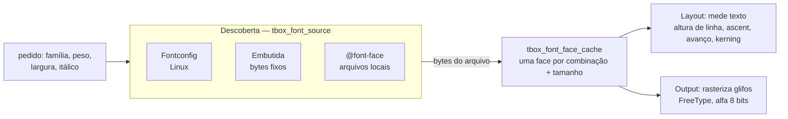

# 9. Texto e fontes

> - **Escopo:** como o tbox encontra, carrega, mede e desenha fontes; o que funciona em texto e o que não funciona.
> - **Código relacionado:** `include/tbox/font.h`, `src/font/`, `src/context/tbox_context_font.c`, `src/app/tbox_app.c` (resolver de fontes), `external/liberation-sans/`
> - **Veja também:** [Layout e pintura](08-layout-e-pintura.md), [Plataformas e build](11-plataformas-e-build.md)

## Três responsabilidades separadas

1. **Descoberta** — de onde vêm os bytes da fonte. No Linux, o Fontconfig
   transforma `"sans-serif", negrito` num arquivo `.ttf` real e faz a
   substituição quando a família pedida não existe. A fonte embutida
   (`tbox_font_source_embedded_create`) sempre devolve os mesmos bytes; é o
   que os testes usam para ter resultados iguais em qualquer máquina.
   `@font-face` registra arquivos locais no cache.
2. **Faces e métricas** — `tbox_font_face` é um `FT_Face` do FreeType num
   tamanho em pixels. O cache carrega sob demanda uma face por combinação de
   família, peso, largura (`font-stretch`), itálico, kerning e tamanho, e a
   mantém pela vida do cache (não é refeita a cada frame).
3. **Rasterização** — o Output pede o bitmap de cobertura de cada glifo e o
   compõe no buffer com a cor do texto.

Com `tbox_app` você não precisa fazer nada: ele resolve sans-serif regular e
negrito pelo Fontconfig na criação e as outras famílias sob demanda. Com
`tbox_context` direto, você cria o `tbox_font_face_cache` (ver
[exemplo 9](04-exemplos.md#9-pipeline-sem-tbox_app)).

## O que funciona

- `font-family` — **o primeiro nome da lista** é pedido ao Fontconfig (que
  já faz fallback se ele não existir); nomes genéricos (`serif`,
  `sans-serif`, `monospace`) funcionam. `<pre>` e `<code>` usam `monospace`
  pela folha user-agent.
- `font-size` (com palavras-chave `small`…`xx-large`, `smaller`/`larger`),
  `font-weight` numérico e `bolder`/`lighter`, `font-style` (itálico real;
  `oblique` usa itálico), `font-stretch`, `font-variant: small-caps`
  (sintetizado), shorthand `font`.
- `font-kerning` (ligado por padrão; mesma regra na medição e no desenho).
- `font-size-adjust: <número>` / `ex-height <número>` (herdado): a face é
  carregada num tamanho em que a altura do "x" (`tbox_font_face_x_height`:
  métrica OS/2, ou o glifo "x") é número × `font-size`. Unidades `em`
  continuam usando o `font-size` declarado. `from-font` equivale a `none`
  (cada elemento usa uma única fonte); outras métricas (`cap-height`,
  `ch-width`…) são ignoradas.
- `font-variant-position: sub`/`super`, sintetizado (sem recursos
  OpenType): onde o valor muda, a fonte encolhe como `smaller` (÷1,2), e o
  texto com `vertical-align: baseline` sobe/desce como `super`/`sub`.
  Inline-blocks e imagens não se movem. Não é lido do shorthand
  `font-variant`.
- `font-synthesis` (e `-small-caps`, `-position`): desliga as sínteses de
  small-caps e de sub/super; sem síntese o texto sai normal, já que não há
  glifos OpenType. `-weight`/`-style` não têm efeito: a tbox nunca
  sintetiza negrito nem itálico.
- `@font-face` com arquivos locais.
- Decorações (`underline`, `overline`, `line-through`, estilos sólido,
  tracejado, pontilhado, duplo e ondulado), `text-shadow`,
  `text-transform`, `letter-spacing`, `word-spacing`.
- UTF-8 em todo o pipeline; glifos ausentes na fonte não quebram nada.
- `<ruby>` desenha cada trecho de texto-base com seu `<rt>` centralizado
  acima. O `<rt>` usa metade do tamanho da fonte por padrão e `<rp>` fica
  oculto. A unidade ruby não quebra entre trechos. Veja
  `tests/assets/114.html`.

## O que não funciona (ainda)

- Ruby aceita texto-base direto e um `<rt>` por trecho. Conteúdo interno com
  estilos mistos é achatado em texto; anotação lateral, múltiplas camadas de
  anotação e posicionamento vertical não são suportados.
- **Sem shaping.** A largura do texto é a soma dos avanços dos glifos (com
  kerning). Não há ligaduras, nem reordenação, nem formas contextuais: texto
  árabe, hebraico, devanágari e similares não são exibidos corretamente.
  HarfBuzz seria a troca de implementação natural, atrás da mesma API.
- **Sem fallback por glifo.** Cada trecho usa uma fonte; um caractere que
  não existe nela não é buscado em outra.
- **Sem texto bidirecional** nem `writing-mode` vertical.
- **Sem lista de fallback** em `font-family` além do primeiro nome (o
  Fontconfig cobre a maior parte disso).
- **`@font-face` remoto** (URLs `http`) e faixas de peso não são suportados.
- **Sem limite de tamanho** no cache de faces (um documento de UI usa poucas
  combinações).

## Fonte embutida

`external/liberation-sans/LiberationSans-Regular.ttf` (SIL Open Font
License, métricas compatíveis com Arial). Não é compilada na biblioteca: o
caminho é lido em tempo de execução por quem cria o cache. Um build sem
Fontconfig (`-DTBOX_ENABLE_FONTCONFIG=OFF`) ainda funciona com ela via
`tbox_context` — mas `tbox_app` precisa de Fontconfig.
