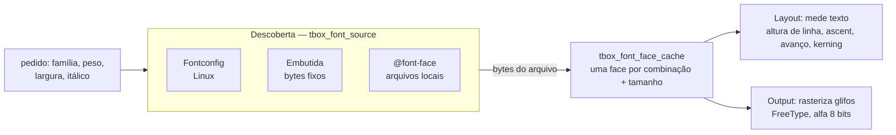

# 9. Texto e fontes

> - **Escopo:** como o tbox encontra, carrega, mede e desenha fontes; o que funciona em texto e o que não funciona.
> - **Código relacionado:** `include/tbox/font.h`, `src/font/`, `src/context/tbox_context_font.c`, `src/app/tbox_app.c` (resolver de fontes), `external/liberation-sans/`
> - **Veja também:** [Layout e pintura](08-layout-e-pintura.md), [Plataformas e build](11-plataformas-e-build.md)

## Três responsabilidades separadas



1. **Descoberta** — de onde vêm os bytes da fonte. No Linux, o Fontconfig
   transforma `"sans-serif", negrito` num arquivo `.ttf` real e faz a
   substituição quando a família pedida não existe. A fonte embutida
   (`tbox_font_source_embedded_create`) sempre devolve os mesmos bytes; é o
   que os testes usam para ter resultados iguais em qualquer máquina.
   `@font-face` registra arquivos locais no cache.
2. **Faces e métricas** — `tbox_font_face` é um `FT_Face` do FreeType num
   tamanho em pixels. O cache carrega sob demanda uma face por combinação de
   família, peso, largura (`font-stretch`), itálico, kerning e tamanho, e a
   mantém pela vida do cache (não é refeita a cada frame).
3. **Rasterização** — o Output pede o bitmap de cobertura de cada glifo que
   o layout já posicionou (ver [Shaping](#shaping-do-texto-aos-glifos)) e
   o compõe no buffer com a cor do texto.

Com `tbox_app` você não precisa fazer nada: ele resolve sans-serif regular e
negrito pelo Fontconfig na criação e as outras famílias sob demanda. Com
`tbox_context` direto, você cria o `tbox_font_face_cache` (ver
[exemplo 9](04-exemplos.md#9-pipeline-sem-tbox_app)).

## Shaping: do texto aos glifos

Todo texto passa por um **shaper** antes de ser medido ou desenhado. Ele
recebe o trecho, a face e o `letter-spacing` e devolve glifos posicionados:

```c
typedef struct tbox_glyph {
    uint32_t id;       /* índice do glifo na face */
    uint32_t cluster;  /* offset em bytes do caractere de origem no texto */
    double x, y;       /* posição relativa à origem do run e à linha de base */
    double advance;    /* avanço + letter-spacing */
} tbox_glyph;
```

Há duas implementações, escolhidas no configure — uma ou outra é compilada,
nunca as duas (ver [Plataformas e build](11-plataformas-e-build.md#dependências)):

| Arquivo | Quando | O que faz |
|---|---|---|
| `src/font/tbox_font_shaper_harfbuzz.c` | HarfBuzz encontrado (`TBOX_ENABLE_HARFBUZZ=ON`, padrão) | GSUB/GPOS do HarfBuzz: ligaduras, formas contextuais (árabe, devanágari…), marcas combinantes posicionadas (`y`), kerning OpenType |
| `src/font/tbox_font_shaper_simple.c` | sem HarfBuzz | um glifo por codepoint, kerning da tabela `kern` pelo FreeType |

No HarfBuzz:

- **A fonte é lida dos bytes que a face já guarda** (`hb_face` sobre o
  mesmo buffer do `FT_Face`), sem `hb-ft`: o processo tem dois FreeType (o
  estático do build e o do sistema, de que o HarfBuzz depende), e o `hb-ft`
  chamaria o errado.
- **Avanços vêm do FreeType** (`FT_Load_Glyph`, com hinting) — os mesmos
  que o raster usa para os bitmaps; o HarfBuzz decide quais glifos e os
  deslocamentos (kerning, marcas).
- **`font-kerning: none`** desliga a feature `kern`; **`letter-spacing`
  diferente de zero** desliga as ligaduras opcionais (`liga`, `clig`,
  `dlig`), como o CSS recomenda. O `letter-spacing` entra uma vez por
  cluster, depois do último glifo dele.
- O objeto `hb_font` e o buffer de shaping vivem **na face** (nada global);
  são criados no `tbox_font_face_load` e destruídos com ela.
- Script, direção e idioma são adivinhados por trecho
  (`hb_buffer_guess_segment_properties`). Uma palavra hebraica ou árabe sai
  com os glifos na ordem visual certa; a ordem das **palavras** numa linha
  mista continua lógica (sem bidi).

Veja `tests/assets/141.html` (compare com um build
`-DTBOX_ENABLE_HARFBUZZ=OFF`).

`tbox_font_shape` (`src/font/tbox_font_measure.h`) grava os glifos numa
arena; `tbox_font_measure_text_spaced` é a largura do mesmo shaping. O
layout molda cada palavra na posição em que a linha a coloca e guarda os
glifos em `tbox_layout_text_run.glyphs`; o render os copia para o
`TEXT_RUN` e o raster os pinta por índice (`tbox_font_rasterize_glyph_id`)
— ver [Layout e pintura](08-layout-e-pintura.md#texto-como-glifos-posicionados).

## Largura de cada prefixo

Quem precisa da largura de **cada prefixo** de um trecho (posicionar o
cursor por clique, quebrar uma palavra longa com `overflow-wrap`, quebrar
linhas do `<textarea>`) usa o medidor de `src/font/tbox_font_measure.h`:

```c
tbox_text_measurer m;
tbox_text_measurer_init(&m, face, letter_spacing, text.data, text.size);
while (m.at < text.size) {
    tbox_text_measurer_step(&m);
    /* m.width == largura de text[0..m.at) dentro do texto moldado */
}
tbox_text_measurer_finish(&m);
```

O medidor molda o trecho **inteiro** uma vez e anda por ele um codepoint
por passo; a largura acumulada é a dos clusters já percorridos. Um cluster
com vários caracteres (a ligadura "ffi", uma letra com acento combinante)
tem a largura repartida igualmente entre eles, como fazem os navegadores —
o cursor pode parar dentro de uma ligadura. Ao fim do texto, `m.width` é
exatamente `tbox_font_measure_text_spaced(face, text, letter_spacing)`.

Uma consequência do shaping: a largura do prefixo **dentro** do texto
inteiro não é, em geral, a largura do prefixo moldado sozinho ("f" seguido
de "i" vira um glifo só; sozinho, "f" é outro). O medidor dá a primeira,
que é a que corresponde ao que está desenhado. Custo: um shaping por trecho
e O(n) passos.

`tbox_text_measurer_init_masked` mede como se cada codepoint fosse um único
caractere de substituição (a máscara do `<input type=password>`); o layout
desenha a máscara com o mesmo shaper, então cursor e texto coincidem.

## O que funciona

- `font-family` — **o primeiro nome da lista** é pedido ao Fontconfig (que
  já faz fallback se ele não existir); nomes genéricos (`serif`,
  `sans-serif`, `monospace`) funcionam. `<pre>` e `<code>` usam `monospace`
  pela folha user-agent.
- `font-size` (com palavras-chave `small`…`xx-large`, `smaller`/`larger`),
  `font-weight` numérico e `bolder`/`lighter`, `font-style` (itálico real;
  `oblique` usa itálico), `font-stretch`, `font-variant: small-caps`
  (sintetizado), shorthand `font`.
- `font-kerning` (ligado por padrão; mesma regra na medição e no desenho).
- `font-size-adjust: <número>` / `ex-height <número>` (herdado): a face é
  carregada num tamanho em que a altura do "x" (`tbox_font_face_x_height`:
  métrica OS/2, ou o glifo "x") é número × `font-size`. Unidades `em`
  continuam usando o `font-size` declarado. `from-font` equivale a `none`
  (cada elemento usa uma única fonte); outras métricas (`cap-height`,
  `ch-width`…) são ignoradas.
- `font-variant-position: sub`/`super`, sintetizado (sem recursos
  OpenType): onde o valor muda, a fonte encolhe como `smaller` (÷1,2), e o
  texto com `vertical-align: baseline` sobe/desce como `super`/`sub`.
  Inline-blocks e imagens não se movem. Não é lido do shorthand
  `font-variant`.
- `font-synthesis` (e `-small-caps`, `-position`): desliga as sínteses de
  small-caps e de sub/super; sem síntese o texto sai normal, já que não há
  glifos OpenType. `-weight`/`-style` não têm efeito: a tbox nunca
  sintetiza negrito nem itálico.
- `@font-face` com arquivos locais.
- Decorações (`underline`, `overline`, `line-through`, estilos sólido,
  tracejado, pontilhado, duplo e ondulado), `text-shadow`,
  `text-transform`, `letter-spacing`, `word-spacing`.
- `text-emphasis` (shorthand, `-style`, `-color`, `-position`, herdados):
  uma marca centrada sobre (ou, com `under`, sob) cada caractere, menos
  espaços, controles e pontuação (blocos ASCII, geral e CJK). As formas
  `dot`, `circle`, `double-circle`, `triangle` e `sesame`, cheias ou
  `open`, são desenhadas como formas alinhadas aos pixels (não dependem da
  fonte ter os glifos); uma `<string>` usa a fonte do texto com metade do
  tamanho. `left`/`right` em `-position` são aceitos sem efeito (não há
  texto vertical). As marcas não reservam espaço na linha: com
  `line-height` apertado, encostam na linha de cima. Veja
  `tests/assets/131.html`.
- UTF-8 em todo o pipeline; glifos ausentes na fonte não quebram nada.
  Texto vindo de fora (`tbox_html_parse`, `tbox_css_parse`,
  `tbox_html_node_set_attribute`/`_set_text_content` e paste) passa por
  `tbox_utf8_sanitize`: cada sequência malformada vira U+FFFD (subparte
  máxima, como no WHATWG Encoding), então o resto do pipeline só vê UTF-8
  válido. `tbox_context_dispatch_text` continua rejeitando UTF-8 inválido.
  Toda iteração por codepoint (medição, raster, `text-transform`,
  `break-all`, reticências, cursor, máscara de senha) usa o único
  decodificador de `src/base/tbox_string.h` (`tbox_utf8_decode`/`_next`/
  `_previous`), que respeita o fim da view; o `utf8codepoint` do utf8.h não
  é usado porque lê além dela. Codificação (`tbox_utf8_encode`) e
  maiúsculas/minúsculas (`tbox_utf8_to_upper`/`_to_lower`) também ficam
  ali. `src/base/tbox_string.c` é o único arquivo que inclui
  `external/utf8.h`: o CMake só dá o caminho dele a esse arquivo, então um
  `#include "utf8.h"` em outro lugar não compila. Valores de CSS copiados
  para campos de tamanho fixo (`text-overflow`, `hyphenate-character`,
  `text-emphasis`, `content` do marcador) são cortados entre codepoints,
  nunca no meio de um (`tbox_utf8_copy_truncated`).
- Números em CSS e atributos (`1.5em`, `value` de `<input type=number>`,
  `coords`) são lidos e escritos por `src/base/tbox_number`, sem depender
  do `LC_NUMERIC` da aplicação.
- `<ruby>` desenha cada trecho de texto-base com seu `<rt>` centralizado
  acima. O `<rt>` usa metade do tamanho da fonte por padrão e `<rp>` fica
  oculto. A unidade ruby não quebra entre trechos. Veja
  `tests/assets/114.html`.

## O que não funciona (ainda)

- Ruby aceita texto-base direto e um `<rt>` por trecho. Conteúdo interno com
  estilos mistos é achatado em texto; anotação lateral, múltiplas camadas de
  anotação e posicionamento vertical não são suportados.
- **Shaping só com HarfBuzz.** Sem ele (`tbox_font_shaper_simple.c`), a
  largura é a soma dos avanços com kerning: sem ligaduras nem formas
  contextuais, e árabe, devanágari e similares saem errados.
- **Shaping por palavra.** Cada palavra é moldada sozinha; não há kerning
  nem contexto através de um espaço ou de uma fronteira de elemento.
- **Unidade é o codepoint, não o grafema.** Cursor, backspace,
  `break-all`, reticências e máscara de senha andam por codepoint: um "é"
  decomposto (e + U+0301), emojis com modificador/ZWJ e bandeiras podem ser
  partidos. Ver [Débito técnico](dev/debito-tecnico.md#segmentação-por-grafema).
- **Sem fallback por glifo.** Cada trecho usa uma fonte; um caractere que
  não existe nela não é buscado em outra.
- **Sem texto bidirecional** nem `writing-mode` vertical. O HarfBuzz põe os
  glifos de uma palavra RTL na ordem visual, mas as palavras de uma linha
  ficam na ordem lógica, e cursor, seleção e reticências supõem LTR.
- **Sem lista de fallback** em `font-family` além do primeiro nome (o
  Fontconfig cobre a maior parte disso).
- **`@font-face` remoto** (URLs `http`) e faixas de peso não são suportados.
- **Sem limite de tamanho** no cache de faces (um documento de UI usa poucas
  combinações).

## Fonte embutida

`external/liberation-sans/LiberationSans-Regular.ttf` (SIL Open Font
License, métricas compatíveis com Arial). Não é compilada na biblioteca: o
caminho é lido em tempo de execução por quem cria o cache. Um build sem
Fontconfig (`-DTBOX_ENABLE_FONTCONFIG=OFF`) ainda funciona com ela via
`tbox_context` — mas `tbox_app` precisa de Fontconfig.
